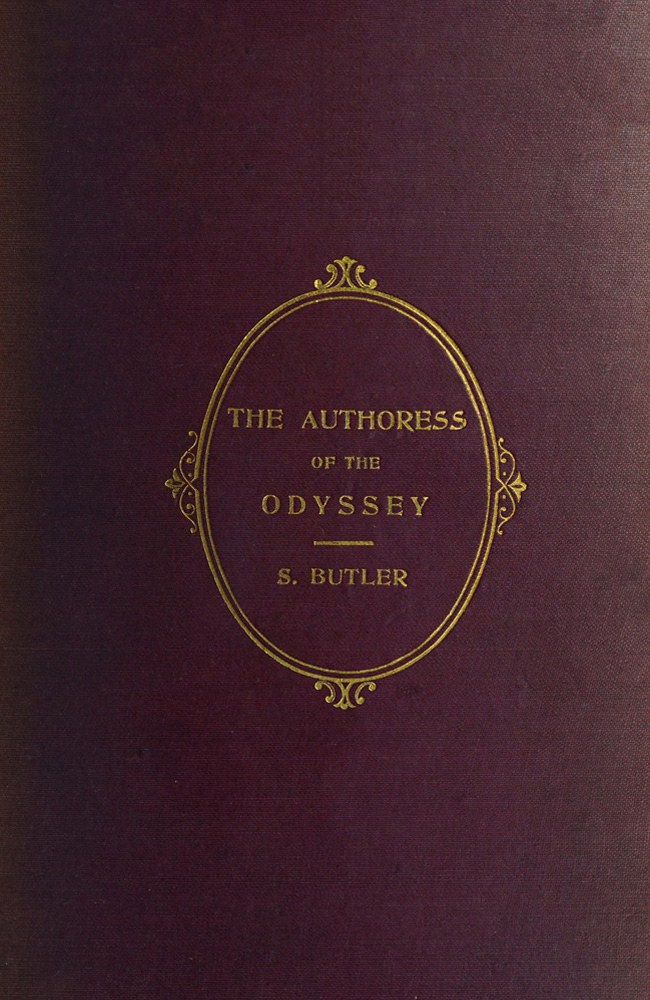
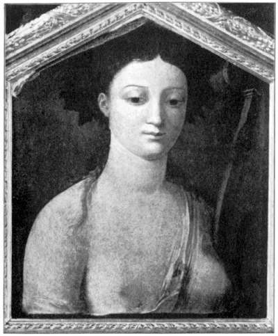

> 特洛伊史詩叢書 v2.0.0｜中文譯文與編輯文字：CC BY-NC-SA 4.0；英文原文與原書圖版屬公版（見 LICENSE-CONTENT.md、NOTICE.md）
[← 分章目錄](../README.md)　｜　[全書](../../中文好讀版_附原文.md)

## 目錄

- 序
- 第二版序
- 目錄
- 圖版目錄
- 第一章
- 第二章　《奧德賽》的故事
- 第三章　《奧德賽》中女性的壓倒性分量
- 第四章
- 第五章　論潘妮洛碧是否遭到粉飾
- 第六章
- 第七章
- 第八章
- 第九章
- 第十章
- 第十一章　作者是誰？
- 第十二章
- 第十三章
- 第十四章
- 第十五章
- 第十六章　結論

---

# 中文好讀版

<!-- U0001 -->

<!-- U0002 -->
### 《奧德賽》的女作者，

<!-- U0003 -->
### 她在何處、何時寫作，她是誰，她如何運用

<!-- U0004 -->
### 《伊里亞德》，

<!-- U0005 -->
### 以及

<!-- U0006 -->
### 這部詩如何在她手中成長

<!-- U0007 -->
### 作者

<!-- U0008 -->
### 塞繆爾．巴特勒

<!-- U0009 -->
### 著有《烏有之鄉》《生命與習性》《阿爾卑斯山與聖所》、

<!-- U0010 -->
### 《塞繆爾．巴特勒博士生平與書信》等書

<!-- U0011 -->
> 「沒有任何單一事實足以支持定罪。」考克先生說。副檢察總長答道，他並不倚賴任何單一事實，而是倚賴一連串事實；這些事實合在一起，使人無路可逃。

<!-- U0012 -->
> 《泰晤士報》社論，1894 年 11 月 16 日。（被告被判有罪。）

<!-- U0013 -->
### 紐約

<!-- U0014 -->
### E．P．達頓公司

<!-- U0015 -->
### 1922

<!-- U0016 -->

*圖版 2：瑙西卡（見序）。（卷首插圖。）*

<!-- U0017 -->
### AL PROFESSORE（致教授）

<!-- U0018 -->
### CAV. BIAGIO INGROIA,（勳位騎士比亞焦．英格羅亞）

<!-- U0019 -->
### PREZIOSO ALLEATO（珍貴的盟友）

<!-- U0020 -->
### L'AUTORE RICONOSCENTE.（心懷感激的作者）

<!-- U0021 -->
