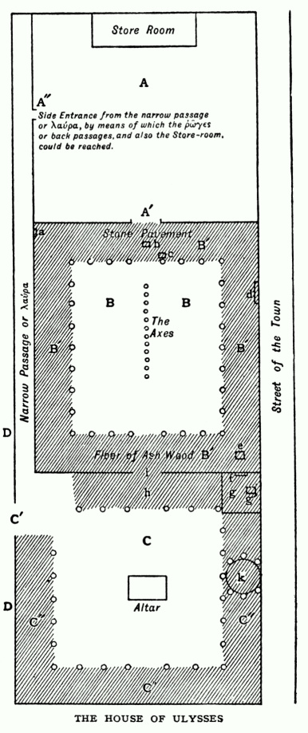
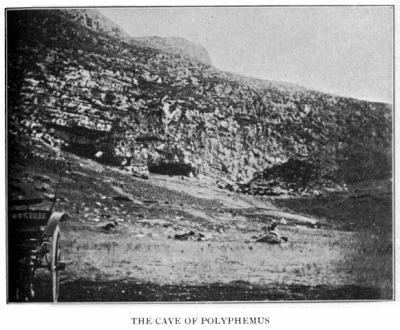
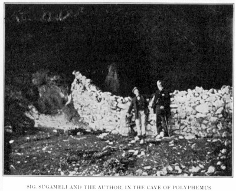

> 特洛伊史詩叢書 v2.0.0｜中文譯文與編輯文字：CC BY-NC-SA 4.0；英文原文與原書圖版屬公版（見 LICENSE-CONTENT.md、NOTICE.md）
[← 分章目錄](../README.md)　｜　[全書](../../中文好讀版_附原文.md)

## 第二章

<!-- U0127 -->
### 《奧德賽》的故事

<!-- U0128 -->
我將論證《奧德賽》出自女性之手、寫於西西里西岸的特拉帕尼，並追索這部詩在作者手中如何逐步成形。為了方便讀者跟上這些論證，我想先把自己已經譯完、但尚未出版的全譯本縮寫一份，擺在讀者面前。篇幅若容許，我本該把譯文全部印出來，但這顯然辦不到，因為我在這裡給出的只有全詩大約四分之一。所以我挑出最能說明上述問題的部分，中間只留下足以讓全篇讀得下去、看得明白的銜接文字。我很清楚，這樣一來全詩的美便被摧殘殆盡，因為最動人的段落，往往正是對我的論證最沒有用處的段落。因此，這裡的縮譯只能看作一幅索引草圖──就像一幅畫滿人物肖像的畫作，其版畫底下常附的那種標號略圖。它的用意不在成為藝術品，只是一張說明用的圖解。

<!-- U0129 -->
至於縮譯與原文貼得多緊：每一段開頭所標的詩卷出處，會讓讀者看出哪些地方刪節得最多，也讓讀者可以拿希臘原文，或布徹與朗兩位先生的譯本，來查核我的譯法是否忠實。我敢有把握地說：讀者若肯費心這樣查核任何一段讓他覺得現代得不可能的文字，便會發現，在用自己的話講故事、又得加以刪節的限制之下，我已盡我所能，嚴格守住了原作的意圖。

<!-- U0130 -->
有一位評論者──而且是十分友善的一位──對我說，我「扭曲了《奧德賽》的質樸，好讓它顯得荒唐可笑」。我不這麼認為。我揭露了，但我沒有扭曲。要我相信自己曾經這樣做過，哪怕只有片刻，我也會大感震驚。不錯，我「毫無寬飾」，但我也「未嘗懷著惡意落筆」。作者想讓我們相信不可能的事時，我指出了她正在這麼做，也指出了她為什麼要我們相信；但是，除非有人能指出哪怕一段我改動了原作意圖的地方，否則我仍要堅持：我在後面篇幅中呈現給讀者的這部詩的面貌，比就我所知迄今公開過的任何見解都更公允；而且，比起其他任何見解，它都讓這部作品和它的作者有趣上百倍。

<!-- U0131 -->
在縮譯之前，我先附上一張奧德修斯宅邸的平面圖，這是我盡力從詩中推敲出來的。讀者若肯稍加用心研究這裡所附的平面圖，會發現自己對故事的理解要好得多。

<!-- U0132 -->
傑布教授就這個題目所寫的文字[^6-1]，我讀過了；布徹與朗合譯的《奧德賽》書末，安德魯．朗先生的第 18 則附註，我也讀過了。我還讀了亞瑟．普拉特先生論求婚者遭殺戮的文章[^6-2]，結果發現，我與朗先生的看法，遠比與另外兩位接近。我與朗先生意見不同之處只有幾點。其一是內院。他把它看成有屋頂的大廳，我則認為它是露天的，只有四周帶頂的迴廊，也就是 μέγαρα σκιόεντα（有蔭的廳廊）除外──這種格局在西西里的房屋中至今仍很常見，特拉帕尼與巴勒莫尤其如此。其二，我看不出有什麼理由認為那片「石砌地面」是墊高的。其三，我認為 ὀρσοθύρα（暗門）位於忒勒馬科斯那座塔樓的頂上，之所以說它「在牆上」，是因為塔樓緊貼著牆。這些都只是細節。大體而言，我對殺戮求婚者時的情節與場景的看法，與朗先生一致。我不打算說明我為何不得不與傑布教授和普拉特先生意見相左，只把我的宅邸平面圖與縮譯，交由讀者評判。

<!-- U0133 -->
*A* 是宅邸主體，內有婦女的居室和其他房間。它有樓上一層，潘妮洛碧的房間就在那裡，俯瞰著求婚者大半時間都待在其中的那座庭院。

<!-- U0134 -->
宅邸主體內也有庫房，似乎設在房子的最裡頭，或許在地下一層。從門口 *A'* 有一條通道可以通到庫房，從側門 *A"* 也有幾條後面的通道可達；我猜想這道側門就是宅邸的後門。婦女的居室就開向那條從 *A'* 通往庫房的通道。

<!-- U0135 -->
*B* 與 *B'* 就是大廳（Megaron，或作複數 Megara），也就是內院；其中 *B'* 是帶頂的迴廊，屋頂由立柱撐起，上有橫樑與椽木。庭院露天的部分沒有鋪地，只是天然的泥土。牲畜似乎就在這裡剝皮、整治，因為求婚者被殺時，墨東無疑就在內院，他藏身在一張剛剝下的牛皮（或小母牛皮）底下（《奧德賽》卷二十二 363 行）。

<!-- U0136 -->
*B'* 稱為 μέγαρα σκιόεντα，即庭院中「有蔭」的部分，以別於曬得到太陽的那部分。靠近宅邸主體的一端鋪著石板，靠近外院的那一端（大概另外兩側也一樣）則鋪著梣木地板。迴廊鋪石的部分，似乎並沒有比其餘部分墊高；石砌地面的一端有一扇門 *a*，通往一條窄巷。這扇門雖然緊接在 ὀρσοθύρα，亦即暗門（卷二十二 126 行）之後被提到──暗門我們待會兒就會談到──卻與暗門毫無關係。比試斧頭時，石砌地面約略正中處擺著一張座椅 *b*，奧德修斯就是坐在這裡一箭射穿斧頭，開始射殺求婚者時，也是從這裡一躍而起；撐著迴廊屋頂的一根立柱旁邊，有一座長矛架 *c*。

<!-- U0137 -->

*圖版 3：奧德修斯的宅邸*

<!-- U0138 -->
迴廊四邊擺滿了小桌，求婚者就在這些桌上用餐。一個人可以把這樣一張桌子舉在身前當盾牌（卷二十二 74、75 行）。

<!-- U0139 -->
迴廊裡還有：

<!-- U0140 -->
*d*，一處開放式的爐灶或火塘，設在與宅邸主體相接的那面牆成直角的另一面牆上。至少，我是這樣解讀 τοίχου τοῦ ἑτέρου（另一面牆；卷二十三 90 行）的。

<!-- U0141 -->
*e*，在調酒缸裡兌酒用的桌子──當然，上面說過的其他桌子也都在。

<!-- U0142 -->
*f*，一扇門，通往 *g*，即忒勒馬科斯平常睡覺的塔樓〔我把 ἄγχι παρ' ὀρσοθύρην（卷二十二 333 行）譯作「朝著 ὀρσοθύρα 那邊靠近」，而不是「在 ὀρσοθύρα 附近」〕。

<!-- U0143 -->
這座塔樓頂上有一扇暗門 *g'*（ὀρσοθύρα），人可以從那裡爬出去，到塔樓的屋頂上發出警報；但這扇門既不是進來的路，也不是出去的路。

<!-- U0144 -->
*C* 是外院，即 αὐλή，由 *C'* 進入；*C'* 是正門，即 πρῶται θύραι，一座上面蓋有房間的有頂門樓。這座有頂門樓，就是 αἰθούση ἐρίδουπος，也就是回聲響亮的門廊；我們在《奧德賽》裡別的人家也會碰到它，而在今天義大利與西西里的房屋中，更是再熟悉不過。外院四周圍著 *C"*，即有頂的棚舍或穀倉，用來存放車輛、農具，大概還有一些農產。外院之中有：

<!-- U0145 -->
*h*，前廳（prodomus），也就是內院前方的門廳；訪客要穿過下面這道門才能進去──

<!-- U0146 -->
*i*，πρόθυρον，亦即內門（不過 πρόθυρον 這個字也用來指外門），以及

<!-- U0147 -->
*k*，圓頂屋（tholus），也就是一間有拱頂的房間。關於它的確切位置，我們所知道的只是卷二十二 459、460 行說它緊貼著外院的牆。我懷疑──但無法證明──這就是奧德修斯親手造床的那間屋子（卷二十三 181–204 行）。

<!-- U0148 -->
*D* 是 τυκτὸν δάπεδον，也就是奧德修斯宅邸前方那片平整的場地，求婚者常在這裡擲鐵餅、朝靶子投擲長矛來消遣（卷四 625、627 行）。

<!-- U0149 -->
上述平面圖與說明中，唯一勉強了原文的地方是正門的位置：我把它放得離 λαύρα（巷道）口太遠，一個人不可能守在那裡，把所有想來援救求婚者的人都擋在外面。不過，想想我們還得接受多少其他不可能的事，我以為這一點也不妨跟著其餘的一併放行。像我所設想的《奧德賽》作者那樣一位年輕女子，只要合她的意，把大門往 λαύρα 挪近一點這種小事，她是不會躊躇的。

<!-- U0150 -->
順帶一提，阿伽門農遇害的地方（《奧德賽》卷四 530、531 行），看來就是一座與上面為奧德修斯宅邸所設想的頗為相似的迴廊庭院。宴席似乎擺在庭院一側的迴廊裡。對面一側的迴廊裡，則埋伏著人。

<!-- U0151 -->
最後──姑且一提，價值如何，由讀者自行判斷──我想提醒讀者：在奧德修斯宅邸中求婚者經常出入的那部分，詩裡連一點有窗戶的暗示都沒有。

<!-- U0152 -->
> *眾神的會議──忒勒馬科斯與求婚者在奧德修斯家中*

<!-- U0153 -->
> 繆思啊，請告訴我那位足智多謀的英雄，特洛伊城陷落之後，他一心要把手下帶回家鄉，途中歷經了許多奇遇。他沒能做到，因為那些人吃了赫利俄斯的牛，全因自己愚不可及而喪命；他本人雖然渴望回到妻子身邊，此刻卻困在一座孤島上憔悴度日──那是仙女卡呂普索的居所。卡呂普索想要他娶她，把他留在身邊許多年，直到最後，眾神都憐憫起他來，只有波賽頓例外，因為奧德修斯弄瞎了他的兒子波呂斐摩斯。

<!-- U0154 -->
> 卻說事有湊巧，波賽頓到埃塞俄比亞人那裡作客去了；埃塞俄比亞人分居兩半，一半面向大西洋，另一半面向印度洋。其餘的神於是召開會議，宙斯對他們發表一篇演說，講埃癸斯托斯追求克呂泰涅斯特拉、謀殺阿伽門農是何等愚蠢；最後，他向雅典娜讓步，同意讓奧德修斯回到伊薩卡。

<!-- U0155 -->
> 「既然如此，」雅典娜說，「我們就該派赫耳墨斯去找卡呂普索，告訴她我們的決定。我也要到伊薩卡去，給奧德修斯的兒子忒勒馬科斯壯壯膽，讓他把他母親潘妮洛碧的求婚者打發走；這些人揮霍無度，正在把他吃垮。此外，我還要送他到斯巴達和皮洛斯去打聽父親的消息，這會為他贏得好名聲。」

<!-- U0156 -->
> 女神於是振翅飛到奧德修斯家門口，扮成這家人的一位世交老友，看見求婚者在宅前下著跳棋，擺出好大的威風。忒勒馬科斯見她站在門口，便走上前去，把她領進屋內，將她的長矛放進靠在一根粗壯立柱旁的矛架上，給她搬來座椅，又擺上點心招待。

<!-- U0157 -->
> 這時，求婚者成群湧進環繞內院的那些有遮蔭的迴廊；他們照例在這裡大吃大喝，吃完了，又逼著著名的歌人費彌俄斯為他們唱歌。忒勒馬科斯趁機悄悄和雅典娜說起話來：他告訴她，父親的歸來看來已全然無望，最後又問起她的姓名與家鄉。

<!-- U0158 -->
> 雅典娜說她是塔福斯人的首領門特斯，正載著一船鐵要到忒墨塞[^6-3]去換銅。她告訴忒勒馬科斯，她的船停在城外涅里通山[^6-4]下一個名叫瑞特隆[^6-5]的港灣裡。她又說：「你去問問老拉厄爾特斯吧，我聽說他如今住在鄉下，日子過得很清苦，從來不進城；他會告訴你，我是你父親的老朋友。」

<!-- U0159 -->
> 接著她說：「可是，我看見在你家裡胡作非為的這些人，到底是些什麼人？這一切是怎麼回事？他們的行徑，足以讓任何正派的人作嘔。」

<!-- U0160 -->
> 「他們是我母親的求婚者，」忒勒馬科斯答道，「從鄰近的杜利基昂島、薩墨、扎金索斯來，也有伊薩卡本地的。我母親既不說她不再嫁，又沒辦法讓這場求婚收場。所以他們就把我吃窮了。」

<!-- U0161 -->
> 雅典娜非常氣憤，勸他裝備一條船，到皮洛斯和斯巴達去打聽父親的消息。「如果，」她說，「你聽說他還活著，那就把這種揮霍再忍上十二個月。反之，如果你聽說他已經死了，就立刻回來，把你母親送回她父親家，然後不擇手段，殺掉那些求婚者。」

<!-- U0162 -->
> 忒勒馬科斯謝過她的忠告，答應照辦，又力勸她多留些時候。她解釋說無論如何不能久留，隨即像一隻老鷹般飛上天去。

<!-- U0163 -->
> 費彌俄斯還在唱；他選的題目，是亞該亞人從特洛伊歸來的悲慘遭遇。潘妮洛碧在樓上房裡聽得見，便下樓來到求婚者面前，用面紗遮著臉，兩名侍女一左一右陪在她身旁。她站在撐著迴廊屋頂的一根立柱旁邊，叫費彌俄斯換個題目，因為這歌讓她想起失去的丈夫，實在太痛苦。

<!-- U0164 -->
> 忒勒馬科斯跟她講道理，最後要她回樓上去。「回去吧，」他說，「回到屋裡，照料你每天的事──你的織機、你的紡錘，還有使喚你的僕婦；因為說話是男人的事，而首先是我的事，因為這裡是我當家。」

<!-- U0165 -->
> 潘妮洛碧聽了，帶著她的侍女回到屋裡，心中驚異不已；她一走，忒勒馬科斯就向求婚者下戰帖，要他們第二天到全體大會上與他相見，好讓他正式、公開地警告他們離開他的家。

<!-- U0166 -->
> 他們的兩名首領安提諾俄斯與歐律馬科斯都出言反駁；但不久夜幕降臨，求婚者全體離開宅邸，各自回家。他們走後，老奶媽歐律克蕾亞拿著火把，領忒勒馬科斯到他的臥房去；臥房在一座高高的塔樓裡，俯瞰外院，遠近都看得見。

<!-- U0167 -->
> 歐律克蕾亞年紀還很輕時，就被拉厄爾特斯買了下來；他為她付了值二十頭牛的價錢。她在家中所受的看重，與他自己的妻子不相上下，但他並沒有讓她上他的床，因為他顧忌妻子不高興。這位好心的老婦人領忒勒馬科斯進房，等他脫衣。她從他手上接過襯衣，仔細摺好，掛在床邊的木釘上。辦完這些，她便離開了，讓他整夜夢著即將啟程的航行。

<!-- U0168 -->
> *伊薩卡人民大會──忒勒馬科斯啟程前往皮洛斯*

<!-- U0169 -->
> 第二天早上，忒勒馬科斯一起身穿好衣服，就派傳令官繞城一周，召集人民開會。眾人到齊後，他向他們訴說自己的不幸：父親已死，而更大的不幸，是求婚者正在糟蹋他的家產。他最後說：「如果非得有人把我吃得傾家蕩產，我寧可是你們自己來吃；因為你們都是有家底的人，我若挨家挨戶向你們討，還討得回來；可是告一群自己身無分文的年輕人，什麼也拿不到。」

<!-- U0170 -->
> 安提諾俄斯回答說，這是潘妮洛碧自己的錯。她一直在鼓勵求婚者，給他們每一個人都捎去討好的口信。他說明她如何在將近四年間，用那匹布騙了他們──她說那是要給拉厄爾特斯做壽衣的。「所以，」他說，「我們給你的答覆是：『把你母親送走，讓她嫁給她自己和她父親所挑選的人。』因為她一天不嫁給我們當中的某一個，我們就一天不走。」

<!-- U0171 -->
> 忒勒馬科斯回答說，他不能違背母親的意願逼她離開。他若這麼做，就得把奧德修斯娶潘妮洛碧時收下的嫁妝退還給外祖父伊卡里俄斯，這對他會是沉重的負擔。況且，這也不是什麼光彩的事。

<!-- U0172 -->
> 於是宙斯從一座山頂[^6-6]放出兩隻老鷹，牠們以自己那種王者般的姿態飛呀飛，直飛到會場上空，在那裡尖叫、搏鬥，向底下眾人的臉上投以死亡的怒視。人們納悶這究竟是什麼兆頭，直到老預言家哈利瑟耳塞斯告訴他們，這預示奧德修斯即將歸來，向求婚者報仇。

<!-- U0173 -->
> 歐律馬科斯怒氣沖沖地回了他一番話。他最後說：「只要潘妮洛碧一天不作選擇，我們就一天不能娶別人，也就要繼續揮霍忒勒馬科斯的家產。」

<!-- U0174 -->
> 忒勒馬科斯答說，再沒有什麼好說的了，接著便請求婚者撥給他一條船和二十名水手，好讓他依照雅典娜給他的忠告行事。

<!-- U0175 -->
> 這時門托爾責備他的同胞：他們明明輕易就能逼求婚者規矩些，卻袖手旁觀；萊奧克里托斯說了幾句蠻橫的話之後，大會便散了。求婚者隨即回到奧德修斯家裡。

<!-- U0176 -->
> 忒勒馬科斯卻獨自走到海邊去禱告。他在灰色的浪裡洗了手，懇求雅典娜幫助他；女神於是化作門托爾的模樣來到他身邊。她就他的一般行止訓誡了他一番，末了說，她不但要替他找一條船，還要親自與他同行。所以他該回家去，把所需的糧食備好。

<!-- U0177 -->
> 他照她的吩咐回家；在那裡和求婚者又鬧了一場不愉快，再次公開宣布要出航之後，他下到庫房，叫歐律克蕾亞準備糧食；同時要她鄭重發誓，十天或十二天內保守祕密，免得驚動潘妮洛碧。這時，仍扮作門托爾的雅典娜向一位鄰人諾埃蒙借了一條船；入夜後，求婚者照例離去，她和忒勒馬科斯帶著二十名自願的水手把糧食搬上船，乘著呼嘯掠過水面的順風，揚帆出發。

<!-- U0178 -->
> *忒勒馬科斯在涅斯托爾家中*

<!-- U0179 -->
> 第二天早上，他們抵達皮洛斯，看見涅斯托爾、他的兒子們和全體皮洛斯人正在舉行波賽頓的祭典。他們受到熱誠的接待，尤其是涅斯托爾的兒子佩西斯特拉托斯，並立刻被邀請一同歡宴。飯後涅斯托爾問他們是什麼人；忒勒馬科斯得到雅典娜壯膽，說明他們來自涅里通山[^6-7]下的伊薩卡，他正在打聽父親奧德修斯的死訊。

<!-- U0180 -->
> 涅斯托爾聽了，便把自己從特洛伊回家途中的種種遭遇一五一十告訴他，卻提供不了奧德修斯的任何消息。不過，他提到了埃癸斯托斯謀殺阿伽門農，以及俄瑞斯忒斯的復仇[^6-8]。

<!-- U0181 -->
> 忒勒馬科斯說，他但願自己也能向母親的求婚者報同樣的仇，他們正在把他吃垮；「可是這種事，」他嘆道，「不可能發生，即使眾神願意也不行。連想一想都太過分了。」

<!-- U0182 -->
> 雅典娜嚴厲地責備他。「天意之手，」她說，「若有心要救一個人，再遠也搆得著。」忒勒馬科斯於是換了話題，問涅斯托爾：埃癸斯托斯是怎麼殺得了阿伽門農的？兩人之中，阿伽門農可強多了。那時墨涅拉俄斯在做什麼？

<!-- U0183 -->
> 「墨涅拉俄斯，」涅斯托爾答道，「那時還在漫長的漂泊中，沒有回來。至於克呂泰涅斯特拉，她天性本來善良，卻受了埃癸斯托斯的引誘；埃癸斯托斯殺了阿伽門農之後，在邁錫尼稱王七年。但到了第八年，俄瑞斯忒斯從雅典回來，殺了他；就在俄瑞斯忒斯為埃癸斯托斯和克呂泰涅斯特拉舉行喪宴的那一天，墨涅拉俄斯回來了。所以你到斯巴達去吧，看他能不能告訴你什麼。」

<!-- U0184 -->
> 這時太陽已經下山，雅典娜提議她和忒勒馬科斯回船上去，但涅斯托爾說什麼也不肯。雅典娜於是同意讓忒勒馬科斯留在岸上，並解釋說她不能陪他，因為第二天早上她得動身到考科涅斯人那裡，去討一筆拖欠她很久的大債。

<!-- U0185 -->
> 說完這話，她化作一隻老鷹飛走了，在場的人無不驚愕。涅斯托爾隨即握住忒勒馬科斯的手，說他看得出這年輕人必定是個非常重要的人物。他又當場許願，要為一頭小母牛的角貼上金箔，獻給女神。然後他帶忒勒馬科斯回家，讓他住在自己府上。

<!-- U0186 -->
> 第二天，涅斯托爾還了願；小母牛從平原上被牽來，牛角貼上了金，涅斯托爾的妻子歐律狄刻和她的女兒們看著牠被宰，歡喜得高聲叫喊。

<!-- U0187 -->
> 接下來的宴會之後，涅斯托爾派一輛雙馬車送忒勒馬科斯和他的兒子佩西斯特拉托斯前往拉刻代蒙；他們途中在費拉伊的狄俄克勒斯家過了一夜，第二天早上抵達。

<!-- U0188 -->
> *忒勒馬科斯在墨涅拉俄斯家中──求婚者決意在他歸途埋伏，將他殺害*

<!-- U0189 -->
> 兩個年輕人抵達拉刻代蒙後，直接驅車來到墨涅拉俄斯家〔，看見他正為女兒赫爾米俄涅和兒子墨伽彭忒斯同時舉行婚禮。〕[^6-9]

<!-- U0190 -->
> 墨涅拉俄斯（他的管家埃特俄紐斯起初有點遲疑，為此挨了主人一頓重責）極其殷勤地款待兩位客人；他無意中聽到忒勒馬科斯要朋友留意這宅邸的富麗堂皇，便向他們解釋自己吃過多少辛苦、受過多少悲傷，尤其是他的哥哥阿伽門農遇害、帕里斯拐走海倫時洗劫了他的家，還有那麼多英勇的戰友死在特洛伊。「然而有一個人，」他接著說，「我只要一想到他，就茶飯不思、夜不成眠。我說的是奧德修斯。」

<!-- U0191 -->
> 忒勒馬科斯聽見有人這樣提起他父親，忍不住流下淚來；正當墨涅拉俄斯拿不定主意該說什麼、不該說什麼的時候，海倫下樓來了（這時晚飯已經吃到一半），身邊跟著三名侍女阿德瑞斯忒、阿爾基珀和菲羅；她們給她擺好座椅，又拿來她那個裝著輪子、遠近聞名的針線籃，好讓她開始紡紗。

<!-- U0192 -->
> 「請問，」她對丈夫說，「光臨寒舍的這兩位先生是誰呀？我猜得對也好、錯也好，但我真非得說出心裡的想法不可。我從沒見過這麼像的──不論男女。這位年輕人一定就是忒勒馬科斯，奧德修斯出征特洛伊時留在家裡、還抱在懷中的那個嬰孩。」

<!-- U0193 -->
> 「我也，」墨涅拉俄斯答道，「看出這種相像了。錯不了。」

<!-- U0194 -->
> 佩西斯特拉托斯於是說明他們猜得完全正確；墨涅拉俄斯便把自己原本打算為奧德修斯做的一切都告訴了他，說得那麼感人，同桌四人全都放聲大哭。過了一會兒，佩西斯特拉托斯恭維墨涅拉俄斯見識過人（這一點他父親涅斯托爾確實常對他說起），又說他不喜歡在吃飯的時候哭；所以他提議，其餘的哀悼不妨延到明天早上。墨涅拉俄斯同意了，晚飯才得以繼續。海倫在酒裡摻了些忘憂藥，大家於是又高興起來。

<!-- U0195 -->
> 接著海倫講起，奧德修斯潛入特洛伊城做探子時，她曾遇見他；她解釋說，那時她已經急著想回家，正悲嘆阿芙蘿黛蒂加在她身上的殘酷災禍，使她與年幼的女兒、與丈夫分離──而她那位丈夫，說實在的，無論相貌還是頭腦，都一點也不差。

<!-- U0196 -->
> 墨涅拉俄斯接著講了一段更勝一籌的故事，說的是亞該亞人藏在木馬裡的經歷。「你不記得了嗎，」他說，「我們在裡面的時候，你繞著木馬走了一圈，還拍拍它？得伊福玻斯跟你在一起，你不停地叫著我們的名字，模仿我們妻子的聲音，直到雅典娜來把你帶走。那時救了我們的，是奧德修斯的沉著機智。」

<!-- U0197 -->
> 他講完之後，忒勒馬科斯說該去休息了，於是他和佩西斯特拉托斯被領到前廳的房間，墨涅拉俄斯和海倫則回到宅邸內室[^6-10]。

<!-- U0198 -->
> 早上，忒勒馬科斯把求婚者的事告訴墨涅拉俄斯，並請他提供任何有關他父親死訊的消息。墨涅拉俄斯大為震驚，但只能把他從普洛透斯那裡聽來的話告訴他。他說，他從埃及回來時，因為眾神不悅，在法羅斯島上被困了幾個星期；要不是女神埃伊多忒亞──普洛透斯的女兒──幫助他，他和他的人早就餓死了。是她教他如何誘捕她的父親，逼他說出天神為何把他困住。

<!-- U0199 -->
> 「埃伊多忒亞，」墨涅拉俄斯說，「把我和我挑選的三個同伴扮成海豹；為此她帶來四張剛剝下的海豹皮，把我們藏在底下。這些皮的腥臭叫我們難受極了──要是躲得掉，誰願意跟海怪同床共枕？──不過埃伊多忒亞在每個人的鼻孔底下抹了些仙饌，這才讓我們大為舒緩。這時其他海豹（人稱『哈洛緒德涅的小雞』）成百成百地不斷上岸，躺在海灘上曬太陽。

<!-- U0200 -->
> 「近午時分，普洛透斯本人上岸了。他先把所有海豹點了一遍，看數目對不對，連我們也一起點了進去；點完之後，他就在牠們中間躺下，像牧人躺在羊群中一樣；他一睡著，我們就撲上去把他牢牢抓住。他一下子變成獅子，接著又變成流水，然後又變成一棵樹；但我們始終沒有鬆手，最後他累了，便把我們想知道的事告訴了我們。

<!-- U0201 -->
> 「他也告訴我俄伊琉斯之子埃阿斯的下場，以及我哥哥阿伽門農的命運。最後他告訴我奧德修斯的事，說他在仙女卡呂普索的島上，因為既沒有船也沒有水手，脫不了身。

<!-- U0202 -->
> 「說完，他就潛入海裡不見了；而我照他的指點平息了天怒之後，便迅速而平安地回到了自己的國家。」

<!-- U0203 -->
> 講完故事，墨涅拉俄斯力勸忒勒馬科斯再留十天或十二天，並答應送他一輛車和一對馬作紀念；但忒勒馬科斯說他不能久留。「我可以聽你講上整整十二個月，」他說，「一次也不會想起我的家和我的父母；可是我留在皮洛斯的手下，已經急著要我回去了。至於你要送我什麼禮物，就送一件金銀器皿吧。我不能把馬帶到伊薩卡去；那裡沒有平原，也沒有草地，適合養山羊，不適合養馬。我們的島沒有一個適合賽車，而伊薩卡又是其中最不適合的。」

<!-- U0204 -->
> 墨涅拉俄斯笑了，說他看得出忒勒馬科斯出身良好。他有一件極其貴重的器皿，正合適，就送給忒勒馬科斯。

<!-- U0205 -->
> 〔這時賓客不斷來到國王家中，帶來了酒和羊，他們的妻子則為他們備好了麵包。他們就這樣在庭院裡張羅起晚飯來。〕[^6-11]

<!-- U0206 -->
> 這時，在伊薩卡，求婚者正在奧德修斯宅前的平整場地上擲鐵餅、向靶子投矛，一如既往地蠻橫放肆。他們正玩著，諾埃蒙走過來問安提諾俄斯，知不知道忒勒馬科斯大概什麼時候會從皮洛斯回來，因為他要用他的船。這下一切都露了餡；求婚者壓根兒沒想到忒勒馬科斯真的走了（他們以為他只是到伊薩卡島上自家的某個農莊去了），於是大為光火。他們因此決定在他歸途中埋伏，並準備動身。

<!-- U0207 -->
> 僕人墨東偷聽到他們的陰謀，全部告訴了潘妮洛碧；她和求婚者一樣，這才頭一次知道兒子已經離家到皮洛斯去了。她狠狠責罵侍女們，怪她們在忒勒馬科斯動身時沒把她從床上叫起來，因為她說她確信她們全都知情。不過，經歐律克蕾亞一番安撫，她不久就上樓向雅典娜獻祭。過了一會兒，她沉沉睡去，睡夢中雅典娜把她的姊妹伊芙提墨的幻影送到她床邊，給了她安慰。

<!-- U0208 -->
> 入夜後，求婚者揚帆出海，打算在薩墨與伊薩卡之間的海峽伏擊忒勒馬科斯。

<!-- U0209 -->
> *奧德修斯在卡呂普索島上──他乘木筏離島，歷盡艱辛，抵達費埃克斯人的國度*

<!-- U0210 -->
> 眾神這時召開第二次會議，雅典娜和宙斯都發了言。

<!-- U0211 -->
> 宙斯說完，便派赫耳墨斯去告訴卡呂普索，奧德修斯要回家了，將在二十天內抵達費埃克斯人的國度。費埃克斯人會送他滿船禮物，再把他送回伊薩卡。

<!-- U0212 -->
> 於是赫耳墨斯飛越大海，像一隻搜遍深海每個角落捕魚的鸕鶿。過了些時候，他到了卡呂普索的洞府，說明來意。卡呂普索非常生氣，但見無可奈何，便答應遵命。赫耳墨斯一走，她就去找奧德修斯，見他照常在哭，愁苦地一直望著大海；她叫他給自己造一隻木筏，乘著它回家。但奧德修斯疑心很重，非要她發下極其鄭重的誓言，保證她無意加害於他，一片誠心為他打算，他才肯放心。

<!-- U0213 -->
> 兩人隨後回到卡呂普索的洞府。「我真不明白，」她說，「你為什麼不肯安安靜靜地跟我待在這裡，偏要一天到晚惦記著你那個妻子。我不相信我長得有哪一點比她差。你要是知道回家之前得吃多少苦，就會留在原地，讓我使你長生不死。」

<!-- U0214 -->
> 「別生我的氣，」奧德修斯答道，「你比潘妮洛碧好看得多了。你是女神，她不過是凡間女子。根本沒得比。儘管如此，不管會遭遇什麼，我就是渴望回到自己的家。」

<!-- U0215 -->
> 接下來四天都花在造木筏上。卡呂普索借給他斧頭和鑽子，又指點他哪裡長著最乾燥、木質最老成的樹，奧德修斯便把它們砍倒。他把木筏造得大約和一般人造一艘上好大船時一樣寬，還給它裝了一支舵──好讓他能夠掌舵。

<!-- U0216 -->
> 接著卡呂普索為他沐浴，給他乾淨的衣服，他便出發了，憑著那支舵巧妙地駕著他的船。他朝大熊星座駛去──人們也稱之為「大車」──讓它保持在左手邊，因為卡呂普索是這樣叮囑他的。

<!-- U0217 -->
> 一連十七天，他一路順利；第十八天，他望見費埃克斯海岸淡淡的輪廓，又長又低地橫在天邊。

<!-- U0218 -->
> 然而就在這時，正從埃塞俄比亞人那裡回家的波賽頓瞥見了他，發覺其他眾神趁他不在時搶先下了一著。他於是用三叉戟攪動四周的海水，掀起一場可怕的颶風，奧德修斯什麼也看不見了，四下漆黑如夜；不久他被浪捲下木筏，但總算又爬了回去。

<!-- U0219 -->
> 他正要認定自己必死無疑時，伊諾──又名琉科忒亞──起了憐憫之心，像一隻海鷗般飛落在他的木筏上；她安慰他，把自己的面紗交給他，同時囑咐他一到岸上，就把面紗扔回海裡，扔的時候還要把臉轉開，背向大海。

<!-- U0220 -->
> 風暴仍在肆虐，木筏在狂風巨浪下解體了，奧德修斯便把伊諾的面紗繫在腋下，開始游泳。波賽頓看到這情景，心滿意足地走了。

<!-- U0221 -->
> 他一走，雅典娜就平息了所有的風，只留下北風；北風猛吹了兩天兩夜，於是奧德修斯又被吹回南方。第三天早上，他看見陸地就在近處，但想上岸時，差一點在礁石上撞得粉碎。最後，他找到一條河的河口，河神應了奧德修斯的禱告，止住水流，奧德修斯才得以游進內陸，爬上岸去。

<!-- U0222 -->
> 他累得半死，不知如何是好，先把伊諾的面紗扔進河中帶鹹味的水裡，然後到內陸的高地上找地方棲身。他在那裡給自己蓋上厚厚一層落葉，便沉沉睡去。

<!-- U0223 -->
> *奧德修斯與瑙西卡相遇*

<!-- U0224 -->
> 奧德修斯這樣睡著的時候，雅典娜去了費埃克斯人的國度──奧德修斯被沖上岸的正是這片土地。

<!-- U0225 -->
> 費埃克斯人從前住在許珀瑞亞，靠近無法無天的庫克羅普斯人；庫克羅普斯人比他們強，常來劫掠他們，所以他們的國王瑙西托俄斯把他們遷到斯刻里亞[^6-12]，在那裡才得安全。瑙西托俄斯如今已經去世，由他的兒子阿爾基諾俄斯在位。

<!-- U0226 -->
> 阿爾基諾俄斯有個獨生女瑙西卡，她正在臥房裡熟睡。雅典娜來到她床邊，在夢中向她顯現，化身為一位狄馬斯船長的女兒──那是瑙西卡的閨中密友。她提醒瑙西卡婚期將近（不過新郎是誰還沒定），又責備她沒有把她自己和家裡的衣物洗乾淨，做好應有的準備。所以她提議，瑙西卡第二天早上把所有沒洗的衣服帶到洗衣池去，並說她會來幫忙；洗衣池離城有一段路，她勸瑙西卡向父親要一輛車和幾匹騾子。

<!-- U0227 -->
> 瑙西卡醒來，把夢告訴了父親和母親。「爸爸，親愛的，」[^6-13]她說，「你能不能給我一輛好大的車？我想把我們的髒衣服全拿到河邊去洗。你是這裡的頭號人物，所以你出席議會的時候，穿件乾淨的襯衣才像樣。何況你有五個兒子，兩個已經成家，另外三個是相貌堂堂的年輕單身漢；你知道，他們出門跳舞，總愛穿乾淨的衣裳。」

<!-- U0228 -->
> 她父親答應給她一切所需。車子備好了，母親給她裝了一籃吃食，瑙西卡便駕車載著侍女們來到河岸邊的洗衣池；池裡流過的清水十分充足，衣服再髒也洗得乾淨。她們在池中把衣服踩洗乾淨，攤在海灘上晾乾，趁衣服晾著的時候吃了午飯，然後瑙西卡唱起歌，她們便開始玩球。

<!-- U0229 -->
> 過了一陣子，她們正想著要回家時，雅典娜叫醒了奧德修斯；他就在她們上方的樹林裡。他坐起身，聽見女子們的說話聲和笑聲，不知道自己身在何處。

<!-- U0230 -->
> 他決定去看看，但想起自己身上一絲不掛，就拿一根橄欖枝擋在身前，然後，就這樣一副猙獰、赤裸、蓬頭垢面的模樣，走出來朝那些女子靠近；她們全都沿著海灘和伸入海中的岬角四散奔逃。然而瑙西卡站穩了沒動，奧德修斯便盤算起來：是大膽走上前去抱住她的膝頭，還是隔著一段恭敬的距離跟她說話。

<!-- U0231 -->
> 他權衡再三，斷定後一種做法最為穩妥；打定主意之後，他開口先請瑙西卡告訴他，她到底是不是女神。如果她是女神，那麼從她的美貌看來，顯然只可能是阿蒂蜜絲。反之，如果她是凡人，那麼哪一位求婚者在聘禮條件上最教人中意，能把她娶回自己家中，那人該是何等幸福啊。最後，他請她行個好，把她帶來包衣服用的舊布隨便給他一塊，再指點他進城的路。

<!-- U0232 -->
> 瑙西卡答道，他看來確實是個很明理的人，但是人不論碰上什麼運氣，都只能忍受。接著她說明他來到的是費埃克斯人的國度，並答應帶他到他們的城裡去。

<!-- U0233 -->
> 說完這話，她叫侍女們別那麼膽小。「這個人，」她說，「一點也不危險；我們住在天涯海角，遠離所有鄰邦，兩邊都是怒吼的大海，沒有人能傷害我們。所以，照顧一下這個可憐人，給他點東西吃吧。」

<!-- U0234 -->
> 侍女們聽了，便走回來，給奧德修斯一件襯衣和一件斗篷；她們還給他一瓶油，叫他到河裡去洗澡。但他說：「你們一直站在這裡，我是不會洗的。要我在一群漂亮的年輕姑娘面前脫光衣服，我實在做不到。」於是她們走開，去告訴她們的女主人。

<!-- U0235 -->
> 奧德修斯洗完後，雅典娜讓他顯得高大威嚴得多，又給了他一頭濃密的頭髮，如風信子般捲曲，垂到肩上。瑙西卡對他外貌的變化大為驚訝。「起先，」她說，「我覺得他長得很普通，現在卻俊美如神。真希望我能有這樣一個人做丈夫，只要他肯留在這裡。不過這且不管；姑娘們，給他點吃的喝的吧。」

<!-- U0236 -->
> 侍女們於是在奧德修斯面前擺上肉和酒；他餓壞了。他吃的時候，瑙西卡把衣服摺好放上車，然後向他交代該怎麼做。「跟在車子後面，」她說，「和侍女們一起走，直到靠近房舍為止。至於城，你會發現它坐落在兩座良港之間，要經過一道狹窄的地峽才能到達；地峽兩邊，你會看見船都拖上了岸──因為每個人都有一處可以停放自己船隻的地方。你還會看見城牆，以及立在石砌市集正中央的波賽頓神廟，四周環繞著船商的店鋪。

<!-- U0237 -->
> 「快到城邊的時候，你就落在後面，因為這裡的人心眼很壞，會在背後說我閒話。他們會說：『跟著瑙西卡到處走的這個英俊外鄉人是誰？她是在哪裡找到他的？我看她是要嫁給他了。他是她從哪條外國船上撿來的水手嗎？還是哪位神應了她的禱告，從天而降，要娶她為妻？她要是到別處去找丈夫倒也好，反正眾多愛慕她的優秀費埃克斯人，她一個也不理。』人們會這樣說，我也不能怪他們，因為我自己要是看到哪個姑娘，父母都還健在，就跟一個外鄉人到處走，又沒有當著全世界的面正式跟他成婚，我也會覺得看不下去。

<!-- U0238 -->
> 「所以照我說的做吧。你走到城外不遠處雅典娜的聖林時，就在那裡等，等到你估計我和侍女們應該已經到家了。然後跟過來，打聽哪一棟是阿爾基諾俄斯的家；到了以後，直接穿過外院和內院，一直走到我母親面前。你會看見她背靠著一根立柱坐著，在爐火旁紡她的紫色紗線。我父親會坐在她旁邊；別管他，只管去抱住我母親的膝頭，因為她若是對你的請求有好感，你多半就能如願以償。」

<!-- U0239 -->
> 瑙西卡隨即駕車前行，太陽將落時，她們來到雅典娜的聖林，奧德修斯便在那裡坐下等候。他向雅典娜禱告，求她幫助；她聽見了他的禱告，卻不肯向他現身，因為她不想得罪她的叔父波賽頓。

<!-- U0240 -->
> *阿爾基諾俄斯王宮的輝煌──阿瑞忒王后想知道奧德修斯的襯衣和斗篷從哪裡來，因為她認得那是自己的手工──奧德修斯作了解釋*

<!-- U0241 -->
> 瑙西卡到家後，她的兄弟們照料車子和騾子，她的侍女歐律墨杜薩生起火，把晚飯送到她自己的房裡。

<!-- U0242 -->
> 不久，奧德修斯認為可以放心前進了，便進了城，周身裹著雅典娜為他灑下的濃霧，好保護他不受費埃克斯人任何無禮的冒犯。她還扮成一個提著水罐的小女孩，在城外與他相遇。

<!-- U0243 -->
> 奧德修斯雖在霧中，仍看得見她，便請她指點去阿爾基諾俄斯家的路；她說這很容易辦到。到了那家門口，她把國王家族的來歷全告訴了奧德修斯，並教他該怎麼應對舉止。

<!-- U0244 -->
> 「要大膽，」她說，「不論一個人從哪裡來，大膽總是管用的。先去找這家的女主人。她和她丈夫是同一家族的人，她的家世是這樣的：歐律墨東是巨人族的國王，但他和他的族人都被消滅了，他自己也送了命。他最小的女兒佩里波亞是位絕色美人，她為波賽頓生下了費埃克斯人的國王瑙西托俄斯。瑙西托俄斯有兩個兒子，瑞克塞諾爾和阿爾基諾俄斯；瑞克塞諾爾早逝，留下一個獨生女阿瑞忒，她的叔父阿爾基諾俄斯娶了她，而且敬重她，普天之下沒有哪個女人受丈夫如此敬重。她所有的家人和鄰人都愛戴她，把她當作朋友與和事佬，因為她是個徹頭徹尾的好女人。你若能得到她的幫忙，一切都會順利。」

<!-- U0245 -->
> 雅典娜於是離開他，前往馬拉松和雅典，造訪了厄瑞克透斯的家；奧德修斯則繼續朝阿爾基諾俄斯的家走去。來到青銅門檻之前，他停下腳步，駐足片刻，心中思緒萬千，因為這座宮殿的輝煌有如太陽與月亮。兩側的牆從這頭到那頭全是青銅，簷口飾著藍色的琺瑯。門扇是黃金的，掛在從青銅地面升起的白銀門柱上；門楣是白銀的，門上的鉤環則是黃金的。

<!-- U0246 -->
> 兩旁有金獒和銀獒，是赫淮斯托斯以他絕妙的手藝，特地打造來看守阿爾基諾俄斯王宮的，所以牠們不死，永遠不會老。沿著牆邊從這頭到那頭，處處擺著座椅，上面鋪著織工精細的墊布，是家中女眷織成的。費埃克斯人的首要人物常坐在這裡吃喝，因為一年四季都豐足有餘；還有一些年輕男子的金像，手持點燃的火把，立在座台上，為坐席用餐的人照明。

<!-- U0247 -->
> 宅中有五十名女僕，有的總在磨坊裡磨著飽滿金黃的穀粒，有的在織機前工作，坐著紡紗，她們的梭子來回穿梭，像白楊葉片簌簌顫動；布織得那麼密，連油都滲不透。費埃克斯人是世上最好的水手，同樣地，他們的女人在紡織上也勝過其他所有人，因為雅典娜教會了她們各式各樣有用的技藝，而且她們都非常聰慧。

<!-- U0248 -->
> 外院大門外有一座大果園[^6-14]，約四英畝，四周圍著牆。園中滿是美麗的果樹──梨、石榴，還有最可口的蘋果。也有甜美多汁的無花果，和長得正茂盛的橄欖。這些果子一年到頭不會爛也不會斷，不分冬夏，因為空氣如此和煦，舊的還沒落，新的一茬又熟了。梨接著梨長，蘋果接著蘋果，無花果接著無花果，葡萄也是如此，因為那裡有一片極好的葡萄園；在其中一塊平地上，葡萄正被曬成葡萄乾；另一塊上正在採收；有些在酒桶裡被踩踏；再往前一些，有的已經落了花，開始結果；還有一些正在轉色。園地的最遠處，有整齊美麗的花圃，四季花開不斷。兩道溪水流經園中，一道引入水渠，灌溉全園，另一道從外院地下引到宅邸本身，城裡的人也從那裡汲水。上天賜給阿爾基諾俄斯王宮的輝煌，就是這樣。

<!-- U0249 -->
> 於是奧德修斯在那裡站了一會兒，四下觀望，看夠了之後，才跨過門檻，進入宅邸的範圍。他穿過每晚都來阿爾基諾俄斯王席上作客的人群，這些人此時正照例向赫耳墨斯行奠酒之禮，準備就寢。雅典娜給他披上的隱身霧仍罩著他；他走到阿瑞忒面前，抱住她的膝頭，這時他忽然現了形。人人都很驚訝，竟看見那裡有一個人，但奧德修斯毫不理會，立刻懇求王后相助；接著他便坐到爐邊的灰燼中。

<!-- U0250 -->
> 阿爾基諾俄斯不知該做什麼、說什麼，其他人也一樣，直到賓客之一埃刻涅俄斯對他說，讓一個乞援人就這樣趴在灰燼裡，對他可不光彩。阿爾基諾俄斯應該請他坐下，擺上食物給他吃。眾人便照辦了；奧德修斯吃完後，阿爾基諾俄斯發表一篇講話，提議第二天為客人舉行盛大的宴會，然後派人護送他回家。大家都同意了，過了一會兒，其他賓客便各自回家睡覺。

<!-- U0251 -->
> 他們走後，奧德修斯單獨留下，與坐在爐火旁的阿爾基諾俄斯和阿瑞忒相對，僕人們則在收拾晚飯後的杯盤。這時阿瑞忒說：「客人，在我們談下去之前，我有個問題想問你。你是誰？誰給了你這身衣服？」因為她認出奧德修斯穿的襯衣和斗篷，是她自己和她的侍女們做的。

<!-- U0252 -->
> 奧德修斯沒有說出自己的名字，只告訴她自己如何從卡呂普索的島上來，又如何在費埃克斯海岸遭了船難。「第二天，」他說，「我遇見了你的女兒；她待我之寬厚，遠超過一般人對這麼年輕的人所能期待的──因為年輕人往往不懂事。衣服就是她給我的。」

<!-- U0253 -->
> 阿爾基諾俄斯隨即說，他希望這位客人永遠留下來，娶瑙西卡為妻。不過他們不會勉強他；他若堅持要走，他們就送他走，不論去哪裡都行。「就算比埃維亞島還遠──據說那是天下最遠的地方──我們也送你去，而且一路上會讓你舒舒服服的，你要是願意，可以一路睡到底。」

<!-- U0254 -->
> 對於這番話，奧德修斯只是祈禱，願國王說到做到。隨後僕人在門樓裡為他鋪好了床，大家便都退下歇息了。

<!-- U0255 -->
> *費埃克斯人為奧德修斯舉行的競技與宴會*

<!-- U0256 -->
> 早上，阿爾基諾俄斯召集費埃克斯人開會，雅典娜則四處奔走，催促每個人來看看這位奇異的外鄉人。她還讓奧德修斯的儀表更加威嚴，好讓他給眾人留下好印象。費埃克斯人聚齊之後，阿爾基諾俄斯說：──

<!-- U0257 -->
> 「我不知道這位外鄉人是誰，也不知道他從哪裡來；但他希望我們送他回家，而我的客人從來沒有誰能抱怨我送他回家不夠快。所以我們來裝備一條新船，配上五十二名水手，送他回去。水手們到我家來，我會供給他們食材，讓他們自己煮。市議員和參事們就在宅中設宴款待。我不容推辭；我們還要請德摩多科斯來為我們唱歌。」

<!-- U0258 -->
> 船和水手立刻就找齊了；水手們連同城裡所有的男丁一窩蜂湧進阿爾基諾俄斯的宅邸，把院落、倉房和各處屋舍擠得水洩不通。國王為他們備了十二頭羊、八頭豬和兩頭公牛，眾人便宰殺烹煮。

<!-- U0259 -->
> 城裡的頭面人物進了內院；宮中總管蓬托諾俄斯把盲眼歌者德摩多科斯領到座位上，座位就擺在撐著迴廊屋頂的一根承重柱旁；他把豎琴掛在歌者頭頂上方的木釘上，還教他怎麼伸手摸到它。他又在歌者身旁擺了一張桌子，上面放著酒食，歌者想吃什麼，隨時可以自己取用。

<!-- U0260 -->
> 賓客一吃完，德摩多科斯就唱起奧德修斯與阿基里斯在特洛伊城下爭吵的故事，這首歌在當時正紅極一時。奧德修斯聽了心中大慟，歌者唱多久，他就哭多久；他雖然瞞得過在場大多數人，阿爾基諾俄斯卻看出了他的苦楚，便提議大家移步去看體育競技──項目主要是拳擊、摔角、跳遠和賽跑。

<!-- U0261 -->
> 於是德摩多科斯把豎琴掛回木釘上，由人領到舉行競技的場地。全城的人都湧去觀看。克呂托紐斯贏了賽跑，歐律阿羅斯奪得摔角獎，安菲阿羅斯跳得最遠，阿爾基諾俄斯的兒子拉俄達馬斯則是拳擊第一。

<!-- U0262 -->
> 接著拉俄達馬斯和歐律阿羅斯提議，請奧德修斯也報名參加一項比賽。奧德修斯回答說，他是個異鄉人，又是個求援者；況且他最近才吃盡苦頭，寧願告免。

<!-- U0263 -->
> 歐律阿羅斯聽了便出言羞辱奧德修斯，說他想必是個唯利是圖的商人，滿腦子只有船上的貨。「你身上，」他說，「可一點運動員的樣子都沒有。」

<!-- U0264 -->
> 奧德修斯勃然大怒，罵歐律阿羅斯是個空有一副好皮囊的年輕傻瓜。接著他拿起一塊鐵餅，比費埃克斯人平常擲的重得多。[^6-15]鐵餅呼嘯著劃過空中，輕輕鬆鬆就超越了此前所有人的成績。他受此鼓舞，又發表了一篇又長又極為憤怒的演說，說無論費埃克斯人要比什麼，他都奉陪到底，唯獨賽跑除外，因為他身子還虛得很，這一項恐怕會輸給他們。「還有，」他說，「我絕不跟拉俄達馬斯比任何項目。他是我東道主的兒子；客人向東道主家裡的任何人挑戰，實在是再愚蠢不過的事。會動這種念頭的人，必定是個白痴。」

<!-- U0265 -->
> 「先生，」阿爾基諾俄斯說，「我明白，我們有位運動員說了些話，惹您不快；他懷疑您的本事，用的是有教養的人絕不會用的方式。我也聽說，您還向我們全體下了戰書。我得解釋一下：我們的拳擊和摔角並不出名，但我們跑得出奇地快，又是大膽的航海家。我們也非常愛好歌舞，喜歡洗熱水澡，常常換穿乾淨的衣裳。那麼，你們當中舞跳得最輕快的，現在就上前來，讓這位客人瞧瞧，在一切優雅的技藝上，我們比別的民族高明多少。也找個人去我家，把德摩多科斯留在那裡的豎琴拿來。」

<!-- U0266 -->
> 豎琴立刻送到，舞者跳起舞來，奧德修斯看著他們的腳步輕快閃動，讚嘆不已。

<!-- U0267 -->
> 他們跳舞時，德摩多科斯唱起阿瑞斯與阿芙蘿黛蒂在赫淮斯托斯家中偷情的故事，又唱赫淮斯托斯如何把這一對捉個正著。眾男神都跑來觀看；女神們則因為害羞，不肯來。

<!-- U0268 -->
> 接著阿爾基諾俄斯讓哈利俄斯和拉俄達馬斯比一場球戲，比完之後，奧德修斯對他們的球技讚不絕口。國王聽到奧德修斯這樣誇獎他的兒子，心花怒放，便說十二位市議員（加上他自己，就是十三位）必須立刻送奧德修斯一件襯衣、一件斗篷和一塔蘭特黃金，好讓他吃晚飯時心情輕鬆。至於歐律阿羅斯，他不但要送禮，還得道歉，因為他失禮了。

<!-- U0269 -->
> 歐律阿羅斯認了錯，把自己的劍連同劍鞘送給奧德修斯，劍鞘是新象牙做的。他說，奧德修斯會發現這把劍值不少錢。

<!-- U0270 -->
> 奧德修斯向他道謝，祝他萬事如意，並說希望歐律阿羅斯日後不會因為少了這把剛才隨著道歉一起送出的劍而覺得不便。

<!-- U0271 -->
> 這時夜幕已經降下，他們便移駕到阿爾基諾俄斯的宅邸。禮物開始陸續送到，國王於是吩咐阿瑞忒替奧德修斯找一口箱子裝禮物，並放進一件襯衣和一件乾淨的斗篷，算是他自己送的禮；他也宣布要送奧德修斯一只金杯。[^6-16]他又說，在這之前，奧德修斯最好先去洗個熱水澡。

<!-- U0272 -->
> 洗澡水備好了。阿瑞忒把費埃克斯市議員們送來的黃金和禮物，連同阿爾基諾俄斯送的襯衣和長袍，全都裝進箱子。阿瑞忒要奧德修斯自己把箱子綁牢，免得他在船上睡著時被人偷了東西；奧德修斯便用喀耳刻教他的一種繩結把箱蓋綁緊。然後他走進浴室──高興得很，因為自從離開卡呂普索之後，他就沒洗過澡；他在卡呂普索那裡時，她一直把他照顧得無微不至，彷彿他是一位神祇。

<!-- U0273 -->
> 他從浴室出來時，瑙西卡正站在撐著迴廊屋頂的一根承重柱旁，向他道別，同時提醒他，當初救了他一命的是她──對此，奧德修斯用寥寥數語優雅地表示了感謝。

<!-- U0274 -->
> 接著他入席；飯後，應他的請求，德摩多科斯唱了〈特洛伊的陷落〉與〈亞該亞人自木馬中突襲〉。奧德修斯又一次感動得忍不住落淚，而這回同樣只有阿爾基諾俄斯一人察覺。

<!-- U0275 -->
> 於是國王發表了一篇演說，說這位客人應當把名字告訴大家。他一定有名字，因為人們總是孩子一生下來就替他取名。他不必為送行的事掛心。他只要說出想去哪裡就行了；費埃克斯人的船聰明得很，自己就會把他載到。話雖如此，國王記得曾聽父親瑙西托俄斯說過，有朝一日，波賽頓會因為費埃克斯人太輕易替人送行而發怒；波賽頓還說過，要在他們的某艘船返航時把它擊毀，並且要用一座高山把他們的城市埋掉。

<!-- U0276 -->
> *奧德修斯的航程──基科涅斯人、食蓮人與庫克羅普斯巨人波呂斐摩斯*。

<!-- U0277 -->
> 於是奧德修斯起身。「阿爾基諾俄斯王，」他說，「您問我的名字，我這就告訴您。我是奧德修斯，住在伊薩卡；島上有座高山，名叫涅里通。附近還有幾座彼此相鄰的島嶼：杜利基昂島、薩墨和扎金索斯。伊薩卡橫臥在天際線上，在海中位置最高、最靠西方，其他島嶼則遠在它的東邊。這就是我想回去的島；因為一個人在沒有父母的異鄉，房子就算再體面，對他來說也比不上自己的家鄉和親生父母那樣甜美。

<!-- U0278 -->
> 「現在我來講講我的遭遇。離開特洛伊之後，我們先登陸基科涅斯人的土地，洗劫了他們的城市，但最後還是被打退了，不過戰利品倒是一併帶走了。

<!-- U0279 -->
> 「我們從那裡往南航行，背後是強勁的北風，一直到了基西拉島；北風持續不停，把我們吹離了航道，使我無法繞過馬勒亞岬。

<!-- U0280 -->
> 「一連九天，我被惡劣的逆風吹得四處漂流，到了第十天，我們抵達食蓮人的土地。那裡的人待我的部下很和善，卻拿蓮花給他們吃；吃了蓮花的人便完全失去了回家的念頭，我費了好大一番功夫，才把那些嘗過蓮花的人重新弄回船上。

<!-- U0281 -->
> 「我們從那裡又被帶往更遠處，來到了野蠻的庫克羅普斯人的土地。在他們的海岸外，不算太遠的地方，有一座長滿樹林的小島，島上到處是野山羊。那裡從來沒有人跡；就連獵人──他們通常在林中或山頂上什麼苦都吃得了──也從不上島；島上既無人耕種，也無人放牧，年復一年荒無人煙，只住著山羊。因為庫克羅普斯人沒有船，所以不能像有船的人那樣四處往來。假如他們有船，早就去那座島上殖民了，因為那座島一點也不差，四季萬物都能應時生長。島上有草地，水源充足，土質優良，一直延伸到水邊。葡萄在那裡一定長得極好；島上有好耕地，土壤肥沃，必能豐收；此外還有一處方便的港口──想必是哪位神把我們引進去的，因為那夜黑得伸手不見五指。船隻四周一片濃黑，天上也沒有月亮，因為雲層遮蔽了天空。誰也看不見那座島，連拍岸的浪花也看不見，直到我們發現自己已經進了港。於是我們就在那裡繫好船，在海灘上紮營。

<!-- U0282 -->

*圖版 4：波呂斐摩斯的洞穴。*

<!-- U0283 -->

*圖版 5：蘇加梅利先生與作者，攝於波呂斐摩斯的洞穴。*

<!-- U0284 -->
> 「天亮後我們去獵野山羊，殺了一百多頭，[^6-17]一整天直到日落，我們都吃著羊肉，喝著從基科涅斯人那裡搶來的存酒。我們也不時眺望對面庫克羅普斯人的土地；那地方近得很，我們看得見他們焚燒麥茬的煙，幾乎覺得聽到了他們的綿羊和山羊在咩咩叫。

<!-- U0285 -->
> 「我們在海灘上又紮營過了第二夜。破曉時分，我召集眾人開會商議，說我要親自帶著自己的船去偵察那片土地，其他船隻則留在島上等候。我隨即出發；快到大陸時，我們看見懸崖上有個大洞穴，離海不遠，洞前還有幾座很大的羊圈。登岸後，我挑了十二個人往內陸走，隨身帶了一皮囊非常奇妙的酒，那是阿波羅的祭司馬容送我的──當初我們洗劫基科涅斯人的城市時，我饒了他和他一家人的性命。其餘船員則留在海邊等我回來。

<!-- U0286 -->
> 「我們很快就到了洞穴，發現主人不在家，便把洞裡的東西察看了一番；只見一桶桶乳清滿到了桶緣，架子上堆滿了乳酪，羊圈裡也擠滿了小綿羊和小山羊。部下們懇求我讓他們偷些乳酪，趕走幾頭小羊，然後揚帆離去，但我不肯，因為我指望主人會送我點東西。

<!-- U0287 -->
> 「我們在洞裡生了火，拿一些乳酪祭了神，其餘的自己吃了，等著主人回來。他回來時，我們才發現他是個巨大的怪物，與其說像人，不如說像高山上一座聳入天際的孤峰。他扛回一大捆柴火，往地上一扔，聲響之大，嚇得我們躲了起來。他把所有母山羊和母綿羊趕進洞裡，公羊則留在外頭；然後用一塊巨石堵住洞口，那石頭就是二十二輛大車也拉不動。他有條不紊地擠完山羊和綿羊的奶，讓每頭母羊去餵自己的小羊［因為小羊整天都留在圈裡］；接著他喝了一些奶，另外留一部分當晚飯。不久他生起火來，瞧見了我們，便問我們是什麼人。

<!-- U0288 -->
> 「我告訴他，我們是從特洛伊回家的人，求他看在上天的分上別傷害我們；可我一答完他的問話，他就一把抓起我的兩個部下，往地上一摔，生吞下肚，血肉、骨頭、內臟一樣不剩，活像荒野裡一頭兇殘的獅子。然後他躺在洞底的地上睡著了；我本該悄悄爬到他身邊，趁他熟睡一劍刺進他的心臟，只是我知道，真這麼做，我們就永遠推不開那塊巨石了。於是我們只能等待天亮。

<!-- U0289 -->
> 「天一亮，怪物又生起火，有條不紊地擠了母羊的奶，讓每頭母羊去餵自己的小羊。接著他又抓起我的兩個部下，一吃完，就把巨石從洞口滾開，把羊群趕出去，再把石頭放回原處。不過他在洞裡留下了一根又長又大的橄欖木；他走後，我和部下動手把木頭的一端削尖，藏進洞裡堆得厚厚的羊糞底下。傍晚他回來，擠了母羊的奶，又吃了兩個人；於是我帶著馬容送我的那皮囊奇妙的酒走上前去，給他斟了滿滿一碗。他又要了一碗，接著再要一碗，我都一一給了他；他喜出望外，便問我叫什麼名字，我說我叫『無人』。

<!-- U0290 -->
> 「酒力開始發作，不一會兒他就爛醉如泥，倒在地上。於是我和部下把那根橄欖木的尖端放進火裡，燒得通紅，然後戳進這惡棍的眼睛，像轉鑽子似的轉個不停。過了一會兒，他把木頭拔出來，甩到一旁，開始大聲呼喊鄰居來幫忙。他們來了之後說：『你怎麼啦？誰在害你？』他回答：『無人在害我。』他們便說他一定是病了，最好向他的父親波賽頓祈禱；說完就走了，而我則為自己的計謀得逞暗自發笑。

<!-- U0291 -->
> 「接著我把部下綁在羊肚子底下藏好。那個庫克羅普斯人──他名叫波呂斐摩斯──摸索著走到巨石旁，把它滾開，坐在洞口，在羊群出去時一隻隻摸牠們的背；可是人都在羊肚子底下，所以他一個也沒摸到。他也沒發現我，因為我藏身在一頭公羊肚腹濃密的羊毛裡；那頭公羊是他不知怎地和母羊一起趕進洞來的。不過他差一點就發現了我，因為那頭公羊最後一個出去，他把牠留住了一會兒，還跟牠說了話。

<!-- U0292 -->
> 「到了外面，我從公羊肚子底下脫身，替同伴們鬆綁。我們把母羊趕到船邊，弄上船，划向大海。划出一小段距離後，我嘲笑那個庫克羅普斯人，他便扯下一塊大岩石朝我們砸來；岩石落在船前方，差點打中船舵；而且激起的浪頭幾乎把我們推回岸邊，幸好我用一根篙竿把船撐開了。

<!-- U0293 -->
> 「等我們離岸的距離大約是先前的兩倍時，我又想跟那庫克羅普斯人喊話；部下們雖然想攔住我，我還是朝他大喊：『庫克羅普斯，你若想知道是誰弄瞎了你，聽好了：是我，奧德修斯，拉厄爾特斯之子，家住伊薩卡。』

<!-- U0294 -->
> 「『唉呀，』他回喊道，『那麼關於我的那則古老預言要應驗了。我早知道自己會在奧德修斯手裡失去視力，可我一直以為來的會是個身材高大、相貌堂堂的人，誰知他竟是個不起眼的小矮子。那麼，奧德修斯，你過來吧，好讓我送你待客之禮，並且祈求我的父親波賽頓──他會治好我的眼睛──護送你平安回家。

<!-- U0295 -->
> 「『我但願，』我說，『我能確定可以要了你的命、叫你魂飛魄散，就像我確定連波賽頓也治不好你的眼睛一樣。』

<!-- U0296 -->
> 「於是他向波賽頓祈禱說：『聽我說，波賽頓，倘若我真是你的兒子，就請應允我，讓拉厄爾特斯之子奧德修斯永遠回不了家。但假如他命中注定要回去，回到親友身邊，就讓他失去所有部下；他即使終究到了家，也要遲遲才到，搭的是別人的船，到家還要碰上一屋子麻煩。』

<!-- U0297 -->
> 「說完，他扯下一塊更大的岩石扔過來，這回落在船後一點，卻近得差點打中船舵；不過它激起的浪頭把我們往前推，一直推到我們出發的那座島。

<!-- U0298 -->
> 「我們在那裡大吃搶來的羊，並哀悼被波呂斐摩斯吃掉的同伴。

<!-- U0299 -->
> *埃俄羅斯──萊斯特律戈涅斯人──喀耳刻*。

<!-- U0300 -->
> 「我們繼續航行，來到埃俄羅斯所住的島上；他和妻子以及六個兒子、六個女兒住在一起，日子過得極其富足，從不間斷。我在他那裡住了整整一個月；我要走時，他把所有的風（他是風的看管者）都綁進一只皮袋，交給了我；只留下西風不綁，因為那正是我需要的風。

<!-- U0301 -->
> 「我們航行了九天，第十天已望見故鄉，地上還燒著麥茬。在那之前我從未讓船舵離手，但此時已經靠近岸邊，我便睡著了。部下們以為袋子裡裝著財寶，打開來看，結果眾風呼嘯而出，把我們直接颳回了埃俄利亞島。於是我到埃俄羅斯家裡求他幫忙，他卻說：『滾吧，你這遭上天憎惡的人！上天所恨的人，我絕不相助。』我只好滿懷悲傷地離去。

<!-- U0302 -->
> 「我們從那裡又航行了六天，身心俱疲，第七天抵達拉摩斯王的要塞，也就是萊斯特律戈涅斯人的城市忒勒皮洛斯；在那裡，趕著羊群進城的牧人會向趕著羊群出城的牧人打招呼，對方也回禮。在那個國家，一個人若能不睡覺，就能賺雙份工錢，因為那裡的人夜裡和白天幹的活差不多。我們在那裡登岸，我爬上一塊高岩四下眺望，卻看不到任何人畜的蹤跡，只有從地面升起的炊煙。

<!-- U0303 -->
> 「我派了兩名船員，帶著一名隨從，去看看那裡住的是什麼樣的人。他們遇見一位年輕女子，正走下來到阿爾塔基埃泉去汲水，當地人都從那口泉取水。這位年輕女子把我的人帶到她父親安提法特斯家裡，他們這才發現，那裡的人都是像波呂斐摩斯一樣的巨人和吃人妖怪。我的一個部下被抓起來吃了，另外兩個逃回了船上。萊斯特律戈涅斯人大呼小叫地追趕他們，衝到港口──除了我自己的船，我所有的船都停泊在港內──扔下岩石，把我整個船隊砸得粉碎。只有我和我自己的船逃過一劫，因為我們停在港外；我命令部下拚命划船逃命。

<!-- U0304 -->
> 「我們一路航行，直到抵達喀耳刻的島，上天引我們進了一處港灣。在這裡，我又爬上一塊岩石，看見喀耳刻家中的炊煙從一片茂密的樹林裡升起；接著我回船，途中走運獵殺了一頭雄偉的雄鹿，讓我們有肉可吃，那天剩下的時間都在大吃大喝。第二天早上，我召集會議，把看到的炊煙告訴部下。

<!-- U0305 -->
> 「於是歐律洛科斯帶著二十二個人往內陸偵察，發現喀耳刻的房子是用方石砌成的，矗立在森林中央的一塊高地上。這片森林裡滿是野獸，都是被喀耳刻施了魔法、神智昏亂的可憐生靈；不過牠們對我的部下搖尾討好，並沒有傷害他們。部下們來到她家門口時，聽見她在屋裡唱著極其優美的歌，便喊她下來；她出來後請他們進屋，給他們喝了下了藥的飲料，然後把他們變成豬──只有留在外頭的歐律洛科斯例外。

<!-- U0306 -->
> 「歐律洛科斯火速趕回來告訴我，我便動身前往喀耳刻家。走到野獸出沒的林子裡時，赫耳墨斯迎面而來，給了我一種名叫魔羅的藥草，能保護我不受喀耳刻的魔法所害；他也告訴我該怎麼對付她。然後我到了她家，喊她下來。

<!-- U0307 -->
> 「她請我進屋，想像對付其他人那樣對我施法，但赫耳墨斯給我的藥草保護了我；於是我拔劍向她衝去。她一見這情形，便說她知道我一定就是奧德修斯，而且我得立刻娶她。可是我說：『喀耳刻，你剛剛才把我的部下變成豬，還費盡心思想連我也一併施法；你怎麼能指望我對你友善？不過，你若肯發誓不占我的便宜，我就答應。』於是她發了誓，我也馬上就答應了。

<!-- U0308 -->
> 「接著她叫家裡的四名女僕替我沐浴、擺宴款待我，可我仍悶悶不樂，不肯進食，直到喀耳刻解除了部下身上的魔法，讓他們恢復人形，安然無恙地回來。她辦妥之後，要我回船把其餘部下帶來──我隨即照辦了；我們在她那裡待了整整十二個月，天天宴飲，喝掉的酒多得數不清。不過到了最後，部下們說，我要是還打算回家，也該是想想動身的時候了。

<!-- U0309 -->
> 「因此那天夜裡，我和喀耳刻同床時，告訴她部下們怨聲四起，求她放我走。她說她會答應；不過我必須先下到黑帝斯的宅邸，去請教忒拜的盲眼先知忒瑞西阿斯。她也指點了我該怎麼做。

<!-- U0310 -->
> 「第二天早上，我告訴了部下，我們開始準備行裝；可是出發前出了一件意外。我船上有個又蠢又不太勇敢的年輕人，名叫厄爾佩諾爾，他喝醉了酒，爬到喀耳刻家的屋頂上，想在涼快的地方醒酒。部下們忙亂的聲音把他吵醒，他慌慌張張，完全忘了該從樓梯下來，一頭從屋頂栽了下去，摔斷脖子死了。儘管如此，我們還是照樣出發；喀耳刻給我們帶來一隻羔羊和一頭黑羊，用來獻祭給下界的亡魂。她在我們之間來來去去，我們卻看不見她；說真的，神祇若無意現身，誰又看得見呢？

<!-- U0311 -->
> *奧德修斯在黑帝斯的宅邸*。

<!-- U0312 -->
> 「我們到了水邊，把羔羊和母羊弄上船，駛向大海；那一整天，我們乘著喀耳刻送來的順風航行，到了天黑時駛進俄刻阿諾斯河的深水。這裡是基墨里安人的國度，他們住在陽光永遠照不進的黑暗之中；因此我們把船在岸邊繫牢，下了船，沿著海灘一直走到喀耳刻告訴我們的地方。

<!-- U0313 -->
> 「接著佩里墨得斯和歐律洛科斯按住祭牲，我則依照喀耳刻的指示宰殺牠們，讓牲血流進我事先挖好的一條溝裡。於是亡魂成群從厄瑞玻斯湧上來：有新娘、年輕的單身漢、老人、為情所傷的少女，還有鎧甲上仍沾著血污的戰士。他們發出一種奇異的尖叫聲，嚇得我臉色發白；但在忒瑞西阿斯到來、回答我的問題之前，我不讓任何一個亡魂嘗那血。

<!-- U0314 -->
> 「我見到的第一個亡魂是厄爾佩諾爾，他的屍體還躺在喀耳刻家，沒有下葬。我便說：『怎麼啦，厄爾佩諾爾？你走陸路，倒比我走水路先到了。』這可憐的傢伙告訴我他怎麼忘了樓梯的事，求我回到喀耳刻的島上時，替他辦妥一切應有的葬禮──我也鄭重答應一定照辦。

<!-- U0315 -->
> 「接著我見到了母親安提克蕾亞的亡魂，但我縱然萬分悲傷，仍不讓她嘗那血，要等忒瑞西阿斯來回答了我的問題再說。

<!-- U0316 -->
> 「過了不久，忒瑞西阿斯手裡握著他的金杖來了，他要我讓他嘗嘗那血，並問我究竟為何而來。

<!-- U0317 -->
> 「我告訴他，我想知道怎樣才能回到伊薩卡，他說我會遇上許多困難。『不過，』他接著說，『到了特里納基亞島時，你若能約束住部下，還是回得了家；你會在那座島上看到赫利俄斯的牛群。你若不去傷害牠們，歷經許多艱辛之後，你仍能抵達伊薩卡；但你若傷害了牠們，就會失去部下，你即使終究到了家，也要遲遲才到，［搭的是別人的船，[^6-18]而且你會發現家裡擠滿了胡作非為的人，正在揮霍你的家產，向你的妻子求婚。

<!-- U0318 -->
> 「『你回去之後，確實會殺了這些人，或用計謀，或光明正大地交手；接著你必須扛起一支槳，一直扛到某個民族那裡：他們對海一無所知，吃麵包也不加鹽。這些人從沒聽說過船，也沒聽說過槳──槳就是船飛行的翅膀；我告訴你怎麼認出他們：你會在路上遇到一個人，問你肩上扛的是不是一把揚穀用的鏟子；你一聽到這話，就把槳插在地上，向波賽頓獻祭一頭公羊、一頭公牛和一頭公豬；然後回家，向住在天上的眾神獻上百牲祭。[^6-19]至於你自己的結局，死亡會從海上非常溫和地降臨，在你壽高年長、心境安寧時把你帶走，你的人民也會為你祝福。』］

<!-- U0319 -->
> 「說完這些話，他便回到黑帝斯的宅邸裡去了。於是我讓母親的亡魂走近，嘗了那血；她隨即認出我來，問我是為了什麼事，竟在活著的時候來到這死亡之地。我便告訴了她，也問她是怎麼死的。『也告訴我，』我接著說，『我父親和我留在家裡的兒子近況如何？我的家產還安穩地在他們手裡嗎？還是已經落入別人手中，那人以為我再也回不來了？還有，我的妻子是什麼心思？她是否仍和兒子住在一起，看守他的產業，還是已經嫁給亞該亞人當中最出色的人了？』

<!-- U0320 -->
> 「『你的妻子，』母親回答，『仍在家裡，但她日日夜夜以淚洗面。忒勒馬科斯掌管你的產業，賓客往來頻繁，因為他是地方官，人人都請他赴宴。你父親在鄉下過著貧困艱苦的日子，從不進城。至於我，我不是死於別的，純粹是為你憂傷而死。現在，你盡快回到陽世去吧，好把你在這裡見到的一切告訴你的妻子。』

<!-- U0321 -->
> 「接著珀耳塞福涅送上來昔日偉大君王與英雄們的妻女的亡魂，我讓她們每一位講述自己的身世。其中有堤羅、安提娥珮、阿爾克墨涅、俄狄浦斯之母厄庇卡斯忒、克羅麗絲、勒達、伊菲墨得亞、淮德拉、普洛克里斯、阿里阿德涅，還有可憎的厄里費勒；我和她們每一位都交談過，此外還有多少高貴的女子，我也說不完了，因為現在天色已晚，該休息了。」

<!-- U0322 -->
> 奧德修斯說到這裡停了下來；從有頂的迴廊這一頭到那一頭，聽眾全都坐著，被他故事的魅力迷住了。

<!-- U0323 -->
> 這時阿瑞忒說：「費埃克斯人啊，你們現在覺得這人怎麼樣？無論是儀表還是才幹？他固然是我的客人，但他的光臨是你們全體的榮耀。所以，你們送他禮物時可別小氣，因為上天賜給你們每個人的財富都極其豐厚。」阿爾基諾俄斯也開口，催奧德修斯再多講一些冒險經歷，並說說他是否遇見了曾與他在特洛伊並肩作戰的英雄。奧德修斯經不住這樣再三懇請，便接著講下去。

<!-- U0324 -->
> 「珀耳塞福涅，」他說，「遣散了女性亡魂之後，阿伽門農的亡魂走近前來，身邊圍著那些和他一起死在埃癸斯托斯家中的人的亡魂。他哭得十分傷心，我問他是怎麼死的；他便把克呂泰涅斯特拉的背叛一五一十告訴我，說這件事讓天下所有女人都蒙羞，連賢慧的女人也不例外。『你一定要記住，』他接著說，『千萬別對妻子太坦白；只告訴她一部分，其餘的藏在自己心裡。倒不是說你得提防潘妮洛碧，她是位令人欽佩的女子。你也會見到你的兒子，他這時想必已經長大成人了。儘管如此，你回家時別讓人知道，要出其不意，搶先一步。現在，把你所知道的我兒子俄瑞斯忒斯的消息告訴我吧。』對此我回答說，我什麼也說不上來。

<!-- U0325 -->
> 「我們正這樣悲傷地互相交談時，阿基里斯的亡魂走上前來，向我打聽他父親佩琉斯和他兒子的消息。我說，關於佩琉斯，我什麼也說不上來，但他的兒子涅俄普托勒摩斯當時和我一同藏在木馬裡；其他人個個渾身發抖、抹著臉上的淚水，涅俄普托勒摩斯卻連臉色都沒變，一滴淚也沒掉。於是阿基里斯邁開大步，穿過長滿阿福花的草地離去，為兒子的英勇而欣喜若狂。

<!-- U0326 -->
> 「接著其他亡魂也上前來和我說話，唯獨埃阿斯的亡魂遠遠站著，因為他仍為阿基里斯的鎧甲耿耿於懷──那副鎧甲判給了我，而不是他。我跟他說話，他卻不肯回答；儘管如此，我本來會一直跟他說下去，直到他開口為止，只是我急著想見見其他亡魂。

<!-- U0327 -->
> 「我看見米諾斯手持金杖，正在審判死者；也看見俄里翁，在長滿阿福花的草地上驅趕著他生前在山中獵殺的野獸的亡魂。我看見提堤俄斯，禿鷹不停地把喙啄進他的肝臟；也看見坦塔羅斯，站在湖中，湖水淹到他的脖子，可他一想喝，湖水便退去；還有西西弗斯，推著他那塊巨石上山，推得汗流浹背，渾身冒著熱氣。

<!-- U0328 -->
> 「接著我看見了威武的赫拉克勒斯。亡魂們像受驚的鳥兒一樣在他四周尖叫，四散紛飛。他整個人看上去黑沉沉的，像夜晚一樣，手裡拿著出了囊的弓，箭已上弦，怒目四顧，彷彿隨時都要開弓射箭。他胸前繫著一條奇妙的金腰帶，上面精巧地飾滿了熊、野豬和目光炯炯的獅子；還有戰爭、廝殺與死亡的景象。

<!-- U0329 -->
> 「我本來還能再見到其他偉大的亡者，若不是亡魂成千上萬地湧到我身邊，讓我心生恐懼，生怕珀耳塞福涅會送上戈耳戈的頭顱。因此我命令部下火速趕回船上；他們急忙登船，我們便划進俄刻阿諾斯河的水面，沒過多久就遇上了一陣順風。

<!-- U0330 -->
> *塞壬──斯庫拉與卡律布狄斯──赫利俄斯的牛群。*

<!-- U0331 -->
> 「我們一出俄刻阿諾斯河，便駛入開闊的海面，抵達埃埃亞島，那裡是黎明與日出之所在。我們在那裡登岸，在海灘上紮營，等待天明。破曉時，我派部下去取回厄爾佩諾爾的遺體，我們將他火化並埋葬。我們在他上方築起一座墳塚，把他生前慣用的那支槳插在墳上。

<!-- U0332 -->
> 「喀耳刻聽說我們回來了，便帶著侍女們下來，送來麵包和酒。『今天，』她說，『你們就吃喝吧，明天再上路。』

<!-- U0333 -->
> 「我們同意了，整整一天大吃大喝，直到日落；但到了夜裡，喀耳刻把我拉到一旁，告訴我前面的航程。『你們首先會來到兩位塞壬的島，』她說，『她們坐在一片花田裡，用甜美的歌聲把所有靠近她們的人都唱到送命。她們四周散落著死人的骨頭；不過，你若想聽她們唱，可以用蠟塞住部下的耳朵，叫他們把你綁在桅杆的橫木上。

<!-- U0334 -->
> 「『至於你們接下來會到的地方，兩條航路該走哪一條，我無法給你明確的指示。你只能盡力而為。我只能把兩種選擇擺在你面前。我說的是眾神稱為「漂移之岩」的那些懸崖，任何想從中間穿過的東西，它們都會合攏夾住──就連為天父宙斯運送仙饌的鴿子也不放過。而且海上漂滿了船隻的殘骸，那些船都毀於浪濤和烈火般的颶風。

<!-- U0335 -->
> 「『兩塊岩石之中，[^6-20]一塊高聳入天，峰頂終年籠罩著一片永不散去的烏雲。它朝向西方，岩上有個洞穴，高得連箭都射不到。斯庫拉就坐在洞裡，發出像幼犬般尖細的吠叫，但她是個可怕的怪物，有六條長脖子和六個頭，每個頭上長著三排牙齒；每逢有船經過，她就竄出來，每張嘴各叼走一個人。

<!-- U0336 -->
> 「『另一塊岩石較低，但兩塊岩石離得很近，從這塊可以一箭射到那塊。［岩上長著一棵枝葉繁茂的無花果樹］。[^6-21]岩石底下是可怕的卡律布狄斯漩渦，每天三次把海水吸下去，再吐出來。她吸水時你若正在那裡，就連波賽頓也救不了你；所以要緊貼著斯庫拉那一側走，因為損失六個人，總比全船覆沒好。

<!-- U0337 -->
> 「『接著你們會抵達特里納基亞島，在那裡你們會看到赫利俄斯的牛群（還有他的羊群），由兩位仙女蘭佩提亞和法厄圖薩看管。你若不傷害這些牲畜，歷經許多艱辛之後，你仍能抵達伊薩卡；但你若傷害了牠們，就會失去部下，你即使終究到了家，也要遲遲才到。』

<!-- U0338 -->
> 「她說到這裡為止；天一破曉，我們便乘著喀耳刻送來的順風出發了。我把兩位塞壬的事告訴了部下，可話才剛說完，我們就已到了那座島，海面隨即一片死寂，風平浪靜。我揉軟了蠟，塞住部下的耳朵；他們把我綁在桅杆的橫木上；我聽見了塞壬的歌聲，我掙扎著想脫身時，他們又把我綁得更緊。就這樣，我們駛過了那座島。

<!-- U0339 -->
> 「此後不久，我看見前方煙霧瀰漫、巨浪翻騰，又聽見一陣沉悶的轟隆聲。海面一片騷亂，部下們嚇得鬆開了槳，直到我給他們打氣，叫他們使出全力划，並吩咐舵手緊貼斯庫拉那一側行駛。但我對斯庫拉的事隻字未提，只是不停地睜大眼睛，把她的岩石從上到下掃視一遍又一遍，看能不能瞥見她。

<!-- U0340 -->
> 「於是我們就這樣夾在中間：一邊是斯庫拉，另一邊是可怕的卡律布狄斯。我們看見海水像鍋裡的水一樣翻滾沸騰，海底的黑泥也露了出來，周圍一堵漩渦水牆急速奔旋。部下們看到這可怕的景象，正嚇得臉色發白時，斯庫拉伸出她的長脖子，猛撲下來，抓走了其中六個人。我看見他們可憐的手腳在她把他們高高舉起時在空中掙扎，聽見他們最後一次絕望地喊著我的名字。這是我在所有航程中見過最恐怖的景象。

<!-- U0341 -->
> 「通過了那些懸崖，[^6-22]也通過了斯庫拉和卡律布狄斯之後，我們來到特里納基亞島；我在船上就聽得見牛的哞叫和羊的咩叫。這時我想起忒瑞西阿斯和喀耳刻給我的警告，便命令部下遠遠避開那座島。但歐律洛科斯出言不遜，在眾人之間煽動不滿，我只得讓步，讓他們上岸過夜，但先要他們鄭重發誓，絕不傷害那些牛。於是我們在海灘上一條溪流附近紮營。

<!-- U0342 -->
> 「可是到了夜裡第三更，颳起了一場大風暴；到了早上，我們把船拖上岸，停放在一個大洞穴裡，那是海中仙女們聚會、跳舞的地方。接著我把部下召集起來，再一次警告他們。

<!-- U0343 -->
> 「整整一個月都颳著強勁的南風，只是偶爾轉成東風，除了南風與東風之外，再沒有別的風。只要喀耳刻給我們的穀物和酒還沒吃完，部下們就一直信守諾言；但過了一段時間，他們開始飽受飢餓之苦，我便獨自走到一旁，祈求上天憐憫我們。我洗淨雙手，向上天祈禱，禱告完畢，便沉沉睡去。

<!-- U0344 -->
> 「就在這時，歐律洛科斯唆使我的部下違抗我，他們趕來幾頭牛宰了。我醒來，快走回船邊時，開始聞到烤肉的味道，心裡完全明白發生了什麼事。

<!-- U0345 -->
> 「仙女蘭佩提亞立刻去把我的部下幹的事告訴赫利俄斯。他大發雷霆，威脅宙斯說，若不替他報仇，他就再也不在天上發光，要下到冥界，把光照給死人看。『一整天，』他說，『無論我是升上天空還是落下，沒有什麼比看那些牛更讓我喜愛的了。』

<!-- U0346 -->
> 「宙斯告訴他，等我們的船一遠離陸地，他就把它擊毀，赫利俄斯便不再多說。我之所以知道這一切，是卡呂普索告訴我的，而她是從赫耳墨斯那裡聽來的。

<!-- U0347 -->
> 「部下們大吃了六天──期間出現了最可怕的凶兆，嚇壞了他們：牛皮不停地四處走動，烤著的肉塊竟發出哞叫聲。第七天，風停了，我們離開那座島；但一看不見陸地，就突然颳起一陣暴風，宙斯趁機用雷電擊中我們的船，把它打得粉碎。我的部下全都淹死了，我本來也會淹死，若不是我把桅杆（我發現它在水上漂著）和船的龍骨綁在一起，給自己做了一個木筏。

<!-- U0348 -->
> ［「暴風來時颳的是西風，這時轉成了南風，颳了一整夜，到了早上，我又回到了斯庫拉和卡律布狄斯之間。我的木筏被捲進漩渦，但我緊緊抓住那棵無花果樹的枝幹，苦苦撐了好久好久，那段時間裡，我心焦如焚，就像一位地方法官想回家吃晚飯，卻被一樁樁麻煩的案子困在法庭上一樣。但過了一段時間，我的木筏又從漩渦裡冒了出來，等它來到我正下方時，我便跳下去落在上面，隨即被帶出了漩渦。幸好宙斯沒讓斯庫拉看見我。］[^6-23]

<!-- U0349 -->
> 「此後我在海上漂流了九天，被帶到卡呂普索所在的俄古癸厄島。這件事我昨天已經跟你們講過，就不再重複了，因為我最討厭把同一件事講兩遍。」

<!-- U0350 -->
> *費埃克斯人送奧德修斯返回伊薩卡*。

<!-- U0351 -->
> 奧德修斯如此說罷，阿爾基諾俄斯立即提議再多送他一些禮物。不過，他說，這些禮物的開銷應當向全體公眾攤派或課徵地方稅來支付。賓客們都表示贊同，然後各自回家睡覺。

<!-- U0352 -->
> 第二天早上，他們把送的五金器物搬到船上，阿爾基諾俄斯親自看著把東西放妥，免得礙著划槳的人。隨後阿爾基諾俄斯家裡又舉行了第二場宴會，但奧德修斯一直望著太陽，盼著它快快落下，好讓他動身上路。最後他站起來向費埃克斯人致詞；感謝他們之後，他在結尾說，希望自己回家時，會看到妻子在親友之間過著平安寧靜的日子，[^6-24]也希望費埃克斯人繼續讓他們的妻兒稱心如意。他也向阿瑞忒道別，祝她和她的兒女、她的人民以及阿爾基諾俄斯王一起幸福美滿。

<!-- U0353 -->
> 奧德修斯到了船上，有人替他鋪好一張毯子和一面帆布，他躺下來，立刻沉沉睡去──睡得之沉，宛如死去一般。船一路疾駛，比獵鷹飛得還快，天一破曉，他們便抵達了伊薩卡。

<!-- U0354 -->
> 話說伊薩卡有一處避風的港灣，船停在裡面連纜繩都不必繫。港灣盡頭有一棵大橄欖樹，樹旁有一個洞穴，是那伊阿得斯仙女的聖地；在那裡你可以看到她們的石杯和石製雙耳瓶，還有她們用來織海紫色袍子的石頭織機──十分奇特。野蜂也在洞裡築巢。洞裡終年有水，洞有兩個入口，一個朝北，凡人可以由此下到洞裡；另一個朝南，但人不能從那裡進去──那是眾神走的路。

<!-- U0355 -->
> 水手們熟悉這個港口，便把船駛了進去。他們划得太用力，船身有一半衝上了岸；他們下船後，把仍躺在毯子和帆布上熟睡的奧德修斯抬下船，放在地上。他們又把費埃克斯人送他的所有禮物放在他旁邊；他們把禮物擱在橄欖樹的樹根旁，稍稍偏離小路，免得過路人偷走，然後便返回斯刻里亞。

<!-- U0356 -->
> 這時波賽頓看到了費埃克斯人的所作所為，便去找宙斯商量該如何報復。商量的結果是：他到斯刻里亞去，趁那艘船正要入港時把它變成石頭，讓它在海裡生根。他就這麼做了，費埃克斯人便說：「唉呀，是誰讓那艘船正要進港就在海裡生了根？我們一分鐘前還看得見整艘船呢。」

<!-- U0357 -->
> 這時阿爾基諾俄斯告訴他們，波賽頓很久以前就威脅過，要在某艘費埃克斯船送客返航時這樣對付它，還要用一座高山埋掉他們的城市，作為他們太隨便替人送行的懲罰。因此費埃克斯人準備了隆重的祭品獻給波賽頓，祈求他手下留情。

<!-- U0358 -->
> 他們正這樣圍著神的祭壇站著的時候，奧德修斯在自己的故鄉醒來，但他離家太久，竟認不出這是哪裡。而且雅典娜也在他四周灑下一片濃霧，好讓她向他說明情況時，他不被人看見；因為她不想讓他的妻子或任何人知道他回來了，要等他向求婚者們報了仇再說。因此她讓一切在他眼中都顯得陌生──那些筆直的長路、停滿船隻的港灣、陡峭的懸崖，還有樹木。

<!-- U0359 -->
> 奧德修斯這時站起身來，納悶自己身在何處。他不相信自己是在伊薩卡，狠狠埋怨費埃克斯人把他送錯了地方。接著他清點他們送他的所有三腳鼎、大鍋、黃金和衣物，看看有沒有被偷；結果樣樣都在，他卻不知該拿這些東西怎麼辦，一籌莫展。他正這樣猶疑不決時，雅典娜化身成一個年輕牧人朝他走來，於是他問她這是什麼地方，她回答說這裡是伊薩卡。

<!-- U0360 -->
> 奧德修斯說，他聽說過有這麼一個地方；他對雅典娜編了一大套謊話，說自己怎麼會來到她看見他的這個地方；女神聽了，便變成一位美麗、端莊又聰慧的女子，笑他竟認不出她來。奧德修斯回答說，她可不是個容易認出來的人，因為她老是變換模樣。再說，她在特洛伊時雖然待他很好，此後卻一直對他撒手不管，直到把他帶進費埃克斯人的城市為止。「別再騙我了，」他說，「告訴我，這裡到底是不是伊薩卡。」

<!-- U0361 -->
> 「你總是這麼狡猾多疑，」女神回答，「正因如此，我才狠不下心丟下你不管。換了別人，遠航歸來，一定馬上回家去看妻子兒女；你卻似乎一點也不想知道他們的事，只想著試探妻子是否忠貞。至於說我對你撒手不管，我其實一直都知道你最後會平安到家，而且我也不想跟我的叔父波賽頓鬧翻。現在我就向你證明這裡是伊薩卡──這裡是海之老人福爾庫斯的港灣，港灣盡頭就是那棵大橄欖樹；旁邊就是那伊阿得斯仙女的聖洞；這裡，還有那座穹頂洞窟，你曾在裡面向仙女們獻過許多次百牲祭；而這就是林木蓊鬱的涅里通山。」

<!-- U0362 -->
> 女神於是驅散濃霧，讓景物顯現出來。奧德修斯這才信服，雅典娜便幫他把費埃克斯人送的財寶藏進洞裡。辦完這件事，她要奧德修斯好好想想該怎樣殺掉那些邪惡的求婚者。「他們在你家裡作威作福，」她說，「已經三年了，[^6-25]一直追求你的妻子，送她求婚的禮物；而她呢，可憐的女人，雖然對他們虛與委蛇，還派人捎信給每一個人，讓人人都抱著希望，其實卻為了你沉浸在最深的悲痛之中，她說的話沒有一句是真心的。」

<!-- U0363 -->
> 「天哪，」奧德修斯回答，「我差一點就落得和阿伽門農一樣的下場，真是好險。女神啊，請站在我這邊，教我該怎樣報仇。」

<!-- U0364 -->
> 「我會把你扮成一個可憐的老乞丐，」雅典娜說，「讓誰也認不出你。等我扮好了，你就去找你的牧豬人，他一向對你和你一家忠心耿耿。你會在阿瑞圖薩泉旁、那塊名叫『渡鴉』的岩石（科拉科斯岩）附近找到他和他的豬。這段時間，我要去斯巴達接忒勒馬科斯回來，他到那裡去打聽你的消息了。」

<!-- U0365 -->
> 「可是，」奧德修斯回答，「你既然什麼都知道，為什麼不告訴他呢？」

<!-- U0366 -->
> 「別替他擔心，」她回答，「他在那裡過得極其富足。是我派他去的，好讓他因這趟遠行博得好名聲。」

<!-- U0367 -->
> 於是雅典娜把奧德修斯變得讓人怎麼也認不出來，兩人隨即分手──她前往斯巴達，奧德修斯則前往牧豬人的住處。

<!-- U0368 -->
> *奧德修斯在歐邁俄斯的小屋*。

<!-- U0369 -->
> 奧德修斯沿著一條陡峭的小路，從港口穿過森林，翻過山頂，一直走到歐邁俄斯的小屋。歐邁俄斯是他最勤儉持家的僕人，主人不在的這些年，他蓋了許多座很好的院欄和豬圈。

<!-- U0370 -->
> 奧德修斯看見他坐在小屋門口；那小屋蓋在高處，從老遠就能看見。他身邊圍著四條兇猛的狗，他自己則正在裁切皮革，替自己做一雙涼鞋。

<!-- U0371 -->
> 群狗朝奧德修斯撲去，歐邁俄斯費盡力氣才把牠們喝住。「牠們差點，」他說，「就要了你的命，那我可就惹上麻煩了；我已經夠傷心了，因為失去了世上最好的主人，我沒有一刻不為此哀嘆。不過請進來吧，吃點東西，然後跟我說說你的身世。」

<!-- U0372 -->
> 說罷，他把奧德修斯領進屋裡，在地上鋪了些柴枝，再在上面攤開一張山羊皮，讓奧德修斯躺臥。「我能為你做的實在不多，」他說，「僕人頭上若壓著年輕的主子，日子總是提心吊膽，我眼下正是這樣；因為我那位好心的老主人跟著阿伽門農去了特洛伊，我這輩子再也見不到他了。」

<!-- U0373 -->
> 接著他出門宰了兩頭乳豬，燎去豬毛，切成小塊，把肉串在叉子上擱到炭火餘燼上烤，烤好了便連叉帶肉、熱騰騰地端給奧德修斯，奧德修斯就在肉上撒了麵粉。「吃吧，」牧豬人說，「這是僕人吃的豬肉；長足了的肥豬都得送下去給求婚者吃。」隨後他又細細說明奧德修斯有多麼富有。

<!-- U0374 -->
> 「請問，」奧德修斯說，「你這位高貴的主人究竟是誰？你說他死在特洛伊了；果真如此，我或許能給你帶來一點他的消息。」

<!-- U0375 -->
> 「那可不成，」歐邁俄斯答道，「老是有人上門來奉承我那可憐的女主人，給她虛假的希望，可他們全都是騙子。我的主人奧德修斯早已死了，再也回不來，像他那樣的人，我再也見不到第二個。我連提起他的名字都受不了。」

<!-- U0376 -->
> 「朋友，」奧德修斯回答，「別這麼不肯相信。我憑著我如今來到的這座爐灶起誓：不出這個月，奧德修斯就會回來。他若回來了，你就得給我一件襯衫和一件斗篷；在那之前，我什麼也不收。」

<!-- U0377 -->
> 「朋友，」歐邁俄斯說，「別再多說一個字了。你這件襯衫和斗篷是永遠拿不到的。而且如今我替他的兒子忒勒馬科斯擔心，就跟從前替奧德修斯本人擔心一樣；因為他到皮洛斯去了，求婚者正埋伏著，等他回程時下手。不過眼下我們先別談他了；倒是說說你自己吧──你是誰，又是怎麼到這裡來的。」

<!-- U0378 -->
> 於是奧德修斯對他編了一篇關於自己在克里特冒險的長長謊話：說他如何被迫與伊多梅紐斯一同統率克里特的軍隊遠征特洛伊；如何襲擊埃及，被俘，發了財，後來又如何被人誘騙前往利比亞；又說在駛往那裡的途中，船離開克里特之後遇難，他被沖上忒斯普洛提亞的海岸。「就是在那裡，」他接著說，「我從費冬王那裡聽到了奧德修斯的消息。國王天天盼著他從多多納回來──他到那裡求問神諭去了；國王告訴我，奧德修斯馬上就要回伊薩卡，可是恰好有一艘船要開往杜利基昂島，國王便在奧德修斯從多多納回來之前把我送上了那艘船。船上的水手決意把我賣作奴隸，把我綁了起來；可他們在伊薩卡的海岸登陸，我便趁機溜掉，一路摸到了你的小屋。」

<!-- U0379 -->
> 「可憐的人，」牧豬人答道，「可是關於奧德修斯的事，你永遠沒法讓我相信。你何必對我說這種謊話呢？這類故事我聽得太多了，再也不會相信了。」

<!-- U0380 -->
> 奧德修斯想再進一步說服他，可是毫無用處。不久，底下的牧豬奴們把出外覓食的豬群趕了回來，歐邁俄斯吩咐他們宰一頭最好的豬，準備晚飯，他們便照辦了。歐邁俄斯是個好人，不忘對眾神應盡的本分，所以豬一宰好，他就把一些豬鬃丟進火裡，向上天禱告，求奧德修斯歸來。隨後他們吃了晚飯，便上床睡覺。

<!-- U0381 -->
> 那一夜風雨交加，十分惡劣。大家躺下之後，奧德修斯怕自己會冷，又編了一個謊話，說他曾在特洛伊跟奧德修斯一起有過一番經歷，藉此哄得歐邁俄斯拿自己一件多餘的斗篷給他蓋上。然後牧豬人便出門去和豬群一起過夜──奧德修斯看見他雖然以為主人不在，仍把主人的家產照料得這樣周到，心裡十分高興。他先把劍斜挎在肩上，披上一件厚斗篷擋風；又拿了一張肥壯山羊的皮，還帶了一根標槍，以防有人或狗來襲擊。這樣裝備停當，他便到豬群歇宿的地方去睡；豬群就臥在一塊突出的岩石底下，那岩石替牠們擋住了北風。

<!-- U0382 -->
> *忒勒馬科斯從皮洛斯歸來，上岸後前往歐邁俄斯的小屋*。

<!-- U0383 -->
> 這時雅典娜前往拉刻代蒙，看見忒勒馬科斯和佩西斯特拉托斯正睡得香甜。她在夢中向忒勒馬科斯顯現，告訴他必須立刻返回伊薩卡，因為他母親就要嫁給歐律馬科斯了，說不定還會帶走他一部分家產。她還告訴他，求婚者正埋伏在伊薩卡與薩墨之間的海峽裡等他。她說，他一到伊薩卡，就要先下船，再讓船開往城裡，自己則到牧豬人的小屋去。「在那裡過夜，」她說，「到早上再派牧豬人去告訴潘妮洛碧，說你已經平安回來了。」

<!-- U0384 -->
> 說完她便離去，忒勒馬科斯也醒了過來。他踢了佩西斯特拉托斯一腳，把他踢醒，說他們必須馬上動身。佩西斯特拉托斯回答說這辦不到：天還黑著，而且他們總得向墨涅拉俄斯辭行；只要忒勒馬科斯肯等一等，墨涅拉俄斯一定會送他們一份禮物。

<!-- U0385 -->
> 天一亮，忒勒馬科斯看見墨涅拉俄斯已經起身走動，便匆匆套上襯衫、披上斗篷，對他說他們非走不可了。

<!-- U0386 -->
> 墨涅拉俄斯說他不會強留他們，不過無論是為了禮數還是為了節省，他們動身之前都得先吃點東西，還要收下那些正等著忒勒馬科斯笑納的禮物。「我會吩咐僕人，」他說，「把家裡現成的東西替你們備辦一些；你們若想到伯羅奔尼撒的幾座大城巡遊一番，我可以親自陪同。沒有人會讓我們空手而去，人人都會送我們一點東西。」

<!-- U0387 -->
> 可是忒勒馬科斯說他必須立刻動身，因為他留在家裡的產業沒有人好好看守。

<!-- U0388 -->
> 墨涅拉俄斯聽了這話，便吩咐妻子和僕人馬上準備午飯。住得不遠的埃特俄紐斯這時也來了，墨涅拉俄斯叫他生火做飯；他便照著吩咐去做。

<!-- U0389 -->
> 接著墨涅拉俄斯和墨伽彭忒斯一同下到庫房，取來一只雙耳杯和一只銀調酒缸；海倫則拿來一件美得出奇的衣裳，那是她親手織成的。墨涅拉俄斯送上酒杯和調酒缸之後，海倫便說：「收下吧，我的孩子，就當是海倫親手送你的紀念品，讓你的新娘在婚禮那天穿上。在那之前，就讓你親愛的母親替你保管著。願你就此帶著輕快的心情上路。」

<!-- U0390 -->
> 忒勒馬科斯向她道謝；佩西斯特拉托斯把禮物收進馬車，眾人便坐下吃飯。埃特俄紐斯切肉，墨伽彭忒斯替大家斟酒。吃完之後，兩個年輕人便準備上路。

<!-- U0391 -->
> 他們正要動身時，一隻老鷹從他們右手邊飛過，爪子裡抓著一隻從農家院子裡叼來的鵝。這個徵兆好得不能再好，人人看了都歡喜，佩西斯特拉托斯便說：「請問，墨涅拉俄斯王，這個徵兆是給我們的，還是給您自己的？」

<!-- U0392 -->
> 墨涅拉俄斯一時不知如何回答，海倫卻說，正如這隻老鷹從山上飛來抓走了鵝，奧德修斯也將歸來，向求婚者報仇。忒勒馬科斯說，但願真是如此；兩人隨即驅車而去。第二天他們到了皮洛斯，忒勒馬科斯央求佩西斯特拉托斯直接送他到船邊，因為怕他若到涅斯托爾家去，涅斯托爾會把他留住。

<!-- U0393 -->
> 「我知道，」佩西斯特拉托斯說，「他有多固執。他要是曉得你在這裡，一定會親自跑到你的船上來，不帶你回去絕不罷休。不過他一定會大發脾氣。」說完他便驅車到船邊，忒勒馬科斯吩咐船員盡快開船。

<!-- U0394 -->
> 他正一面張羅大小事務、一面向雅典娜獻祭時，來了一個墨蘭波斯族裔的人，因為殺了人，正從阿爾戈斯逃亡出來。他名叫忒俄克呂墨諾斯，出身一個古老而極受尊崇的家族，父親和祖父都是有名的先知與占卜者。他懇求忒勒馬科斯帶他到伊薩卡去，好讓他躲過正在追捕他的仇家。忒勒馬科斯答應了，把忒俄克呂墨諾斯帶上船，並把他的長矛放在甲板上。

<!-- U0395 -->
> 於是他們揚帆而去；第二天，他們駛進了那些「飛逝的群島」之間，[^6-26]忒勒馬科斯不禁揣想，自己究竟會被逮住，還是能逃脫。

<!-- U0396 -->
> 這段時間，奧德修斯一直和歐邁俄斯待在小屋裡。晚飯後，奧德修斯說他明天想到城裡去，看看求婚者肯不肯收他當差。歐邁俄斯立刻向他說明，這種念頭根本想都別想。「你不知道，」他說，「這些求婚者是什麼樣的人；他們的蠻橫無禮直衝上天；伺候他們的年輕人個個面目俊秀、頭髮梳得齊齊整整；桌子總是擦得乾乾淨淨，堆滿了吃不完的東西。那些求婚者會要了你的命的；所以就留在這裡吧，在這裡你礙不著誰，一直待到忒勒馬科斯從皮洛斯回來。」

<!-- U0397 -->
> 奧德修斯謝過歐邁俄斯的指點，接著便打聽他自己的父母是否還在世；他得知安提克蕾亞已經過世，[^6-27]拉厄爾特斯雖然還活著，卻巴不得跟她一起去。歐邁俄斯說，他是在他們家裡長大的，從前的日子好過得多；如今卻休想從女主人那裡聽到一句好話，因為求婚者把整個家攪得天翻地覆。「做僕人的，」他說，「喜歡和女主人說說話，聽她親口吩咐些事情；他們喜歡聽主人叫他們吃、叫他們喝，也喜歡回鄉下時准他們帶點東西走。這樣才能讓僕人高高興興、心滿意足。」

<!-- U0398 -->
> 經奧德修斯進一步追問，歐邁俄斯才說出自己小時候如何被一些腓尼基商人拐走：那些商人勾引了他的保姆（她也是腓尼基人），說動她跟他們一起走，還把他也帶上。

<!-- U0399 -->
> 「我出生在，」他說，「敘里埃島，就在俄爾提基亞的對面，太陽轉向的地方。[^6-28]那島上人口不多，卻有兩座城，兩城之間瓜分了整片土地，我父親就是這兩城的國王。保姆拐走我之後沒幾天，我們還在海上航行，阿蒂蜜絲就把她射死了，她被拋進海裡，我卻被帶到伊薩卡，拉厄爾特斯把我買了下來。」

<!-- U0400 -->
> 奧德修斯和歐邁俄斯大半夜都在彼此交談。天亮時，忒勒馬科斯的船員駛近陸地，收起船帆，划進港口。他們在那裡拋下錨石，把船繫牢，上了岸，就在海灘上吃午飯。吃完之後，忒勒馬科斯說：「現在你們把船開到城裡去；我要去照看我的農莊，傍晚再下城來。明天早上我會請大家飽餐一頓，酬謝你們的辛勞。」

<!-- U0401 -->
> 「可是，」忒俄克呂墨諾斯說，「我該怎麼辦呢？我要到誰家去？」

<!-- U0402 -->
> 「換作別的時候，」忒勒馬科斯答道，「我會帶你到我自己家裡去；可是眼下你會覺得不方便，因為我不在家，我母親也不會見你。所以我要送你到歐律馬科斯家去，他是我們這裡數一數二的人物，向我母親求婚也最熱切。」

<!-- U0403 -->
> 他話剛說完，一隻鷹從忒勒馬科斯右手邊飛過，爪下抓著一隻鴿子，一邊飛一邊拔牠的羽毛。忒俄克呂墨諾斯向忒勒馬科斯擔保，這是個預示他家門興旺的大吉之兆。於是議定讓忒俄克呂墨諾斯到克呂提俄斯之子珀萊俄斯家去。

<!-- U0404 -->
> 這時船員們解開纜繩，讓船駛離泊位，照著先前的吩咐繼續往前開；忒勒馬科斯則一路匆匆趕路，朝歐邁俄斯所住的那座養豬場走去。

<!-- U0405 -->
> *奧德修斯與忒勒馬科斯父子相認*。

<!-- U0406 -->
> 天一亮，奧德修斯和歐邁俄斯就準備早飯。忒勒馬科斯快到小屋時，奧德修斯聽見了腳步聲，卻發覺狗沒有吠叫，便問來客是不是牧豬人的熟人。他話還沒說完，忒勒馬科斯就進了門，歐邁俄斯連忙迎接他。

<!-- U0407 -->
> 「我母親還在家裡嗎？」他說，「還是已經另嫁他人、離家而去，奧德修斯的床榻上只剩蛛網懸掛？」

<!-- U0408 -->
> 「她還在家裡，」歐邁俄斯答道，「日日夜夜都以淚洗面。」

<!-- U0409 -->
> 歐邁俄斯把吃食擺到他面前；他吃完之後，便問這位陌生人是誰。

<!-- U0410 -->
> 忒勒馬科斯一聽說奧德修斯是個船難落難的乞援人，心裡很不高興。「我年紀還太輕，」他說，「在家裡還撐不起局面；那我又能給這個人什麼像樣的照應呢？不過他既然投奔到你這裡，我就送他衣服和一切必需的食物；讓他留在你這裡吧。我不許他靠近那些求婚者，否則一定會惹出禍事來。」

<!-- U0411 -->
> 奧德修斯對求婚者的行徑表示驚訝與憤慨，忒勒馬科斯便進一步說明，最後吩咐歐邁俄斯立刻去告訴潘妮洛碧他已經回來了。歐邁俄斯問要不要稍微繞點路，順道告訴拉厄爾特斯，忒勒馬科斯卻說不必，潘妮洛碧自會在適當的時候派人通知他。

<!-- U0412 -->
> 歐邁俄斯一走，雅典娜便來到小屋。奧德修斯認出了她，狗也認出了她，因為牠們嗚嗚哀叫著躲到院子另一頭去了；忒勒馬科斯卻看不見她。她向奧德修斯示意要他出來；他出來之後，她告訴他現在該向兒子表明身分了──說著便用魔杖點了他一下，賜給他堂堂的儀表，又給他穿上華美的衣裳。

<!-- U0413 -->
> 於是他回到小屋裡，告訴兒子自己是誰；可是忒勒馬科斯好半天都不肯相信。最後他終於信了，父子倆便互相摟住脖子痛哭，就像被人奪走了雛鳥的鷹或禿鷲。說真的，若不是忒勒馬科斯想起要問父親是搭什麼船來到伊薩卡、是哪裡的船員送他來的，他們恐怕會一直哭到日落。

<!-- U0414 -->
> 奧德修斯把費埃克斯人的事告訴他，又說自己如何把他們送的禮物藏了起來。「我現在來，」他說，「是聽從雅典娜的指點，要和你商量怎樣向求婚者報仇。所以我想知道他們一共有多少人，再盤算一下我們兩個能不能把他們殺光，還是必須從外面找幫手。」

<!-- U0415 -->
> 忒勒馬科斯說，不靠援手就想攻擊求婚者，那是毫無指望的。其中五十二人來自杜利基昂島，另帶六名隨從；二十四人來自薩墨；二十人來自扎金索斯；十二人來自伊薩卡。

<!-- U0416 -->
> 奧德修斯說明他可以倚仗宙斯和雅典娜相助，認為這樣就夠了。「一旦真正打起來，」他說，「他們很快就會來助我們一臂之力。那麼，明天你就到城裡去，混在求婚者當中；讓牧豬人晚一點帶我去，把我扮成一個可憐兮兮的窮乞丐。不管你看見求婚者對我怎樣施暴，都別放在心上。你只管看著，什麼也別說，頂多客客氣氣地請他們別找我麻煩。還有，找個藉口把牆上的兵器盔甲撤走。就說煙燻壞了它們，又說人看見兵器有時會動手打起來，所以還是收起來為好──但要留下兩把劍、兩面盾、兩支長矛，好讓你我隨手抓起來用。」

<!-- U0417 -->
> 他們正這樣談著，那艘從皮洛斯載忒勒馬科斯回來的船已經抵達伊薩卡港，船員把墨涅拉俄斯送給他的禮物送到克呂提俄斯家。他們派一個人去告訴潘妮洛碧，說忒勒馬科斯在農莊上，先把船打發回城，好讓她放心。這個人和牧豬人在奧德修斯家裡碰了頭，那人當著女僕們的面說：「夫人，您的兒子從皮洛斯回來了。」歐邁俄斯卻站到她身邊，把她兒子吩咐的話全都告訴了她。然後他便回他的養豬場去了。

<!-- U0418 -->
> 求婚者氣惱極了，正打算派一艘船去把埋伏等候忒勒馬科斯的人叫回來，求婚者之一安菲諾摩斯恰好轉過身，看見他們的船正駛進港來。他便笑著說：「不必派人了，他們已經回來了。」於是眾人都去迎船。安提諾俄斯說，既然他們防得那麼嚴，忒勒馬科斯還是逃過了，那就必須殺了他──要麼在農莊上下手，要麼趁他從那裡回來的路上。否則他會揭穿他們的陰謀，民眾就會起來反對他們。「如果，」他最後說，「你們不贊成這辦法，想留他一條命，那我們就不能再吃他的家產了，只能各自回家，從自己家裡去求婚，讓我們當中出價最高的、或是抽籤抽中的那一個娶潘妮洛碧。」

<!-- U0419 -->
> 這時，來自牧草豐美、盛產穀物的杜利基昂島的安菲諾摩斯開口了。他生性厚道，他的談吐比其他任何求婚者都更討潘妮洛碧喜歡。「要我同意殺忒勒馬科斯，」他說，「除非眾神表示贊許。殺害一個王族出身的人，可是一件嚴重的事。眾神若是准許，我就跟你們一起幹；否則我主張別碰這件事。」

<!-- U0420 -->
> 其餘的人都表示同意，便回到宅邸。可是墨東把這條新陰謀告訴了潘妮洛碧，她便帶著侍女們下樓，站在撐住迴廊屋頂的一根承重柱旁，嚴厲斥責安提諾俄斯忘恩負義，竟忘了當年奧德修斯曾救過他父親歐佩特斯的命。

<!-- U0421 -->
> 接著歐律馬科斯發表了一篇冠冕堂皇卻虛情假意的演說，發誓永遠與忒勒馬科斯為友；潘妮洛碧則回到自己房裡哀悼丈夫，直到雅典娜讓她合上雙眼沉沉睡去。

<!-- U0422 -->
> 傍晚時分，歐邁俄斯回到小屋，其他人正好宰了一頭一歲的小豬，在準備晚飯。在這之前，雅典娜又把奧德修斯變回了一個老乞丐的模樣。

<!-- U0423 -->
> 「城裡有什麼消息，歐邁俄斯？」忒勒馬科斯問，「求婚者的船回來了嗎？」

<!-- U0424 -->
> 「我沒有打聽，」歐邁俄斯答道，「因為我把話傳到之後，就直接轉身回家了；不過我碰到了你那艘船上派來的信差，他搶在我前頭把你回來的消息告訴了你母親。我回來的路上，走到城上方赫耳墨斯山丘時，看見一艘船駛進港來，船上人很多，兵器也很多；所以我猜那是求婚者，但也說不準。」

<!-- U0425 -->
> 忒勒馬科斯朝父親使了個眼色，卻沒讓牧豬人看見。隨後他們一起吃了晚飯，便上床睡覺。

<!-- U0426 -->
> *忒勒馬科斯進城，歐邁俄斯與奧德修斯隨後跟去；奧德修斯遭求婚者虐待*。

<!-- U0427 -->
> 早晨一到，忒勒馬科斯就告訴歐邁俄斯，他現在要進城去讓母親見見他，因為她不親眼看見他，是怎麼也不會安心的。「至於這個可憐的陌生人，」他接著說，「你把他帶到城裡去，讓他在那裡討飯，能討多少算多少；他要是不樂意，那是他自己倒楣，我這個人就喜歡有話直說。」

<!-- U0428 -->
> 奧德修斯說他很樂意去，因為乞丐在城裡討生活比在鄉下好得多；不過他得先暖暖身子，等太陽曬得有點熱度再走；他身上的衣服破爛不堪，城又離這裡有段路，他會凍死的。

<!-- U0429 -->
> 於是忒勒馬科斯先走了。他到家之後，把長矛靠在一根結實的承重柱上，穿過石鋪的地面走進屋裡。他看見歐律克蕾亞正在座椅上鋪羊皮。她和其他女僕一看見他，全都跑過來，親吻他的頭和肩膀。接著潘妮洛碧也哭著從房裡出來，擁抱他，要他把所見所聞都講給她聽。

<!-- U0430 -->
> 忒勒馬科斯請她回房去，向雅典娜禱告，求讓他們向求婚者報仇雪恨。「我得到議事場去一趟，」他說，「去照應一位我帶回來的客人，我把他留在珀萊俄斯那裡了。」

<!-- U0431 -->
> 潘妮洛碧照兒子的話去做；忒勒馬科斯則前往議事場，他的兩條狗也跟著他。那些當天還沒到奧德修斯家去的求婚者圍到他身邊，對他說盡好話，可他知道他們虛情假意，便走去和他的老朋友門托爾、安提福斯和哈利瑟耳塞斯坐在一起。不久珀萊俄斯帶著忒俄克呂墨諾斯走過來，說：「希望你派幾個女僕到我家來，把墨涅拉俄斯送你的禮物拿走。」

<!-- U0432 -->
> 忒勒馬科斯說，他不知道會發生什麼事；要是求婚者殺了他，他寧可讓珀萊俄斯留著這些禮物，也不願落到求婚者手裡。反過來，要是他殺了求婚者，那麼珀萊俄斯若肯把禮物交還給他，他會非常感激。

<!-- U0433 -->
> 然後他帶著忒俄克呂墨諾斯回到自己家裡，兩人洗了澡，有人把吃食擺到他們面前。他們用餐時，潘妮洛碧坐在近旁紡紗，隨後說她要上樓去，躺到那張床榻上──自從丈夫離開她的那天起，她就沒有一天不以淚水浸濕那張床榻。「可是，」她又說，「在求婚者進來之前，你竟沒有耐心告訴我，你究竟有沒有打聽到你父親的一點消息。」

<!-- U0434 -->
> 忒勒馬科斯告訴她，涅斯托爾待他多麼好，又如何送他去見墨涅拉俄斯；墨涅拉俄斯向他保證奧德修斯還活著，只是被卡呂普索留住了，因為沒有船，脫不了身。潘妮洛碧聽了心緒大亂，忒俄克呂墨諾斯便把忒勒馬科斯回到伊薩卡時迎面出現的那個徵兆告訴她，好讓她安心。

<!-- U0435 -->
> 他們這樣交談的時候，求婚者正在奧德修斯家門前的平地上擲鐵餅、朝靶子投標槍取樂。可是快到午飯時候，羊群照常由牧人從四鄉趕回來［擠奶］，深得求婚者歡心的墨東便招呼他們進屋，著手準備午飯。他們於是進了屋，開始宰殺一些綿羊、山羊、豬和一頭小母牛。

<!-- U0436 -->
> 這時歐邁俄斯對奧德修斯說，該動身了，因為天已經大亮，要是等到午後，他會覺得更冷。「無論如何，」奧德修斯說，「你若有手杖就給我一根吧，因為這條路很崎嶇。」歐邁俄斯給了他一根，兩人便沿著通往城裡的陡峭小路出發了。快到城邊時，他們來到伊薩科斯、涅里同斯和波呂克托爾所造的泉水旁，城裡的人都從這裡汲水；他們就在這裡撞見了多利俄斯之子墨蘭提俄斯（Melantheus），[^6-29]他正和兩個手下的牧人一起趕著山羊，要送去給求婚者做午飯。

<!-- U0437 -->
> 墨蘭提俄斯對奧德修斯和歐邁俄斯百般辱罵，還想一腳把奧德修斯踢下小路，卻沒能踢動他。奧德修斯忍住了，向寧芙們禱告；墨蘭提俄斯便說，他要把他押上船，賣到外國去。說完他就匆匆趕路，留下牧豬人和他的主人慢慢跟在後頭。

<!-- U0438 -->
> 他們走近宅邸時，聽得見費彌俄斯的豎琴聲，還有他為求婚者歌唱的嗓音。他們也聞得到烤肉的香味。[^6-30]歐邁俄斯說，他先進去，但奧德修斯最好隨即跟進來，因為他要是被人看見在外院裡站著閒晃，大家可能會拿東西扔他。

<!-- U0439 -->
> 他們正這樣說著，躺在糞堆上、滿身跳蚤的老獵犬阿爾戈斯看見了奧德修斯，認出了他，搖著尾巴，想要到他跟前去，卻已經做不到了。奧德修斯見了，抹去眼中的一滴淚，問歐邁俄斯這條狗還有沒有用處，還是只因為長得好看才養著。歐邁俄斯說起阿爾戈斯當年是多麼出色的一條獵犬；可是那條狗見過了主人，就在歐邁俄斯走進屋裡的那一刻死去了。

<!-- U0440 -->
> 忒勒馬科斯看見他進來，便招手請他到自己桌旁坐下。奧德修斯隨後也跟了進來，坐在門口內側的梣木地板上，背靠著一根削得方方正正的柏木承重柱。忒勒馬科斯注意到他，便對歐邁俄斯說：「把這一把麵包和肉拿給那位陌生人，再叫他到其他人那裡挨個去討，因為乞丐可不能臉皮薄。」歐邁俄斯把話和麵包、肉都交給了他。

<!-- U0441 -->
> 於是奧德修斯開始挨桌乞討，因為他想摸清求婚者的底細。他從左往右一路討過去，有些人可憐他，另一些人則開始打聽他是誰；墨蘭提俄斯便說他是跟著牧豬人來的。安提諾俄斯因此質問歐邁俄斯，帶這樣一個人來煩擾他們，究竟是什麼意思。

<!-- U0442 -->
> 「不是我請他來的，」歐邁俄斯答道，「誰會去請那種人呢？要請也是請占卜者、醫生、木匠或是吟遊詩人。所有求婚者當中，就數你對奧德修斯的僕人最苛刻，尤其是對我；不過只要潘妮洛碧和忒勒馬科斯站在我這一邊，我就不在乎。」

<!-- U0443 -->
> 「別說了，」忒勒馬科斯說，「安提諾俄斯的嘴是他們當中最刻薄的，還帶壞了其他人。」接著他轉向安提諾俄斯說：「給他一點東西吧，我並不心疼。用不著顧慮我母親或是哪個僕人──你才不會顧慮呢──只不過你愛吃勝過愛給。」

<!-- U0444 -->
> 安提諾俄斯說：「你這個趾高氣揚、不知天高地厚的小子；要是所有求婚者都給他我要給的這麼多，他三個月都不會再靠近這座宅子。」

<!-- U0445 -->
> 他一邊說，一邊拿起桌下的腳凳朝奧德修斯比劃，作勢威嚇。其他求婚者都給了他一點東西；他正要離開，卻又決定再向安提諾俄斯討一次，還給他編了一套自己在埃及遭逢的種種不幸。

<!-- U0446 -->
> 「滾開，」安提諾俄斯說，「滾到院子的露天處去，[^6-31]離我的桌子遠一點，不然我就再讓你嘗一回埃及的滋味。」

<!-- U0447 -->
> 奧德修斯退後幾步，說：「你的相貌比你的見識好。看得出來，你要是在自己家裡，連一撮鹽也不肯施捨給窮人。」

<!-- U0448 -->
> 安提諾俄斯怒目瞪著他。「接著，」他叫道，「然後給我滾出院子去。」說著便把一張腳凳朝他扔去，正打中他的右肩；可是奧德修斯像岩石一樣屹立不動，並禱告說：如果世上真有神明，或是真有替乞丐報仇的神祇，就讓安提諾俄斯還沒當上新郎就先成為一具屍體。

<!-- U0449 -->
> 「當心點，」安提諾俄斯回答，「給我閉嘴，否則我們就活剝你的皮。」

<!-- U0450 -->
> 其他人都責備安提諾俄斯。「你打這人可就錯了，」他們說，「誰知道他會不會是哪位神明，喬裝改扮在世間行走，好糾正冤屈、懲戒人類的蠻橫？」

<!-- U0451 -->
> 潘妮洛碧在樓上的房間裡聽見了這一切，便和女僕們痛罵那些求婚者。女管家歐律諾墨答道，要是她的禱告得蒙應允，他們當中沒有一個能活到天亮。「奶媽，」潘妮洛碧回答，「他們我全都恨，但安提諾俄斯最壞。」接著她派人把歐邁俄斯叫來，說：「去告訴那位陌生人，我想見他；他看起來像個走過許多地方的人，說不定見過或聽過一點奧德修斯的消息。」

<!-- U0452 -->
> 「他在我的小屋裡已經待了三天三夜，夫人，」歐邁俄斯回答，「就是最高明的吟遊詩人也不能讓我聽得更入迷了。他告訴我奧德修斯就在忒斯普洛提亞人那裡，不久就要回來，還帶著大批財寶。」

<!-- U0453 -->
> 「那就叫他來見我，」潘妮洛碧說，「至於其他那些人，以後就讓他們自掏腰包吃飯，或者愛怎麼吃就怎麼吃，只要別再上這兒來就好。」

<!-- U0454 -->
> 她話音剛落，在樓下的忒勒馬科斯就打了一個大噴嚏，響聲傳遍了整座宅子。潘妮洛碧向歐邁俄斯解釋說，這是個大吉之兆；她又說，那陌生人告訴她的話她若能確信屬實，就送他一件襯衫和一件斗篷。

<!-- U0455 -->
> 歐邁俄斯把潘妮洛碧的話轉告奧德修斯；可是奧德修斯害怕求婚者動粗，便叫他回話說，她必須等到天黑，求婚者都走了以後再說。「到那時，」他說，「請她讓我在火邊找個暖和的位子坐下，我再把她丈夫的事告訴她；因為我的衣服實在破得不成樣子──你是知道的，我頭一個投奔的就是你家。」

<!-- U0456 -->
> 潘妮洛碧對他的推延很不高興，問歐邁俄斯，那人的顧慮是否有道理，還是只不過臉皮薄。歐邁俄斯解釋說他十分有道理，潘妮洛碧這才滿意了；歐邁俄斯隨後回到求婚者那邊，告訴忒勒馬科斯他要回去照看他的豬了。

<!-- U0457 -->
> 忒勒馬科斯說，他最好先吃點東西再走，並吩咐他明天早上再進城來，把要宰來給大家做午飯的那幾頭豬一起帶來。這時已經是下午了，求婚者都已轉而去唱歌跳舞。

<!-- U0458 -->
> *奧德修斯與伊羅斯打鬥──求婚者向潘妮洛碧獻禮──並虐待奧德修斯*。

<!-- U0459 -->
> 這時來了一個下等的流浪漢，到奧德修斯家討飯──一個高頭大馬卻毫無耐力的傢伙──他名叫阿爾奈俄斯；可是大家都叫他伊羅斯，因為誰肯差遣他，他就替誰跑腿。這人開始威嚇奧德修斯，說求婚者已經催他把奧德修斯趕出這座宅子。

<!-- U0460 -->
> 奧德修斯說，這裡的地方容得下他們兩個，彼此應該各過各的、互不相擾。「不過，」他接著說，「真要動起手來，我會讓你滿嘴滿胸都是血，這地方就歸我一個人了，因為你再也不會回來。」

<!-- U0461 -->
> 伊羅斯怒沖沖地回嘴；安提諾俄斯聽見他們吵嘴，便告訴其他求婚者，伊羅斯和那個陌生人要打架了。「這可是上天送進這座宅子來的最精彩的一場好戲，」他說，「我們晚飯要吃塞滿了血和肥油的山羊肚；這場架誰打贏了，那些羊肚就隨他挑。」

<!-- U0462 -->
> 預備事項安排妥當，奧德修斯也講定了要公平比試，便開始脫衣。伊羅斯一看見他的肌肉，心就虛了；可是安提諾俄斯硬逼著他上場，打鬥於是開始。[^6-32]奧德修斯一出手就差點要了伊羅斯的命，抓著他的腳跟把他拖到外院，把手杖塞進他手裡，讓他靠著牆撐坐著，已是半死不活。安提諾俄斯隨即給了奧德修斯一個大山羊肚，安菲諾摩斯也舉杯祝他健康。

<!-- U0463 -->
> 奧德修斯向安菲諾摩斯發表了一番極其莊重、懇切動人的話，警告他離開這座宅子，因為奧德修斯很快就要回來了。「你看來，」他說，「是個明白事理的人，看看你是誰的兒子，這也就不足為奇了。我聽人稱讚過你父親；他是杜利基昂島的尼索斯，既勇敢又富有。人家告訴我你是他的兒子，而你看起來也是個有身分的人；所以請聽好，把我的話記在心上。人是世上所有生存、活動的生物當中最虛妄的：只要上天賜他健康和力氣，他就以為往後不會遭到任何禍患；即便有福的眾神降下憂患給他，他也只能不得不忍受，盡量往好處想，因為全能的神日復一日地給人當天的心思。這一切我都清楚，因為我也曾經是個富人，仗著一股頑固的傲氣，又自恃有父親和兄弟們撐腰，做了許多錯事；所以人在任何事上都應時時敬畏神，上天願意賜給他什麼好處，就接受下來，不要虛榮自誇。」可是安菲諾摩斯雖然心裡隱隱覺得不祥，卻還是不肯聽勸。

<!-- U0464 -->
> 這時雅典娜讓潘妮洛碧心生一念，要從求婚者身上弄些禮物來。「我恨他們，」她對歐律諾墨說，「不過我還是要破例見他們一次；我想提醒我兒子提防他們。」

<!-- U0465 -->
> 「當然好，我親愛的孩子，」歐律諾墨答道，「可是你得先洗把臉。你不能帶著滿臉淚痕出去見人。」

<!-- U0466 -->
> 「歐律諾墨，」她的女主人回答，「別來勸我了。自從我丈夫揚帆去特洛伊的那一天，上天就奪走了我所有的美貌；不過你去叫奧托諾厄和希波達彌亞來陪我吧，因為我不能想像沒有人陪著就去見那些求婚者。」老婦人便穿過宅子去叫那兩個女僕；她一走，雅典娜就讓潘妮洛碧沉沉睡去，在她睡著時賜給她光彩奪目的美貌：用阿芙蘿黛蒂與美惠三女神一同出去跳舞時所用的那種仙饌般的嬌豔替她洗臉，又讓她的儀態更加端莊、更加雍容。兩個女僕來了，她們走近的聲響把她吵醒。「好一場甜美的睡眠，」她驚嘆道，「竟這樣籠罩了我。但願那是死亡的長眠，就此結束我所有的悲傷。」

<!-- U0467 -->
> 接著她走下樓，求婚者都被她的美貌晃得目眩神迷。她一開口就責備忒勒馬科斯，不該讓那場打鬥發生。忒勒馬科斯承認自己有錯，但辯稱自己處境極為艱難，何況說到底，是奧德修斯把伊羅斯痛揍了一頓。

<!-- U0468 -->
> 歐律馬科斯插嘴打斷他們的談話，對潘妮洛碧說她多麼美麗；潘妮洛碧回答說，自從她丈夫揚帆去特洛伊的那一天，上天就奪走了她所有的美貌。「還有，」她又說，「我還有另一樁大傷心事──你們這些求婚者求婚的方式不合常規。男人向一位他們認為會是好妻子的女子求親時，通常會帶來牛羊讓她的親屬宴飲，並送給女方本人貴重的禮物，而不是白吃別人的家產。」

<!-- U0469 -->
> 奧德修斯聽見她這樣說，心裡十分高興，看著自己的妻子一邊設法從求婚者身上弄到禮物，一邊把他們耍得團團轉。

<!-- U0470 -->
> 這時安提諾俄斯說：「潘妮洛碧，能拿多少禮物就儘管拿吧，可是你不嫁給我們當中最好的那個人，我們就不走。」於是他們都送給潘妮洛碧華貴的禮物，她便回到自己房裡，女僕們跟在後頭，替她捧著那些禮物。

<!-- U0471 -->
> 求婚者這時轉而唱歌跳舞，照明的是擺在院子裡的幾座大火盆，[^6-33]還有女僕們輪流高舉的火把。過了一會兒，奧德修斯叫她們進屋去，說他自己來舉火把。女僕們聽了哈哈大笑，其中一個叫墨蘭索的開始挖苦他。她是多利俄斯的女兒，可是潘妮洛碧從小把她帶大，還常給她玩具；她卻一點也不體恤潘妮洛碧的傷心，反而和歐律馬科斯私通。「你喝醉了嗎？」她對奧德修斯說，「還是你一向就是這副德性？」

<!-- U0472 -->
> 奧德修斯怒目瞪著她，說要去告訴忒勒馬科斯，讓他把她剁成肉醬。女人們因此嚇壞了，都走開了，於是只剩奧德修斯一個人舉著熊熊的火把──看著所有的求婚者，心裡盤算著他的復仇。

<!-- U0473 -->
> 不久，歐律馬科斯開始嘲弄他，譏笑他寧可乞討也不願幹活。奧德修斯回答說：「歐律馬科斯，要是你我在初夏白晝最長的時候比試一番──給我們每人一把好鐮刀，在牧草長成的時節從天亮割到天黑，看是你還是我割得更有力、餓得更久。或者讓我們在一塊四英畝的田裡，每人各配一對吃得飽飽的黃褐色公牛，看誰犁的溝更直。再說，要是今天就爆發戰爭──給我一副盔甲，你就會看見我在最前列作戰。你蠻橫又殘忍，自以為是個大人物，只因為你活在一個小小的世界裡，而且是個糟糕的世界。」

<!-- U0474 -->
> 歐律馬科斯勃然大怒，抓起一張凳子；可是奧德修斯因為害怕，便坐到來自杜利基昂島的安菲諾摩斯膝邊。凳子打中了斟酒的侍者，把他打倒在地，於是全場一片大亂；亂哄哄之中，忒勒馬科斯說他不會勉強任何人，但他認為大家最好都回家睡覺。眾人表示同意，不久便離開了宅子。

<!-- U0475 -->
> *奧德修斯與潘妮洛碧交談，被歐律克蕾亞認出*。

<!-- U0476 -->
> 迴廊裡只剩下奧德修斯和忒勒馬科斯兩人，奧德修斯說：「我們得把牆上的兵器盔甲取下來；要是求婚者覺得奇怪，就照我在歐邁俄斯小屋裡教你的那樣說。」

<!-- U0477 -->
> 忒勒馬科斯叫來歐律克蕾亞，吩咐她把女人們關在她們的房裡，因為他要把兵器盔甲搬進庫房。「女人們都關起來了，」歐律克蕾亞問，「誰替你照亮呢？」「那個陌生人，」忒勒馬科斯答道，「我不許有人在我的地方閒著沒事幹。」

<!-- U0478 -->
> 於是他和奧德修斯開始搬運兵器盔甲，雅典娜在他們前頭走著，灑下一片奇異而柔和的光芒，在牆壁和椽木上流動閃爍。忒勒馬科斯驚奇得說不出話來，奧德修斯卻說：「別作聲，這就是眾神的作風。你去睡吧，留我在這裡和你母親、和女僕們說說話。」於是忒勒馬科斯穿過院子，回到他平常睡覺的房間，把奧德修斯留在迴廊裡。

<!-- U0479 -->
> 這時潘妮洛碧下樓來，眾人在火邊替她擺了一張座椅；女僕們也被放了出來，前來收走求婚者宴飲剩下的肉食，把火盆裡的灰倒在地上之後，[^6-34]再往火盆裡添上新柴。墨蘭索又開始罵奧德修斯，說他賴在屋裡是要偷看女人。潘妮洛碧聽見了，便說：「大膽的賤丫頭，我聽見你說的話了，你會為此吃苦頭的；我早就跟你說過，我想見見這位陌生人，向他打聽我丈夫的消息。歐律諾墨，給他搬一張座椅來，上面鋪一張羊毛皮。」

<!-- U0480 -->
> 歐律諾墨照著吩咐做了；奧德修斯坐下之後，潘妮洛碧便想知道他是誰。奧德修斯懇求她別問這個，因為這會讓他落淚，到時候她或僕人們可能會以為他喝醉了。

<!-- U0481 -->
> 「陌生人，」潘妮洛碧答道，「自從阿爾戈斯人出發去特洛伊、奧德修斯也跟著他們去了以後，上天就奪走了我所有的美貌。」接著她講起求婚者的事、她織的那匹布，說她如今已經山窮水盡了。她的父母一直催她再嫁，她兒子也是如此，因為她拖了這麼久的求婚期，讓他背上了沉重的開銷，他已經忍無可忍。「不過，儘管如此，」她接著說，「我還是想知道你是誰；因為你總不會是從岩石或橡樹裡生出來的吧。」

<!-- U0482 -->
> 被她這樣追問，奧德修斯便說他名叫埃同，來自克里特；奧德修斯和他的部下前往特洛伊途中，他曾在那裡款待他們好些日子。潘妮洛碧聽著聽著就痛哭起來，奧德修斯費了好大的勁才忍住自己的眼淚──但他總算忍住了。「現在我要考考你，」她說，「告訴我我丈夫當時穿什麼衣服。也告訴我他是個什麼樣的人，還有跟他在一起的那些人。」

<!-- U0483 -->
> 「我就告訴你，」奧德修斯回答，「隔了這麼久，盡我所能記得的說。他穿著一件紫色羊毛的斗篷，是雙層的，用一枚金胸針扣著，胸針上有兩個扣針的鉤子。胸針正面有一幅圖案，刻著一條狗用兩隻前爪按住一頭帶斑點的小鹿，盯著那頭倒在地上喘息的小鹿。人人都驚嘆這些東西是怎麼用黃金做出來的──狗望著小鹿、正把牠勒死，小鹿則拚命抽搐掙扎，想要逃脫。至於他的襯衫，貼身得就像一層洋蔥皮，在陽光下閃閃發亮，凡是看見的女人無不讚嘆。他身邊有個僕人，年紀比他稍長一些，肩膀是駝的；皮膚黝黑，頭髮濃密捲曲。他的名字叫歐律巴特斯。」

<!-- U0484 -->
> 潘妮洛碧深受感動。「你什麼都不會缺，」她說，「你說的那些衣服和胸針，都是我給他的，可是我再也見不到他了。」

<!-- U0485 -->
> 「別太灰心，夫人，」奧德修斯答道，「我在忒斯普洛提亞人那裡的時候，確確實實聽說他還活著，而且安然無恙。說真的，他早就該到家了，只是他認為最好先積攢大筆財富再回來。我最鄭重地起誓：不出這個月，他就會回到這裡。」

<!-- U0486 -->
> 「你若說的是真話，」潘妮洛碧答道，「你一定會得到豐厚的報償，可是他不會回來的。不過，你們這些女人，帶這位陌生人去替他洗洗；給他鋪一張舒服的床，明天早上再替他洗一遍、抹上油，讓他和忒勒馬科斯同桌吃飯；求婚者當中誰要是欺負他，誰就會後悔，因為不管那人怎麼發火，他在這個家裡都別想再有什麼作為。說真的，先生，我若不讓你穿得體面、吃得飽足，你又怎能知道我在賢德與明慧上勝過其他所有女人多少呢？」

<!-- U0487 -->
> 「別替我鋪床了，夫人，」奧德修斯說，「我照往常那樣睡在光禿禿的地上就好。我也不喜歡讓人洗腳。我不許你的任何一個女僕碰我的腳；不過，你若有哪位正派的老婦人，和我一樣飽經風霜，我就讓她替我洗。」

<!-- U0488 -->
> 「陌生人，」潘妮洛碧答道，「到過這裡的外鄉人裡，沒有一個比你更懂得分寸。你說的那種人，我這裡正好有一位；她從奧德修斯出生那天起就是他的奶媽，如今已經年老體衰，不過她會替你洗腳。歐律克蕾亞，過來替這位陌生人洗腳。他和你的主人如今該有的年紀差不多。」

<!-- U0489 -->
> 歐律克蕾亞滿懷憐憫地對奧德修斯說了一番話，最後說他長得很像她的主人。奧德修斯回答說，很多別的人也都注意到了這點相像。

<!-- U0490 -->
> 於是老婦人拿來一個大洗腳盆，倒進一些冷水，再加熱水，調到合適的溫度。可是她一把奧德修斯的腿捧在手裡，就認出了腿上的一道傷疤：那是她的主人和他的外祖父奧托呂科斯在帕爾那索斯山打獵時，被野豬撕開而留下的。赫耳墨斯非常喜愛奧托呂科斯，賜給他一種天賦，讓他成為全世界最高明的小偷和最會發假誓的人。她立刻鬆手放下那條腿，腿撞在盆邊上，發出好大的聲響，把水全都打翻了。她雙眼盈滿淚水，抓住奧德修斯的鬍子，說她認出他了。

<!-- U0491 -->
> 她望向潘妮洛碧，想要告訴她；可是雅典娜已經把潘妮洛碧的注意力引到別處，所以剛才發生的事她一點也沒察覺。奧德修斯掐住歐律克蕾亞的喉嚨，發誓說，她雖然當過他的奶媽，但除非她替他保守回來的祕密，否則他就殺了她──她答應會守密。她又說，要是上天把求婚者交到他手裡，她會給他一份名單，列出家裡所有行為不端的女人。

<!-- U0492 -->
> 「用不著，」奧德修斯說，「我自己會查出來的。你只管替我守住祕密，其餘的交給上天。」

<!-- U0493 -->
> 這時歐律克蕾亞又去打水，因為頭一盆水已經全灑光了。她把水打來，替奧德修斯洗過之後，他便把座椅轉向火邊烘乾身子，又拉起破衣蓋住那道傷疤，免得潘妮洛碧看見。

<!-- U0494 -->
> 接著潘妮洛碧向奧德修斯細訴她的愁苦。她說，別人都睡得著，她卻不行，白天黑夜都睡不著。她一心想著自己該盡什麼本分，怎麼也不得安寧。她該留在原地，守住兒子的家產呢，還是該嫁給求婚者當中的一個，到別處去？她兒子還小的時候，根本不肯聽她這麼做，可是如今他已經長大，明白求婚者把他的家產糟蹋成了什麼樣子，便一再催她離開。此外，她還做了一個奇怪的夢：夢見一隻老鷹從山上飛來，向她心愛的那群鵝猛撲下去──那時牠們正在吃木盆裡的糊食[^6-35]──把牠們全都咬死了。接著那老鷹又飛回來，告訴她牠就是奧德修斯，而那群鵝就是求婚者；可是她醒來時，那群鵝還在糊食盆邊啄食。那麼，這一切究竟是什麼意思呢？

<!-- U0495 -->
> 奧德修斯說，這只能意味著她丈夫即將歸來，向求婚者復仇。

<!-- U0496 -->
> 可是潘妮洛碧不肯相信他。「夢這種東西，」她說，「是非常古怪的。夢從兩道門裡來，一道是角門，另一道是象牙門。從象牙門來的夢毫無意義。唯有另外那些才是真的，而我的夢是從象牙門來的。所以明天我要把奧德修斯的弓擺到求婚者面前，誰能最輕鬆地拉開這張弓，一箭射穿那十二個孔──十二把斧頭就是靠這些孔裝上斧柄的──我就跟他離開這個家。」

<!-- U0497 -->
> 「這場比試你不必延後，」奧德修斯說，「因為還沒等他們當中有誰拉開這張弓、一箭射穿那些斧頭，你丈夫就已經回到這裡了。」

<!-- U0498 -->
> 「陌生人，」潘妮洛碧答道，「我可以整夜坐在這裡和你談下去，可是凡事都有個時候，現在我要去躺到那張床榻上了──自從我丈夫出發前往那座名字不吉利的城那天起，我就沒有一天不以淚水浸濕那張床榻。你可以在屋裡睡，睡地上或睡床架都行，隨你喜歡。」

<!-- U0499 -->
> 說完她便上樓去，哀悼她親愛的丈夫，直到雅典娜在她眼上灑下甜美的睡意。

<!-- U0500 -->
> *奧德修斯與歐邁俄斯及其牧牛人菲羅提俄斯交談──求婚者再度虐待他──忒俄克呂墨諾斯預言他們的劫數，並離開宅邸*。

<!-- U0501 -->
> 奧德修斯在前廳用一張未經鞣製的牛皮鋪了個床，身上蓋著羊皮；隨後歐律諾墨又替他蓋上一件斗篷。他看見那些和求婚者胡來的女人嘻嘻哈哈地走出宅子，恨不得當場就把她們殺了，但還是忍住了。他翻來覆去，就像有人把一個塞滿血和肥油的羊肚放在旺火前翻烤一樣，怎麼也睡不著，直到雅典娜來到他身邊安慰他，提醒他如今已經回到伊薩卡了。

<!-- U0502 -->
> 「這話說得倒好，」奧德修斯回答，「可是請想一想，就算我殺了這些求婚者，到時候我又會怎樣呢？他們的親友來找我報仇，我能逃到哪裡去？」

<!-- U0503 -->
> 「照理說，」雅典娜答道，「就算援手比我弱得多，你也該信得過；睡吧，你的苦難很快就會結束了。」

<!-- U0504 -->
> 奧德修斯這才睡著；可是潘妮洛碧仍然醒著，哀嘆她即將到來的婚事，又哀嘆自己睡不著，聲音大得連奧德修斯都聽見了，還以為她就在他身邊。

<!-- U0505 -->
> 這時已是早晨，奧德修斯起身，一面向宙斯禱告。「請賜給我一個徵兆，」他喊道，「讓宅子裡現在正醒過來的人當中有一個給我徵兆，宅子外面再給我另一個徵兆。」

<!-- U0506 -->
> 宙斯立刻從晴朗的天空中打了一聲雷。接著磨坊房裡又走出一個推磨的女人；她身子虛弱，別人早已做完分內的活，她卻還沒做完。她從奧德修斯身旁經過時，他聽見她咒罵求婚者，祈求他們立刻死掉。奧德修斯因此確信自己必定能殺了他們。

<!-- U0507 -->
> 家裡其他的女人這時生起了火，忒勒馬科斯也從他的房間下樓來了。

<!-- U0508 -->
> 「奶媽，」他說，「我希望你已經照料那位陌生人吃飽住好了。我母親雖然有許多美德，卻往往太容易被下等人打動，反而冷落了那些更值得照顧的人。」

<!-- U0509 -->
> 「孩子，別錯怪人，」歐律克蕾亞說，「這事沒有誰可怪。那位客人坐在那裡，想喝多少酒就喝多少。你母親問他還要不要再吃點麵包，他說不要了。至於床鋪，他根本不肯要，只睡在前廳一張沒鞣過的生皮上，還是我親手給他蓋上一件斗篷的。」

<!-- U0510 -->
> 忒勒馬科斯隨後到議事場去了，兩條狗跟在他身邊。「好了，你們這些女人，」歐律克蕾亞說，「手腳快點，把屋子從裡到外打掃乾淨。座椅鋪上墊布，桌子用海綿擦過；杯子和調酒缸都洗一洗，再來幾個人，馬上到泉邊去打水。今天是節日，求婚者一會兒就到。」於是二十個女僕去打水，其餘的在屋裡忙著收拾整頓。

<!-- U0511 -->
> 接著男僕們進來劈柴。女僕們從泉邊回來了，歐邁俄斯也跟著來，趕來三頭肥豬，任牠們在院子裡四處覓食。他看見奧德修斯，問他近來可好；奧德修斯則祈求上天替他向求婚者報仇。

<!-- U0512 -->
> 接著墨蘭提俄斯帶著他最好的幾頭山羊來了，把牠們拴在門樓裡。拴好之後，他又挖苦了奧德修斯一番，奧德修斯卻沒有理他。

<!-- U0513 -->
> 第三個來的是菲羅提俄斯，帶來一頭不曾生育的小母牛和幾頭肥山羊給求婚者。這些牲口是那些專門載送往來客人的船夫替他運過海來的。他一看見奧德修斯，便問歐邁俄斯這人是誰，又說他長得很像他們那位失蹤的主人。接著他告訴奧德修斯，老主人待他有多好，他又是如何盡心服侍老主人。唉！可惜主人已不在人世了。「我們落到了倒楣的年頭，」他說，「我常常想：忒勒馬科斯還在世，我要是把牛群趕走，連人帶牛投靠別的主人，固然於理不合；可就算這樣，也比眼下這種日子強。說真的，要不是我還死守著奧德修斯或許會回來的指望，我早就帶著牛群走了。」

<!-- U0514 -->
> 「我看得出來，」奧德修斯說，「你是個非常誠實、明理的人。所以我要鄭重向你發誓：奧德修斯馬上就會回來；你願意的話，還可以親眼看著他殺死求婚者。」

<!-- U0515 -->
> 他們這樣談著的時候，求婚者又在密謀殺害忒勒馬科斯；可是天上出現了不祥的徵兆，於是安菲諾摩斯說，他們最好還是回宅邸去準備午餐，他們也就照辦了。入席之後，歐邁俄斯給他們分杯子，菲羅提俄斯傳遞麵包，墨蘭提俄斯替他們斟酒。忒勒馬科斯故意讓奧德修斯坐在迴廊鋪石那一段的一張小桌旁，並告誡求婚者，誰要是欺負他，誰就要倒大楣。「這裡，」他說，「不是什麼酒館，而是我的家；這份家業是從奧德修斯傳到我手上的。」

<!-- U0516 -->
> 求婚者十分惱怒，安提諾俄斯卻勸住了他們。「我們就忍一忍吧，」他說，「要是宙斯准許，我們早就要了他的命了。」這時正逢阿波羅的節日，城裡的人正抬著獻給這位神的神聖百牲祭品，在街上巡行。

<!-- U0517 -->
> 僕人分給奧德修斯的份，和分給別人的一樣多，因為忒勒馬科斯這樣吩咐過。不久，一個名叫克忒西波斯的求婚者注意到了，便說：「我看這位客人分到的，跟誰都一樣好。我要再送他一份更好的，好讓他有東西打賞給澡堂的女僕，或是府裡別的什麼僕人。」──說著便抓起一隻牛蹄，朝奧德修斯的頭扔過去。

<!-- U0518 -->
> 奧德修斯露出一抹陰沉的、薩丁尼亞式的[^6-36]冷笑，把頭一低，牛蹄從他頭頂飛過，砸在牆上。忒勒馬科斯聲色俱厲地斥責了克忒西波斯，眾人一時鴉雀無聲，直到阿革拉俄斯出來打圓場，說：「忒勒馬科斯說得公道，我們就別回嘴了。不過我還是要勸他，好好跟他母親談一談，告訴她：只要奧德修斯還有一絲回來的可能，她遲遲不再嫁，也沒什麼不近情理；可是如今他已絕無歸來之望，你若想安安穩穩享有自己的家業，就叫她嫁給我們當中最優秀、出價也最豐厚的那一位吧。」

<!-- U0519 -->
> 「不，」忒勒馬科斯答道，「耽擱她婚事的不是我。我催她再嫁，可是我不能、也不願逼她。」

<!-- U0520 -->
> 於是雅典娜使求婚者爆出一陣勉強而歇斯底里的狂笑，他們正吃著的肉全都沾滿了血污。他們眼裡噙滿淚水，心頭壓著可怕的不祥預感。忒俄克呂墨諾斯看出大事不妙，便說：「不幸的人哪，你們這是怎麼了？一層黑暗的屍布從頭到腳罩住了你們，你們臉頰上淚水漣漣；空中滿是哀號的聲音；四壁和屋樑都在滴血；迴廊的大門和門外的院子裡擠滿了鬼魂，成群結隊奔下地府的長夜；太陽從天上給抹去了，一片令萬物枯萎的陰霾籠罩著整片大地。」

<!-- U0521 -->
> 求婚者都笑他，歐律馬科斯說：「你要是覺得這裡這麼黑，我們最好派個人送你到外頭空曠的地方去。」

<!-- U0522 -->
> 「我有眼睛，」他答道，「能替我引路；也有雙腳，能帶我躲開我所看見的、懸在你們每一個人頭上的厄運。」說罷他便離開他們，回珀萊俄斯家去了。

<!-- U0523 -->
> 這時一個求婚者說：「忒勒馬科斯，你招待客人的運氣真是差透了。你最好把那個外鄉人和這個傢伙一起裝上船，運到西克洛伊人那裡賣掉。」忒勒馬科斯沒有答話，只是盯著他父親，等著父親向他打什麼暗號。

<!-- U0524 -->
> 潘妮洛碧叫人把她的座椅擺在可以俯瞰迴廊的地方，所有的經過都聽在耳裡。這頓午餐既豐盛又可口，席間笑聲不斷，因為他們宰了許多牲口；可是他們萬萬料想不到，女神和一位壯士正在為他們準備一頓多麼可怕的晚餐。

<!-- U0525 -->
> *比弓與穿斧*

<!-- U0526 -->
> 於是雅典娜讓潘妮洛碧心中生出一個念頭：讓求婚者比試那張弓，爭奪鐵製的獎品。她便上樓取來庫房的鑰匙；奧德修斯的金、銅、鐵等財寶都收在那間庫房裡，那張大弓也在那裡──那是歐律托斯之子伊菲托斯送給他的，歐律托斯在世時一直常用它。她在侍女陪同下來到庫房，打開門，從木釘上取下那張弓，連同裝滿致命箭矢的箭囊一起拿去給求婚者，侍女們則抬來那口箱子，裡面裝著奧德修斯贏來的許多鐵製獎品。接著，她仍由兩名侍女陪著，站在撐著迴廊屋頂的一根承重柱旁，對求婚者說：他們當中誰能最輕鬆地為奧德修斯的弓上弦，並一箭射穿十二個孔──十二個斧頭就是靠這些孔裝在斧柄上的──她就嫁給誰。

<!-- U0527 -->
> 說罷，她把弓交到歐邁俄斯手裡，吩咐他照她說的讓求婚者比試。歐邁俄斯接弓時哭了，在一旁看著的菲羅提俄斯也哭了；安提諾俄斯便罵他們是一對鄉巴佬。

<!-- U0528 -->
> 忒勒馬科斯說他也要參加比試；要是他成功了，他絕不讓母親跟著第二個丈夫離開這個家，把他一個人丟下。說著，他挖了一道筆直的長溝，把斧頭在溝裡排成一列，再把周圍的土踩實，讓斧頭立穩；大家看他把斧頭立得如此精準，都很驚訝，因為他以前從沒見過這種東西。[^6-37]斧頭擺好之後，他站在石砌地面上試著為弓上弦，一連三次都失敗了。不過第四次他本來是會成功的，要不是奧德修斯向他示意，叫他別再試了。於是他把弓和箭都放下，回到座位上。

<!-- U0529 -->
> 「那麼，」安提諾俄斯說，「就從司酒人開始斟酒的地方起，大家依次輪流，由左往右。」於是雷俄得斯第一個上前。他是他們的獻祭祭司，坐在調酒缸旁邊的牆角裡；不過他向來看不慣求婚者的惡行。他沒能為弓上弦，便說這張弓實在太難上弦，會奪走他們當中許多人的性命和心魂──為了這句話，安提諾俄斯狠狠斥責了他。

<!-- U0530 -->
> 「墨蘭提俄斯（Melantheus），拿火來，再從屋裡拿一大塊油脂來，」他對墨蘭提俄斯（Melanthius）說［*sic*，原文如此］，「我們好把弓烤熱，抹上油。」他們照辦了，可是儘管許多人都試過，誰也拉不上弦。只剩下他們的兩個首領，安提諾俄斯和歐律馬科斯。

<!-- U0531 -->
> 牧豬奴和牧牛人菲羅提俄斯這時走出前院，奧德修斯跟在他們後面；走過外院之後，奧德修斯試探了他們一番，確信他們忠心耿耿，便表明了身分，還把腿上的傷疤給他們看。兩人欣喜若狂；奧德修斯說：「你們跟在我後面，一個一個回去，照我的吩咐辦。其他求婚者是不會讓我拿到那張弓的；可是歐邁俄斯，弓一到你手上，你就把它拿來給我，再叫女人們把自己關在房裡。她們待在裡面，要是聽見有人呻吟或喧鬧，叫她們只管做自己的活兒，不要出來。菲羅提俄斯，把外院大門牢牢閂上的事，就交給你了。」他隨即走進去，回到剛才離開的座位上。

<!-- U0532 -->
> 歐律馬科斯接著試著上弦，也失敗了。「娶不到潘妮洛碧，」他說，「我倒不怎麼在乎，伊薩卡和別處多的是女人。叫我難過的是，比起我們的祖先，我們竟是這樣一群軟弱無能的人。」

<!-- U0533 -->
> 安提諾俄斯提醒他，今天是阿波羅的節日。「在這樣的日子裡，」他說，「誰還能射箭？斧頭就留在原地吧──不會有人拿走的；我們也把墨蘭提俄斯能帶來的最好的山羊獻祭給阿波羅，明天再接著比。」

<!-- U0534 -->
> 這時奧德修斯狡猾地要求，讓他也試一試，看自己是否還像從前那樣強壯，為此請他們把弓交到他手上。求婚者大為光火，潘妮洛碧卻堅持要讓奧德修斯拿弓；她說，就算他真把弦上好了，以為她會嫁給他，也是荒唐可笑的；不過她會送他一件襯衣和一件斗篷、一支標槍、一把劍和一雙涼鞋，他想去哪裡，她都會派人送他去。

<!-- U0535 -->
> 「母親，弓是我的，」忒勒馬科斯說，「我要是高興把它送給這個人，送了就是送了。您回屋裡去，管好您自己分內的事吧。」

<!-- U0536 -->
> 潘妮洛碧滿心驚異，帶著侍女回到屋裡，上樓進了房間，為她親愛的丈夫哭泣，直到雅典娜把甜美的睡意灑在她眼上。

<!-- U0537 -->
> 歐邁俄斯正要把弓拿給奧德修斯，求婚者卻把他嚇住了，他便想把弓放下；直到忒勒馬科斯威脅說，他要是不立刻拿過去，就用石頭把他砸回農莊去，他這才把弓交給了奧德修斯。接著他把歐律克蕾亞叫到一旁，吩咐她把女人們關起來，就算聽到呻吟或喧鬧，也不要放她們出來。她便把她們關了起來。

<!-- U0538 -->
> 這時菲羅提俄斯溜了出去，用一條碰巧放在門邊、紙莎草纖維搓成的船纜，把外院的正門牢牢繫住。辦完之後，他回到座位上，目不轉睛地盯著奧德修斯；奧德修斯正仔仔細細地察看那張弓，看它每個部分是否都完好無損。

<!-- U0539 -->
> 「這傢伙，」求婚者說，「是個玩弓的老行家；說不定他家裡也有一把一樣的，要不就是想照樣做一把──瞧這老無賴擺弄得多麼在行。」

<!-- U0540 -->
> 奧德修斯察看完畢，便為弓上了弦，輕鬆得就像歌者給豎琴換上一根新弦。他試了試弓弦，弦在他手下鳴響，宛如燕子的叫聲。他拿起一支放在桌旁、沒有收進箭囊的箭，把箭尾的凹口扣上弓弦，就坐在座位上，一箭射穿了所有斧頭的柄孔，直飛到外面的院子裡。

<!-- U0541 -->
> 「忒勒馬科斯，」他說，「你的客人沒有給你丟臉。現在是求婚者吃晚飯的時候了，飯後再唱唱歌、彈彈豎琴，好好樂一樂。」說著，他向忒勒馬科斯使了個眼色；忒勒馬科斯便佩上劍，握緊長矛，全副武裝地站在父親的座位旁。

<!-- U0542 -->
> *殺戮求婚者*

<!-- U0543 -->
> 奧德修斯扯掉身上的破衣，帶著弓和裝滿箭的箭囊，一躍跳上寬闊的石砌地面，[^6-38]把箭倒在腳前的地上，說道：「比試結束了。現在我要看看，阿波羅肯不肯讓我射中另一個還沒有人瞄準過的靶子。」

<!-- U0544 -->
> 他一邊說，一邊瞄準了安提諾俄斯。箭射中了他的咽喉，他往後一倒，一股濃稠的血從鼻孔噴湧而出。他一腳把桌子踢開，打翻了桌上的東西，麵包和肉都掉到地上，沾滿了污穢。求婚者頓時鬧成一團，朝牆上張望著要找盔甲，卻一件也沒有。「外鄉人，」他們叫道，「你這樣射殺人，要付出慘重代價的。你死定了。」可是他們還不明白，奧德修斯是故意殺死安提諾俄斯的。

<!-- U0545 -->
> 奧德修斯怒目瞪著他們，說：「狗東西，你們以為我不會從特洛伊回來了嗎？你們揮霍我的家產，玷污我家中的女人，我還活著，你們就向我的妻子求婚；你們既不怕神，也不怕人，現在你們都得死。」

<!-- U0546 -->
> 只有歐律馬科斯開口回答。「如果你真是奧德修斯，」他說，「那我們確實大大虧待了你。這全是安提諾俄斯幹的。他根本不是真想娶潘妮洛碧：他想殺掉你的兒子，自己當伊薩卡的頭號人物。如今他已經死了；那就饒了你這些子民的性命吧，我們會全數賠償你。」

<!-- U0547 -->
> 奧德修斯又怒目瞪著他，說：「不把你們一個不剩全部殺光，我絕不住手。你們要嘛就打，要嘛就盡力逃，要嘛就死──而逃，你們既逃不掉，也休想逃。」

<!-- U0548 -->
> 歐律馬科斯便說：「朋友們，這人是不會饒過我們的。我們跟他拚了吧。拔出劍來，把桌子舉在身前當盾牌。一齊向他衝過去，把他從石砌地面和門口趕走。這樣我們就能衝進城裡去求救。」

<!-- U0549 -->
> 他一邊說，一邊向前撲去，奧德修斯一箭射進他的心臟，他便蜷起身子，整個人倒在自己的桌上。他在臨死的痛苦中以額頭猛撞地面，杯子和桌上的肉食也全都跟著翻落在地上。

<!-- U0550 -->
> 接著安菲諾摩斯向奧德修斯衝去，想把他從門口逼開，但忒勒馬科斯繞到他背後，一矛刺穿了他。他把長矛留在屍體裡，飛奔回父親身邊。「父親，」他說，「讓我去拿盔甲來，給您和我，也給歐邁俄斯和菲羅提俄斯。」「快去拿，」奧德修斯答道，「趁我的箭還夠用；動作要快，不然我單槍匹馬，他們可能會把我從門口逼開。」

<!-- U0551 -->
> 忒勒馬科斯到庫房拿來四面盾牌、八支長矛和四頂頭盔。他自己披掛起來，歐邁俄斯和菲羅提俄斯也一樣，然後站到奧德修斯身旁。只要箭還夠，奧德修斯就把求婚者一個接一個射倒，屍首層層疊疊；箭用完了，他便把弓靠在宅邸盡頭、門口旁邊的牆上，自己披掛起來。

<!-- U0552 -->
> 牆上有一扇暗門（見平面圖，以及原書第 17 頁的 *f*）；石砌地面的一端另有一個出口，由一扇堅固的好門關著，通往一條窄巷；奧德修斯叫菲羅提俄斯守在這扇門旁，因為一次只能有一個人來攻它。這時阿革拉俄斯高聲喊道：「誰上暗門那裡去，把這裡的事告訴外面的人；他們會進來幫我們的。」

<!-- U0553 -->
> 「這可不行，」墨蘭提俄斯答道，「窄巷的出口離街上通往外院的入口近得危險。一個勇士就能擋住任何數目的人進來。不過我可以從庫房給你們拿武器來，我敢說他們一定是把武器放在那裡了。」說著，他便從後面的通道進了庫房，給求婚者拿來十二面盾牌和同樣數目的頭盔；奧德修斯看見求婚者在披掛，心裡開始發虛，對忒勒馬科斯說：「屋裡有女人在幫求婚者──要不然就是墨蘭提俄斯。」

<!-- U0554 -->
> 忒勒馬科斯說這是他的錯，因為他沒有關上庫房的門。「歐邁俄斯，」他又說，「去把門關上；看看是哪個女人，還是多利俄斯的兒子墨蘭提俄斯。」

<!-- U0555 -->
> 墨蘭提俄斯正要再回去拿盔甲，被歐邁俄斯看見了，便告訴奧德修斯；奧德修斯說：「你和菲羅提俄斯跟著他；把他的手腳反綁起來，丟進庫房；再把他吊在一根承重柱上，一直吊到貼近椽木，讓他慢慢受罪，拖著死不了。」

<!-- U0556 -->
> 兩人到庫房抓住了墨蘭提俄斯。他們用一條叫人吃盡苦頭的繩子捆住他，照奧德修斯的吩咐把他吊了起來。歐邁俄斯還祝他晚安，然後兩人回到奧德修斯身邊。雅典娜也化作門托爾的模樣來到他們當中；但奧德修斯斷定那就是雅典娜。求婚者看見她，大為惱怒。「門托爾，」他們叫道，「你要為此賠上性命，我們還要沒收你在世上的全部家產。」

<!-- U0557 -->
> 這話惹得雅典娜大怒，她把奧德修斯狠狠數落了一頓。「你的本事，」她說，「已經不如在特洛伊時了。怎麼到了自己的地盤上，反倒沒那麼勇猛了？來吧，好傢伙，看看門托爾怎樣替你作戰，報答你的種種恩惠。」但她還不打算這麼快就讓他得勝，便飛上一根椽木，化作一隻燕子停在那裡。[^6-39]

<!-- U0558 -->
> 搏鬥仍在繼續。「朋友們，」阿革拉俄斯說，「他很快就撐不住了。瞧，門托爾除了說大話，什麼也沒幫他做，就丟下他走了。別一齊向他擲矛，先讓六個人擲。」

<!-- U0559 -->
> 他們照辦了，但雅典娜使他們的長矛全都落空。接著奧德修斯和另外三人擲出長矛，每人各殺一人。求婚者驚恐地退到一個角落裡，四人趁機衝上前去，拔回了自己的武器。求婚者再次擲矛，這一回安菲墨東當真從忒勒馬科斯的手腕上削下一小塊表皮，克忒西波斯的矛也擦過了歐邁俄斯盾牌上方的肩膀。接著輪到奧德修斯和他的人，他們每一支矛都殺了一個人。

<!-- U0560 -->
> 這時雅典娜從高高的屋頂上舉起她那致命的神盾，求婚者頓時驚慌失措；奧德修斯和他的人便撲向他們，四面八方地砍殺。他們的腦袋被砸開時發出可怕的呻吟，地上的血都翻騰起來。雷俄得斯哀求奧德修斯饒他一命，奧德修斯卻毫不留情。

<!-- U0561 -->
> 這時歌人費彌俄斯也來求饒。他站在靠近暗門的那一邊，決意去抱奧德修斯的膝頭，便把豎琴放在調酒缸和那張鑲銀釘的高椅之間的地上。「饒了我吧，」他叫道，「您要是殺了我這樣的歌人，日後會後悔的。我是個自出機杼的創作者，上天把種種靈感都賜給了我。別急著砍我的頭。忒勒馬科斯會告訴您，我給求婚者唱歌，只是因為他們逼我。」

<!-- U0562 -->
> 「住手，」忒勒馬科斯對父親喊道，「別傷他，他是無辜的；我們也要饒了墨東，我小時候他一向待我很好──除非歐邁俄斯或菲羅提俄斯已經把他殺了，或是您自己碰巧撞上了他。」

<!-- U0563 -->
> 「我在這裡，親愛的少爺，」墨東說著，從一張剛剝下來、把他藏住的小母牛皮[^6-40]底下鑽了出來，「請您跟您父親說一聲，不然他恨求婚者揮霍他的家產、又對您那樣無禮，盛怒之下會連我也殺了。」奧德修斯笑了，叫他們到外面的外院去，等殺戮結束再說。他們便出去了，但仍然嚇得要命。奧德修斯接著走遍整座庭院，看看有沒有人躲起來，或是還沒斷氣，可是一個也沒有；他們全都死透了，就像躺在海灘上、曝曬在烈日下的魚。

<!-- U0564 -->
> 然後他叫忒勒馬科斯去喚歐律克蕾亞；她立刻來了，只見他渾身是血。她看見那些屍體，正要發出勝利的歡呼，奧德修斯卻制止了她。「老人家，」他說，「心裡高興就好，別出聲；對著死人誇耀，是褻瀆神明的事。現在告訴我，家裡的女人哪些是清白的，哪些有罪。」

<!-- U0565 -->
> 「家裡有五十個女人，」歐律克蕾亞說，「其中十二個行為不檢，對我和潘妮洛碧都不尊敬。她們對忒勒馬科斯倒沒有失禮，因為他才剛長大，他母親也從不讓他對女僕發號施令。現在讓我上樓去告訴您的妻子吧。」

<!-- U0566 -->
> 「先別叫醒她，」奧德修斯答道，「把有罪的女人給我叫來。」

<!-- U0567 -->
> 接著他喚來忒勒馬科斯、歐邁俄斯和菲羅提俄斯。「動手吧，」他說，「把屍體搬走，叫那些女人幫忙。再拿海綿和清水來，把桌子和座椅沖洗乾淨。等迴廊徹底洗淨了，就把那些女人帶到外面，用劍刺死。」

<!-- U0568 -->
> 女人們下樓來，哭哭啼啼，哀號不已。她們先把屍體抬出去，在外院的門樓裡一具靠著一具地堆起來。奧德修斯指揮她們，盯著她們不許拖延。屍體抬完了，她們又用海綿和水把所有的桌子、座椅洗乾淨；忒勒馬科斯和另外兩人則把地上的血和污泥鏟起來，由女人們全部運到外面。等整座庭院都徹底清理乾淨，他們便把那些女人帶出去，圍堵在圓頂屋和外院牆壁之間的狹窄空間裡。忒勒馬科斯在這裡決定把她們吊死，因為這比用劍刺死更為可恥。於是他把一條船纜牢牢繫在撐著圓頂屋屋頂的一根粗壯承重柱上，繞了一圈，叫女人們一個接一個把頭伸進繩套裡。然後他把繩子高高拉起，讓她們的腳都碰不到地。她們的腳痙攣地踢蹬了一陣，但為時不久。

<!-- U0569 -->
> 至於墨蘭提俄斯，他們把他押過迴廊，帶到外院。他們在那裡割下他的鼻子和耳朵；掏出他的內臟，生著丟給狗吃；接著又砍下他的手腳。完事之後，他們洗了手腳，回到屋裡。「去，」奧德修斯對歐律克蕾亞說，「給我拿硫磺來，我要燒硫磺淨化迴廊。再去叫潘妮洛碧帶著她的侍女和府裡的女人們到這裡來。」

<!-- U0570 -->
> 「讓我先給您拿一件乾淨的襯衣和斗篷來吧，」歐律克蕾亞說，「別再穿著這身破衣了，這樣不成體統。」

<!-- U0571 -->
> 「給我生火，」奧德修斯答道。她依言照辦，拿來硫磺，他便用它把內院、外院和迴廊都徹底淨化了一遍。接著歐律克蕾亞把女人們從她們的住處帶來，她們擁到奧德修斯身邊，親吻他的頭和肩膀，握住他的雙手。這讓他很想哭，因為她們每一個他都記得。

<!-- U0572 -->
> *潘妮洛碧下樓來見奧德修斯，終於確信他就是她的丈夫，便與他一同回到他們從前的臥房──早晨，奧德修斯、忒勒馬科斯、菲羅提俄斯和歐邁俄斯前往拉厄爾特斯家*

<!-- U0573 -->
> 歐律克蕾亞這時上樓，把發生的事告訴潘妮洛碧。「醒醒，我親愛的孩子，」她說，「奧德修斯終於回家了，還把那些在家裡搗亂、吃光他家產、欺負他兒子的求婚者都殺了。」

<!-- U0574 -->
> 「我的好奶媽，」潘妮洛碧答道，「你一定是瘋了。神明有時會讓非常明理的人失去理智，又讓愚蠢的人變得明理。他們一定就是這樣對付你的。再說，你把我從丈夫離家以來睡得最沉的一覺中吵醒了。回女人們的房間去吧；換了是別人，我早就狠狠罵她一頓了。」

<!-- U0575 -->
> 歐律克蕾亞仍然堅持她說的是真的；潘妮洛碧再三追問，她便把自己所知道的殺死求婚者的經過全說了。「我下樓的時候，」她說，「看見奧德修斯站在屍堆中間；您要是看見他渾身濺滿鮮血和污穢、活像一頭獅子的模樣，一定會很痛快。不過屍體現在都堆在門樓裡了，他叫我來帶您去見他。」

<!-- U0576 -->
> 潘妮洛碧說那不可能是奧德修斯，一定是哪位神明決心懲罰那些罪大惡極的求婚者。於是歐律克蕾亞把那道傷疤的事告訴了她。

<!-- U0577 -->
> 「我親愛的奶媽，」潘妮洛碧答道，「不管你多麼聰明，神明的心意你總是難以參透的。不過我還是要去找我兒子，好看看求婚者的屍體，還有殺死他們的那個人。」

<!-- U0578 -->
> 說罷，她下樓來到迴廊，在火光中，靠著與她進來時所經過的那面牆成直角的另一面牆，坐在奧德修斯對面；她的丈夫則坐在迴廊的一根承重柱旁，低頭看著地面，等著聽她要說什麼。她呆坐了許久，彷彿驚愕得失了神，一言不發，直到忒勒馬科斯責怪她冷淡。「您的心，」他說，「向來硬得像石頭。」

<!-- U0579 -->
> 「我的兒啊，」他母親說，「我驚呆了；不過，這人要真是奧德修斯，我自會查出來；因為有些憑證只有我們兩人知道。」

<!-- U0580 -->
> 奧德修斯聽了笑起來，對忒勒馬科斯說：「讓你母親隨意考驗我吧，她很快就會拿定主意的。眼下我們得想想該怎麼辦，因為我們殺掉的，是伊薩卡全部的精英少年。」

<!-- U0581 -->
> 「您認為怎麼做最好，」忒勒馬科斯答道，「我們就怎麼做。」

<!-- U0582 -->
> 「那麼，」奧德修斯說，「你們去洗個澡，把襯衣穿上。也叫女僕們回自己房裡去梳妝打扮。讓費彌俄斯奏起一支舞曲，好讓街上過路的人以為家裡在辦喜事；這樣，在求婚者的死訊傳開之前，我們就能躲進樹林裡。到了那裡，我們再聽憑上天指引行事。」

<!-- U0583 -->
> 他們照他的吩咐做了。整座宅邸迴盪著男男女女跳舞的聲音，外面的人都說：「王后到底還是改嫁了。她真該害臊，竟不肯堅守下去，替丈夫保住家產。」

<!-- U0584 -->
> 歐律諾墨替奧德修斯沐浴、抹油；雅典娜也替他增添了光彩，讓他頭頂的頭髮長得濃密，像風信子般捲曲垂下。他從浴室出來，看上去就像一位不死的神祇，在妻子對面坐下。然而他發現自己打動不了她，便對歐律克蕾亞說：「奶媽，給我鋪張床。我要一個人睡，這女人的心硬得像鐵。」

<!-- U0585 -->
> 「我的好人，」潘妮洛碧說，「我無意抬高自己，也無意貶低您；可是您的相貌並沒有讓我動心，因為我清清楚楚記得，您離開伊薩卡時是個什麼樣的人。不過，歐律克蕾亞，把他的床從他親手為它蓋的那間房裡搬出來，替他鋪好吧。」

<!-- U0586 -->
> 奧德修斯知道，那張床不砍斷一棵活橄欖樹的樹幹是搬不動的，他當初就是在那棵樹的殘樁上造出這張床的。他大為光火，質問是誰竟敢這樣做，同時把那張床的模樣原原本本地向潘妮洛碧描述了一遍。

<!-- U0587 -->
> 於是潘妮洛碧確信他真是奧德修斯，再也撐不住了。她張臂摟住他的脖子，說她之所以冷淡疏遠了這麼久，只是因為一想到可能有人來騙她，就渾身發抖。奧德修斯也心軟了，抱住了她；要不是雅典娜施展神力延長了黑夜，他們會一直傾訴哀愁，直到天明。

<!-- U0588 -->
> 接著奧德修斯開始告訴她，忒瑞西阿斯說過他如今還得踏上哪些旅程，但很快就打住，說他們最好還是上床睡覺。潘妮洛碧回答說，這件事她遲早總要聽的，或許還是現在就聽為好。

<!-- U0589 -->
> 經她這樣一催，奧德修斯便說了。「最後，」他說，「忒瑞西阿斯告訴我，死亡將從海上來找我。他說我的生命會在我壽數圓滿、心境安詳的時候非常平靜地消逝，我的子民也會為我祝福。」

<!-- U0590 -->
> 這時歐律諾墨和歐律克蕾亞把房間準備好了，[^6-41]歐律克蕾亞回到屋裡，留下歐律諾墨掌燈，引潘妮洛碧和奧德修斯進臥房。忒勒馬科斯、菲羅提俄斯和歐邁俄斯這時停止跳舞，也叫女人們停下來。然後他們便在迴廊裡躺下睡覺。

<!-- U0591 -->
> 兩人同床共枕之後，潘妮洛碧告訴奧德修斯，眼看家裡擠滿了邪惡的求婚者，為了她宰殺了那麼多牛羊，喝掉了那麼多桶酒，她吃了多少苦。奧德修斯也把自己的全部經歷說給她聽，每件事都簡要提到，不但細述自己所受的苦，也說了他加諸別人的苦。她聽得津津有味，一直沒有睡著，直到他講完故事，沉沉睡去。

<!-- U0592 -->
> 雅典娜認為奧德修斯睡夠了，便讓黎明女神厄俄斯從俄刻阿諾斯的水中升起，奧德修斯也起身了。「妻子，」他對潘妮洛碧說，「既然我們終於重聚，你要照管好我家裡的財物。至於那些邪惡的求婚者吃掉的綿羊和山羊，我會從別人那裡強取許多回來，其餘的就逼本地人賠償。現在我要到鄉下我父親家去。太陽一出來，我殺死求婚者的事就會傳開。所以你上樓去，和你的侍女待在那裡。誰也別見，什麼也別問。」

<!-- U0593 -->
> 他一邊說，一邊披上盔甲；他也叫醒其他人，吩咐他們武裝起來。接著他打開大門，眾人一齊出發。這時天已大亮，但雅典娜用黑暗把他們罩住，領著他們迅速出了城。

<!-- U0594 -->
> *求婚者的鬼魂在冥府──奧德修斯見到父親──遭求婚者的親友攻擊──拉厄爾特斯殺死歐佩特斯──他與伊薩卡人民講和*

<!-- U0595 -->
> 這時赫耳墨斯拿起那根美麗的金杖──他可以隨心所欲地用它讓人闔眼入睡，或把人喚醒──領著求婚者的鬼魂前往黑帝斯的宅邸；鬼魂們跟在後面，一路嗚咽啾啁。就像一隻蝙蝠從倒掛的群裡跌落時，蝙蝠們在大洞窟深處吱吱尖叫、四處亂飛──他們也這樣嗚咽尖叫著，由解憂者赫耳墨斯領著，下到幽暗的死亡居所。他們經過俄刻阿諾斯的水流和琉卡斯岩石，來到赫利俄斯之門和夢之國，隨即抵達阿福花草地；那些再也不能勞作的人的靈魂與影子，就住在那裡。

<!-- U0596 -->
> 他們在這裡遇見了阿基里斯、帕特羅克洛斯、安提洛科斯和埃阿斯的鬼魂，阿伽門農的鬼魂也過來加入他們。他們正交談時，赫耳墨斯帶著求婚者的鬼魂來到，阿伽門農的鬼魂認出了安菲墨東的鬼魂──他在伊薩卡時，安菲墨東曾招待過他；於是他問安菲墨東，這麼一大群俊秀的年輕人突然到來──而且全都年紀相仿──究竟是怎麼回事；安菲墨東便把整件事從頭到尾告訴了他。

<!-- U0597 -->
> 他們就這樣在大地深處的黑帝斯宅邸裡交談。這時奧德修斯一行人已經出了城，很快就到了拉厄爾特斯的農莊；這片農莊是他費盡千辛萬苦開墾出來的。他的房子就在這裡，四周圍著一圈披屋，替他幹活的奴隸在披屋裡吃飯睡覺；屋裡則有一個西克洛伊老婦人，在這處鄉間農莊照料他。

<!-- U0598 -->
> 「你們進屋去，」奧德修斯對其他人說，「把最好的一頭豬宰了做午餐；我想試探一下我父親，看他認不認得出我。」

<!-- U0599 -->
> 說罷，他把盔甲交給歐邁俄斯和菲羅提俄斯，轉身走進葡萄園，在那裡找到了獨自一人、正在給一株葡萄藤鋤地的父親。他穿著一件骯髒的舊襯衣，補丁累累，破爛不堪；腿上纏著牛皮條，以防荊棘刮傷，手臂上套著皮袖子，以擋尖刺。他頭戴一頂山羊皮帽，一副愁苦不堪的樣子。

<!-- U0600 -->
> 奧德修斯看見他如此憔悴、衰老、滿懷哀傷，便站在一棵高大的梨樹下哭了起來。他猶豫著是該擁抱他、親吻他，把自己回家的事全告訴他，還是先盤問他一番，看他怎麼說。考慮再三，他決定對父親耍個心眼，於是走到正彎著腰、在一株植物周圍挖土的父親跟前。

<!-- U0601 -->
> 「老先生，」奧德修斯說，「我看您是位出色的園丁──您對這座園子可真是費心啊。這裡沒有一株植物──無論是無花果樹、葡萄藤、橄欖樹、梨樹，還是花圃──不帶著您悉心照料的痕跡。不過，我說一句話，希望您別見怪：您照顧園子，比照顧自己還周到。您年紀老邁，邋遢不潔，穿得又十分寒酸。您的主人這樣虧待您，不可能是因為您懶惰；說真的，您的相貌身材沒有半點奴僕的樣子，反倒顯出您出身高貴。照您的樣子，我倒要說您是那種該好好洗澡、好好吃飯、夜裡睡得舒舒服服的人，老年人本來就有權這樣過日子。可是請告訴我，老實告訴我，您是誰家的奴僕？您在誰的園子裡做活？還有一件事也請告訴我──我來到的這個地方，真的是伊薩卡嗎？我剛才碰到一個人，他說是；可他是個遲鈍的傢伙，我向他打聽，我從前住在這裡的一位老朋友是否還活著，他卻沒耐心聽我把話說完。我那位朋友說，他是阿爾克西俄斯之子拉厄爾特斯的兒子；他離開我時，我送了他許多厚禮。」

<!-- U0602 -->
> 拉厄爾特斯哭了，回答說既然如此，他是再也收不回那些禮物了；不過要是奧德修斯還活著，這位客人一定會得到豐厚的回報。「可是請告訴我，」他說，「你是誰？從哪裡來？你的船在哪裡？還是你搭別人的船來的？」

<!-- U0603 -->
> 「我會把一切都告訴您，」奧德修斯答道，「句句實話。我從阿呂巴斯來，是阿菲丹斯王的兒子。我名叫埃佩里托斯；我離開西卡尼亞時，上天把我吹離了航道，身不由己地被帶到了這裡。至於我的船，就停在那邊城外的曠野海岸邊。奧德修斯離開我已經五年了──可憐的人！我們本來滿心希望能再相見，互贈禮物。」

<!-- U0604 -->
> 拉厄爾特斯悲痛欲絕，奧德修斯深受感動，便表明了身分。父親要他拿出證據，他便把腿上的傷疤給父親看。「此外，」他又說，「我還可以把您送給我的那些葡萄園裡的樹一一指給您看；我跟著您在園子裡轉的時候，一棵棵都問過您。我們把每一棵都走了一遍，您告訴我它們的名字，各是什麼樹。您給了我十三棵梨樹、十棵蘋果樹、四十棵無花果樹，還說要給我五十行葡萄藤；每行之間都種著穀物，天上的烈日曬過之後，那些葡萄藤就結出各種各樣的葡萄。」他也告訴父親，他已殺死了那些求婚者。

<!-- U0605 -->
> 拉厄爾特斯這下信了，但說他擔心伊薩卡全城的人都會來攻打他們。奧德修斯回答說他不必為此操心，他們最好先進去吃午餐；等他們走到屋裡，飯也就準備好了。

<!-- U0606 -->
> 他們回到屋裡，那個西克洛伊老婦人把拉厄爾特斯帶進去，替他洗澡、抹油。雅典娜也讓他更顯威儀，看上去比先前更高大、更強壯。他回來時，奧德修斯說：「我親愛的父親，一定是哪位神明讓您變得高大俊朗了許多。」拉厄爾特斯回答說，要是他還像當年攻下岬角上的涅里科斯要塞時那樣年輕健壯，昨天他就能大大幫上兒子的忙，殺掉許多求婚者。

<!-- U0607 -->
> 多利俄斯和他的兒子們原本在附近幹活，這時也來了，因為那個西克洛伊老婦人──她是多利俄斯的妻子──去叫了他們。他們確信奧德修斯真的在這裡之後，欣喜若狂，一個接一個地擁抱他。「可是請告訴我，」多利俄斯說，「潘妮洛碧知道了嗎？還是我們該派人去告訴她？」「老人家，」奧德修斯答道，「她已經知道了。這干你什麼事？」接著大家便入席就座。

<!-- U0608 -->
> 這時求婚者被殺的消息已經傳開，人們聚集在奧德修斯的宅邸前，叫罵哀號。他們領回自己的死者，各自埋葬自家的人；從外地來的，就把屍體放上漁船，讓漁夫各自送回他們的家鄉。接著他們召開大會，歐佩特斯力勸眾人，趁奧德修斯一行還沒逃到大陸上去，趕快追捕他們。

<!-- U0609 -->
> 然而墨東和費彌俄斯這時已經醒來，也來到了大會上。墨東勸阻人們不要照歐佩特斯的主意去做，因為他親眼看見一位神明在殺戮求婚者，違抗上天的旨意是很危險的。哈利瑟耳塞斯也說了同樣意思的話，一半的人被他說服了。另一半人則武裝起來，跟著歐佩特斯去追捕奧德修斯。

<!-- U0610 -->
> 雅典娜於是去請教宙斯，問事情該如何發展。宙斯告訴她，到目前為止一切都照她的意思進行，她儘可以繼續隨心所欲。不過他建議，雙方如今都應當和解，由奧德修斯繼續統治。雅典娜贊同這個主意，便疾飛而下，到了伊薩卡。

<!-- U0611 -->
> 拉厄爾特斯一家這時已經吃完午餐，只見歐佩特斯帶著他那一夥人已經逼近。奧德修斯一行穿上盔甲，雅典娜也來到他們當中。「忒勒馬科斯，」奧德修斯說，「如今你就要參加一場決定性的戰鬥了，務必不要辱沒你的祖先；他們的勇力與英武，可是名揚天下的。」

<!-- U0612 -->
> 「親愛的父親，」忒勒馬科斯答道，「您要是願意，儘管看著吧，我絕無意像您說的那樣，辱沒您的家門。」

<!-- U0613 -->
> 「天哪，」拉厄爾特斯驚呼道，「今天我真是快活！我的兒子和孫子在比誰更勇敢。」這時雅典娜走到他跟前，叫他向她祈禱。她給他注入了新的力氣，他向她祈禱完，便瞄準歐佩特斯擲出長矛，把他殺死了。奧德修斯和他的人撲向其餘的人，把他們打得潰不成軍；要不是雅典娜高聲一喊，叫所有人都停下手來，他們早已把那些人一個不剩全殺光了。「伊薩卡人哪，」她喊道，「停止這場可怕的戰爭吧，不要再流血，把這件事了結了。」

<!-- U0614 -->
> 他們聽了，嚇得臉色發白，扔下兵器，各自往城裡逃去。奧德修斯像一隻老鷹般向他們猛撲過去，可是宙斯擲下一道火焰霹靂，正落在雅典娜面前。於是她說：「奧德修斯，住手，停止這場爭鬥，否則宙斯要對你發怒了。」

<!-- U0615 -->
> 奧德修斯欣然從命。雅典娜接著化作門托爾的聲音和模樣，不久便在交戰雙方之間訂立了和平盟約。

<!-- U0616 -->
[^6-1]: 《希臘研究期刊》（*Journal of Hellenic Studies*）第七卷 170–188 頁；以及《荷馬導論》（*Introduction to Homer*），1888 年第三版，57–62 頁，與附錄註 1。

<!-- U0617 -->
[^6-2]: 《語文學期刊》（*Journal of Philology*）第二十四卷第 39 頁以下。

<!-- U0618 -->
[^6-3]: 忒墨塞位於義大利「靴尖」的西側，一度以銅礦聞名，不過到了斯特拉波的時代，礦藏已經採盡。見史密斯《古典地理辭典》（*Smith's Dictionary of Ancient Geography*）。

<!-- U0619 -->
[^6-4]: 讀作 Νηρίτῳ，而不讀 Νηίῳ；參見卷十三 96 行以下及 351 行，兩處所指顯然是同一個港口。

<!-- U0620 -->
[^6-5]: 即「流動的」，或者說其中有水流。

<!-- U0621 -->
[^6-6]: 這座山用的是單數，彷彿作者心中想的是一座孤立的山，而不是一條山脈。在卷十五 175 行與卷十九 538 行這兩處類似的地方，用的也是單數，而非複數。

<!-- U0622 -->
[^6-7]: 讀作 ὑπονηρίτου，而不讀 ὑπονηίου；參見卷一 186 行，亦見卷十三 351 行。

<!-- U0623 -->
[^6-8]: 讀者會注意到，俄瑞斯忒斯連他母親也殺了這件事，這裡並沒有明說；另外三處提到俄瑞斯忒斯復仇的段落也都沒有明說──想必是因為此事太過駭人。另外那幾處是《奧德賽》卷一 40 行與 299 行（本縮譯未收），以及卷十一 408 行以下。

<!-- U0624 -->
[^6-9]: 更完整的譯文，以及我為什麼把這段加上方括號，見第六章。

<!-- U0625 -->
[^6-10]: 說來奇怪，海倫為忒勒馬科斯與佩西斯特拉托斯所做的就寢安排，以及阿瑞忒王后為奧德修斯所做的安排（卷七 336 行以下），雖然幾乎是逐字照搬阿基里斯為普里阿摩斯與伊代俄斯所做的安排（《伊里亞德》卷二十四 643–647 行與 673–676 行），用在墨涅拉俄斯的宅邸卻同樣妥貼──而墨涅拉俄斯的宅邸，與阿基里斯在特洛伊城下的營房，性質想必大不相同。

<!-- U0626 -->
[^6-11]: 我為什麼把這段加上方括號，說明見第六章。

<!-- U0627 -->
[^6-12]: 斯刻里亞（Scheria）意為「日德蘭」（Jutland）──一塊伸入（jutting out）海中的陸地。

<!-- U0628 -->
[^6-13]: 希臘原文作 πάππα φίλ'（親愛的爸爸），第 57 行。

<!-- U0629 -->
[^6-14]: 潘妮洛碧和卡呂普索也有花園，拉厄爾特斯也有（卷二十四 217 行）。我不記得《伊里亞德》裡提到過花園。

<!-- U0630 -->
[^6-15]: 這塊鐵餅竟被拿了來，有點奇怪，因為費埃克斯人並不用這樣的鐵餅。我們只能假定，是雅典娜把它和其他鐵餅放在一起，然後在它上面罩了一層濃厚的黑暗，使侍從沒有注意到它。

<!-- U0631 -->
[^6-16]: 阿爾基諾俄斯似乎始終只停留在說要送那只杯子；他從沒真把它送出去，那一塔蘭特也沒送──那句熟悉的 ῶς εἰπὼν ἐν χερσὶ τίθει κ.τ.λ.（他如此說罷，便放到他手中云云）在這裡明顯缺席。他找來了那口箱子，又費了好大功夫把禮物裝上那艘要送奧德修斯回伊薩卡的船（見卷十三 18 行以下），但他自己的貢獻，似乎就到此為止了。

<!-- U0632 -->
[^6-17]: 住在西西里東岸的人相信，這裡所說的島就是阿奇特雷扎，位於阿奇雷亞萊與卡塔尼亞之間。我把那座島走遍了，不相信島上能有超過兩英畝可供任何山羊吃草的土地。說《奧德賽》的作者會讓奧德修斯和他那一大群人在這樣一個地方花上半天工夫殺掉一百多頭山羊，這種想法不值得認真討論；所以等我討論到奧德修斯的航程時，我將略過不提。人們竟然如此篤信它就是庫克羅普斯人土地外海的那座島，這對我自己倒是一個警惕，因為它顯示出：人只要打定主意，多麼容易就能說服自己，接受任何地點作為任何場景的所在。

<!-- U0633 -->
[^6-18]: 我為什麼把第 115–137 行加上方括號，理由見第十五章。

<!-- U0634 -->
[^6-19]: 奧德修斯要去平息波賽頓的怒氣，方法是去當一名傳教士，到一個不認識波賽頓的民族當中宣揚他的名號。

<!-- U0635 -->
[^6-20]: 這裡的前後不連貫是很明顯的；但由於奧德修斯照理應該來到漂移之岩時（他其實從未到過），同樣的情形又出現了一次，所以這必須歸因於一處 *lacuna*（脫漏）──不是文本中的脫漏，而是作者資料來源中的脫漏；對此她似乎完全心知肚明。

<!-- U0636 -->
[^6-21]: 我認為這一行是在本卷第 426–446 行添入時一併加上的。

<!-- U0637 -->
[^6-22]: 這裡所指的無疑是漂移之岩，因為奧德修斯在卷二十三重述自己的歷險時，明確提到他在遇見塞壬之後、遇見斯庫拉與卡律布狄斯之前，到過 πλαγκτὰς πέτρας（漂移之岩；卷二十三 327 行）。不管作者對它們所知多麼有限，她都決意要把它們寫進故事裡。

<!-- U0638 -->
[^6-23]: 我傾向於認為這幾行是事後才添上的，而且是作者本人加的。

<!-- U0639 -->
[^6-24]: σὺν ἀρτεμέεσσι φίλοισιν（與安然無恙的親友們一起）。

<!-- U0640 -->
[^6-25]: 雅典娜一心想把求婚者在奧德修斯家盤踞的時間說得短些，似乎忘了他們從忒勒馬科斯還是個小孩子起就一直在那裡了（《奧德賽》卷二 312–314 行）。

<!-- U0641 -->
[^6-26]: 即那些看起來從他們身旁飛掠而過的。

<!-- U0642 -->
[^6-27]: 據傳說，她是聽到兒子的死訊後上吊自盡的。

<!-- U0643 -->
[^6-28]: 見第十二章開頭附近。

<!-- U0644 -->
[^6-29]: 在幾乎所有其他地方，他都叫作墨蘭提俄斯（Melanthius）。

<!-- U0645 -->
[^6-30]: 如果場景設在露天庭院，這一切都完全說得通；但如果是在宅邸內的大廳裡，就很難說得通了。

<!-- U0646 -->
[^6-31]: ἐς μέσσον（到中間；第 447 行）。

<!-- U0647 -->
[^6-32]: 在露天庭院的中央打鬥，完全說得通；但在有屋頂的大廳裡就很難。他們會到外面去打。

<!-- U0648 -->
[^6-33]: 原文作 ἐν μεγάροισιν（在廳院裡），而不是 ἐν μεγάροισι σκιόεσσι（在有蔭的廳院裡）。

<!-- U0649 -->
[^6-34]: 文中沒有任何跡象顯示他們是走到外面去做這件事的；他們似乎就把灰燼倒在庭院露天的部分。

<!-- U0650 -->
[^6-35]: 我在特拉帕尼及其附近，一再看到鵝這樣覓食。夏天草全被曬枯了，所以牠們沒辦法像在英格蘭那樣吃草。

<!-- U0651 -->
[^6-36]: 這是《伊里亞德》與《奧德賽》中唯一提到薩丁尼亞的地方。

<!-- U0652 -->
[^6-37]: 如果忒勒馬科斯以前從沒見過這種東西，那麼《奧德賽》的作者大概也沒見過──無論如何，至今還沒有哪位注釋家能弄懂她的描述，我也懷疑她自己是否弄懂了。看來斧頭應該是楔進斧柄，或是用某種方式綁在斧柄上，讓斧頭上那個平常使用時插斧柄的孔露出來。這項比試顯然是雙重的：拉弓比的是力氣，射穿一排環孔比的是準頭。

<!-- U0653 -->
[^6-38]: 原文並沒有明說這裡指的就是那片「石砌地面」。希臘原文只說 ἆλτο δ᾽ ἐπὶ μέγαν οὐδόν（他跳上那寬大的門檻），但我毫不懷疑這裡指的正是石砌地面。

<!-- U0654 -->
[^6-39]: 這一點再次暗示──雖然不能證明──我們是在一座四周環繞迴廊的露天庭院裡，燕子常會停在迴廊的椽木上。第 297 行更強烈地暗示了這一點：「屋頂」無疑是指迴廊的屋頂，雅典娜從椽木飛上那裡，好讓她的神盾更能俯控整座庭院。

<!-- U0655 -->
[^6-40]: 大概就是菲羅提俄斯那天早上牽來的那頭小母牛的皮（卷二十 186 行）。

<!-- U0656 -->
[^6-41]: 這間房似乎不在宅邸主體之內。它肯定在底層，因為那張床是固定在一截樹樁上的；我強烈懷疑它就是那間圓頂屋，有罪女僕的屍體當時仍吊在它的外牆四周；我也懷疑，忒勒馬科斯之所以吊死而不刺死那些女人，正是為了像掛花綵那樣把那間屋子圍起來；不過這已踏入那種危險的臆測，而這種臆測，我向來極力反對別人去做。要不是第 129–151 行那場舞蹈令人毛骨悚然，我也不會有這樣的念頭。

<!-- U0657 -->
