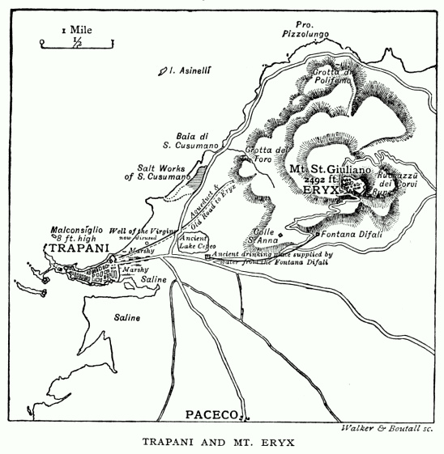
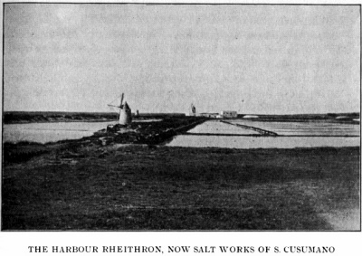
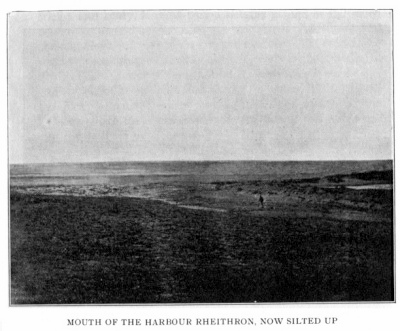

> 特洛伊史詩叢書 v2.0.0｜中文譯文與編輯文字：CC BY-NC-SA 4.0；英文原文與原書圖版屬公版（見 LICENSE-CONTENT.md、NOTICE.md）
[← 分章目錄](../README.md)　｜　[全書](../../中文好讀版_附原文.md)

## 第八章

<!-- U0862 -->
伊薩卡與斯刻里亞都取材自特拉帕尼及其近郊

<!-- U0863 -->
以上我已陳述了一些理由，說明我何以相信，從《奧德賽》第一卷到最後一卷，我們都是在一位年輕女子的手中──雖然比起這個題目所需要的篇幅，我講得簡略太多了。那麼，她是誰？她住在哪裡、在哪裡寫作？她是有血有肉的人，活在某個時間、某個地方，看過海，看過天，在某處某時來來去去──可是在哪裡？在什麼時候？而最要緊的，她是誰？接下來幾章，我的目標就是盡我所能，替這些問題投下一點光。

<!-- U0864 -->
我會沿用前面的做法，把自己一步步走到這些結論的路徑重走一遍。

<!-- U0865 -->
讀完第十卷時，我已確信《奧德賽》不是男人的作品，但還沒看到任何跡象，讓我覺得它是在某個地方而非別的地方寫成的。然而，讀到卷十三 159–164 行，波賽頓把費埃克斯人的船變成斯刻里亞港口入口處的一塊岩石，我便深信作者是照著一處實有的地貌在寫，於是記下一筆：任何地方，不管它多麼恰好位於兩個港口之間，若不是其中一個港口盡頭有一塊半沒入水中的小岩礁，就不可能是斯刻里亞。不久，我著手思考：假定斯刻里亞是真實的地方，我應該去找哪些自然地貌的組合？我把它們列成下面這張清單：──

<!-- U0866 -->
一、城鎮必須坐落在一片伸入海中、宛如天涯盡頭的岬角上，兩側各有一個港口，或可供船隻停泊的海灣（卷六 263 行）。它必須以一條狹窄的地峽與大陸相連。而且，如我剛才所說，其中一個港口的入口處必須有一塊半沒入水中、令人生畏的岩礁。

<!-- U0867 -->
二、兩個港口都不能有河流注入，否則瑙西卡就不必走那麼遠去洗衣服了。走到那條「河」時，它也許不過是一片潟湖，有一兩道淡水泉流入其中。因為那些衣服看來並不是在河裡洗的，而是在公共的洗衣池裡洗的（《奧德賽》卷六 40、86、92 行），一道小泉就足以讓池子保持水量充足，「即使衣服很髒也洗得乾淨」。場景就設在緊鄰海岸處，因為衣服是攤在海浪堆起的高高礫石灘上晾乾的；而瑙西卡的侍女們躲避奧德修斯時，也是沿著海灘和伸入海中的沙嘴四散奔逃。

<!-- U0868 -->
三、離城不遠處必須有一座顯眼的高山，波賽頓揚言要用一座高山把城埋掉，這威脅才有著落。此外，上面描述的整個組合，它在埃維亞島以西的距離，必須遠遠超過伊薩卡，因而也遠在伊薩卡以西（卷七 321 行）。說真的，如果作者是照著一個真實的地方在寫，這些線索綽綽有餘，足以讓人輕易找到它。

<!-- U0869 -->
就我所觀察，科學界人士生怕倉促下結論，往往忘了世上還有一種事叫做倉促避開結論；荷馬學者們在這方面似乎也向他們取了經。我不禁要問：一個真實的地方與一部小說裡描寫的地方之間，要有多少處醒目的吻合，才足以讓人合理地確信，集這些特徵於一身的那個地方，就是小說取材的地方？依我說，四處鮮明的吻合，就足以使人極難在別處找到同樣的組合；若是五處，那麼除非我們找到什麼理由，足以抵銷真實地方與小說所描寫的地方如此密切的吻合所引出的推論，或者除非能證明，由於某種離奇的巧合，同樣的組合連同一切細節，也出現在另一個更說得通的地點，否則我們就可以確定，那部小說是取材自那個地方；因為所要求的組合中，每多一項細節，只要它確實符合，出錯的機率就以幾何級數遞減。

<!-- U0870 -->
假設有個警察奉命留意一位約六十歲的老先生。這人是外國人，會講一點英語但不多，左腳跛，藍眼睛，酒糟鼻，身高約五英尺十英寸。這些特徵，警察要湊齊幾項，才會頗有把握自己找對了人？只要看到外國人，他就會多看兩眼。看到一個身高約五英尺十英寸的外國人，他會留意對方的年紀；如果年紀看來約莫六十，而且這人左腳一跛一跛的，他大概就會覺得把人攔下來並無不妥。等他發現──他一定會發現──這人還有個酒糟鼻，他就不必再管什麼藍眼睛、破英語了，直接把人帶到治安法官面前。

<!-- U0871 -->
假如隨後發現這人的眼睛是淡褐色的，而且他不是英語講得很流利，就是根本不會講──那麼，既然所要求的其他特徵這麼多項都對得上，治安法官會因為此人與通緝描述之間這幾處小小出入就把他放了嗎？他難道不會反過來要求被告拿出極有說服力的證據，證明這是認錯了人？

<!-- U0872 -->
再舉一個例子，也許更切中要點，因為它牽涉到真實地方與小說所描寫的地方之間的比較。下面是一段小說摘錄：──

<!-- U0873 -->
> 格拉默頓和其他美麗的城市一樣，建在一座山丘上。最高處是那所古老典雅的伊莉莎白時代學校，當時、乃至今日，都享譽全歐。學校對面是那座殘破頹圮的古堡，俯瞰著寬闊湍急的薩伯河那翻騰沸湧的淺灘。……城鎮從山丘向四面八方陡然傾斜而下，直抵河邊。河水把它圍成一座半島，上面星羅棋布地散落著住家。（查爾斯．克拉克著《博克勒父子》，查普曼與霍爾出版，第一卷第 28 頁。）

<!-- U0874 -->
凡是智力尋常、又熟悉什魯斯伯里的人，有誰會懷疑克拉克先生寫的就是什魯斯伯里？

<!-- U0875 -->
我把《奧德賽》所描寫的斯刻里亞與至今猶在的特拉帕尼之間那些多得多、分量也重得多的吻合之處提出來時，傑出的荷馬學者們不止一次、兩次對我說──而且說得一點也不謙和，倒像是一副要把我壓垮的架勢──我的論證主要建立在海岸其他地方也並非沒有的地理特徵上，以及同樣屬於別處的傳說上。

<!-- U0876 -->
回到我那個例子，他們會這樣論證：格拉默頓不可認定為什魯斯伯里，因為哈羅和什魯斯伯里一樣，學校也在城裡地勢最高處。再說，伊頓也有一條河，所以伊頓很可能才是作者心目中的地方。設想薩伯這個名字不過是薩布麗娜在文學上的戲仿變形，實在異想天開。諾丁漢有座城堡，幾年前還是一片廢墟，從那裡也看得見特倫特河。所以，諾丁漢和什魯斯伯里一樣，都可能是格拉默頓的原型。

<!-- U0877 -->
如此這般，沒完沒了（*ad infinitum*）。這種論證路線的毛病，在於無視對方論證的力量所在：對方證明了一個高度複雜的組合確實存在，其中各個組成項目，全都出現在同一處時威力強大，若不組合在一起，就毫無力量。傑出的荷馬學者們討論我的《奧德賽》理論時，幾乎無一例外都走這條路線；但這條路線無法說服另一群人──在他們面前，即使最傑出的荷馬學者，最終也得低頭──我指的是具有尋常常識的人。這些人會明白：要把格拉默頓從什魯斯伯里身上拉開，只有兩條路，要不證明什魯斯伯里的特徵其實與格拉默頓並不相符，要不證明英格蘭另有一座城鎮具備同樣的組合，而且在其他方面更令人信服。

<!-- U0878 -->
特拉帕尼與斯刻里亞也是如此。傑出的荷馬學者們必須證明我誇大了兩地之間的吻合之處──面對海軍部海圖和《奧德賽》，他們恐怕不太敢這麼做；或者，他們必須另外提出一個地方，同樣集這些吻合之處於一身──這他們不會去嘗試；再不然，他們就必須拿出理由，讓人相信特拉帕尼與斯刻里亞、伊薩卡所有場景之間那些為數極多而又精確的吻合，都只能歸諸純粹的偶然──而這種說法，只能說服那些肯相信有人連續三局手上都握著十三張王牌、卻沒在牌上動過手腳的人。最後這種假定，我不必討論；至於其他兩種，我只能向讀者保證：自從我的理論首次公諸於世，將近六年來，從沒有人試圖證成其中任何一種。

<!-- U0879 -->
將來也永遠不會有人去試。因為斯刻里亞應該到希臘以西的某道西岸上去找，而除了義大利和西西里的西岸，並沒有這樣的西岸；這兩處我都夠熟悉，足以確定，假如斯刻里亞的組合能在特拉帕尼以外的地方找到，我早就找到了。即使真能找到這樣一個地方，連同它的馬爾孔西利奧岩、傳說和一切都齊全，它要和特拉帕尼爭奪《奧德賽》的歸屬之前，也還得在斯刻里亞的組合之外，再拿出伊薩卡的組合；因為一個地方若能同時提供伊薩卡與斯刻里亞的地形，當然比只能提供斯刻里亞細節的地方，更有資格被視為《奧德賽》的取材之地。

<!-- U0880 -->
再者，就算他們找得到另一個兼具斯刻里亞與伊薩卡全部特徵的地方，我的論敵們的麻煩也才解決了一半；因為特拉帕尼仍可與它分庭抗禮，除非那地方外海也有四座島嶼（不多也不少），其中一座又長又窄，而且全都與《奧德賽》對愛奧尼亞群島那不準確的描述相符。即使如此，它也還談不上與特拉帕尼平起平坐，直到有人證明，奧德修斯航程中真正要緊的部分是從那裡開始、又在那裡結束的。等這一切都做到了──但不能在那之前──才是權衡兩地孰是孰非的時候。

<!-- U0881 -->
因為我的論證，是建立在四條論證路線的和諧並進之上；每一條都要求滿足許多極其嚴格的條件，而每一條單獨拿出來，都足以有力地推定，特拉帕尼是《奧德賽》作者心中最突出的那個地方。這四條是：──

<!-- U0882 -->
一、斯刻里亞取材自特拉帕尼。我將提出一組比格拉默頓與什魯斯伯里之間強得多的吻合之處，來證實這一點。

<!-- U0883 -->
二、伊薩卡也取材自特拉帕尼及其近郊。讀者會發現，我在這一點上的論證，若有可能，甚至比我用來證明斯刻里亞就是特拉帕尼的論證還要有力。

<!-- U0884 -->
三、《奧德賽》所描述的愛奧尼亞群島，不可能取材自真正的愛奧尼亞群島，也不可能取材自特拉帕尼外海那幾座島以外的任何島嶼；而且作者為了把這些島硬塞進她的敘事，不惜違背自己所知的實情。

<!-- U0885 -->
四、奧德修斯的航程，實際上可以歸結為一段從特洛伊到西西里附近的航行，此後則是一趟環繞西西里的航行，從特拉帕尼出發，又回到特拉帕尼結束。

<!-- U0886 -->
為支持其中任何一個命題而提出的論據，都必須不與支持其他命題的論據相牴觸；四條論證路線還必須彼此印證，像兒童拼圖的碎片那樣互相嵌合。除了真實的理論，不可想像還有什麼能滿足如此苛刻的條件。現在我就來證明斯刻里亞就是特拉帕尼，並回頭講述我得出這個結論的步驟。

<!-- U0887 -->
我帶著本章開頭列出、必須找到其組合的那份要點清單，前往大英博物館的地圖室，打算必要時從特洛阿斯一路搜尋地中海直到直布羅陀；但我記得（基於前面已說明的理由）我應該到希臘以西相當距離處去找，又記得《奧德賽》的作者似乎住在一處面向西方而非東方的海岸，於是決定先搜尋西岸。我知道繆爾上校以及相當有分量的古代證言，都把庫克羅普斯人安置在埃律克斯山上；而且在我看來，奧德修斯獵山羊的那座島，以及整段庫克羅普斯插曲，比航程中任何其他部分都更鮮明地讓人覺得是取材自實景。此外，我知道作者是一位不大可能出過遠門的年輕女子，因此確信只要找到其中一個地方，其他地方也就不難找到了；所以我調閱了利呂拜翁岬的地圖，因為在希臘以西的西岸之中，它最有成功的希望。地圖剛拿到手，我就發現斯刻里亞所需的組合，正好就躺在埃律克斯山腳下。伸入海中的天涯岬角──兩側各一的兩個港口──兩片沼澤之間的狹窄入口──近在咫尺的高山──其中一個港口入口處的岩礁──沒有任何河流──這些都可以在這裡附上的地圖中看到；這張地圖是沃克與布托爾公司根據義大利政府的測量和我國海軍部的海圖替我繪製的。

<!-- U0888 -->

*圖版 6：特拉帕尼與埃律克斯山──沃克與布托爾刻製。*

<!-- U0889 -->
但這還不是全部。那塊岩礁不但高度恰到好處，而且其方位轉向，正好讓人聯想到一艘正駛入港口的船；更奇的是，它帶著一個古怪的名字：馬爾孔西利奧（Malconsiglio），也就是「惡謀」。這讓我大為震動，於是寫信到特拉帕尼，打聽有沒有和這塊岩礁有關的地方傳說；回信說有兩則──一則荒誕不經，另一則大意是說，這塊岩礁原是一艘土耳其海盜船，海盜們前來攻打特拉帕尼，卻在港口入口處被特拉帕尼聖母（Madonna di Trapani）變成了石頭。我毫不懷疑，這個名字和這則傳說合起來，以基督教化的形式保存了《奧德賽》的版本──傳說記錄了一艘船在駛入港口時被變成石頭這件事，名字則告訴我們另一件事：這是一場「惡謀」所招致的後果。

<!-- U0890 -->
我相信，以上所述已足以讓人合理地確信斯刻里亞取材自特拉帕尼；因此我接著要證明，伊薩卡的場景也取材自同一個地方及其近郊。

<!-- U0891 -->
為此，我有責任在特拉帕尼附近──雖然不是就在城裡──找到一個港口：它現在存在，或可以證明在一切合理的可能性上曾經存在；港內現在有、或過去有水流；而且它緊靠在一座山的山腳下。這個港口的底部應該是緩坡，因為送奧德修斯到伊薩卡的費埃克斯船員，在船勢未止之前，就讓船身衝上岸達半個船長。不遠處必須有兩個彼此相近的洞穴（卷十三 103–112 行及 347–349 行）。其中一個必須有兩個入口──一個朝北，人可以由此下到洞裡；另一個朝南，只有眾神才能從那裡進去。洞裡必須有水，還應該能找到史前的器物。從洞附近必須看得見港口（複數），而且洞應該在山腰上。奧德修斯就是在這裡藏起費埃克斯人送給他的財寶。另一個洞則不必有什麼特殊之處。

<!-- U0892 -->
從這些洞穴往山上爬、再沿著山頂走的人，應該會來到一處視野遼闊的高地，那裡有一道泉水和一塊名叫「烏鴉」的岩石（即科拉科斯岩）。這個地點冬天必定冷得刺骨，而且離特拉帕尼必定約兩小時路程；通往城裡的小路必須崎嶇到一個體力尋常的人不拄根手杖就不想走；最後，這條路必須經過一座顯眼的土丘或小山，它比上述高地離特拉帕尼近得多，而且可以把城市和港口盡收眼底。讀者若翻閱本書所收卷十三、十四、十五、十六、十七的縮譯，就會發現這些要點樣樣都不可少。

<!-- U0893 -->
這些要點至今全都存在，連那塊岩石被叫做「烏鴉」也不例外，只有一項除外──我指的是費埃克斯人駛入的那個港口的口子；它如今已經淤塞，就像塞利努斯港一樣[^12-1]──塞利努斯我幾乎可以說是在同一段海岸上。港口內側仍滿是海水，但已改建成鹽場[^12-2]，略低於海平面。舊出口的河床清晰可見，雖然已經完全乾涸，裡面仍長著燈心草：它非常狹窄，冬天常常積滿水；義大利官方地形圖上用虛線標出了它，我國海軍部海圖上卻沒有。

<!-- U0894 -->
這道河床的存在，是特拉帕尼的蘇加梅利先生指給我看的。他向我保證，直到 1848 年開闢鹽場之前，鹽場所占的整片地方原是一片開闊的湖沼，他父親常去那裡打野鴨。開闢鹽場的一大難題，是淡水泉太多，必須在鹽田上抹水泥，才能防止淡水混進鹹水裡。卷六 40 行的 πλυνοί，也就是洗衣池，或許就是由其中某幾道泉水供水的──除非瑙西卡其實是用海水洗衣服，就像我在潘泰萊里亞島上看到婦女們至今仍在做的那樣。

<!-- U0895 -->

*圖版 7：瑞特隆港，今為聖庫蘇馬諾鹽場。*

<!-- U0896 -->

*圖版 8：瑞特隆港的口子，今已淤塞。*

<!-- U0897 -->
設想有一片長將近一英里、寬四分之一英里的水域，出口狹窄，而此地潮水的漲落有二到三英尺，就會造成一股時而相當強勁的水流，足以讓人把它既描述為一條河，又描述為一個有水流的港口。暫且回到斯刻里亞：我推想，這就是奧德修斯在其河口登岸的那條河；而所謂河流為他止住了水勢（卷五 451 行），我認為意思是他抵達那裡時正好碰上潮水轉向。我還可以說，這個港口在《奧德賽》中被用了五次：──

<!-- U0898 -->
一、作為「城外鄉間、涅里通山下那個有水流的港口」。如前所述，此處讀作 Νηρίτῳ 而非 Νηίῳ。雅典娜與忒勒馬科斯交談時，說她把船停在那裡（卷一 185、186 行）。二、作為奧德修斯在斯刻里亞登岸、瑙西卡洗衣服的地方。三、作為奧德修斯在伊薩卡登岸的地方。四、作為忒勒馬科斯從皮洛斯歸來、在伊薩卡登岸的地方（卷十五 495 行以下）。五、作為奧德修斯所指、他的船停泊「在城外鄉間」的那個地點（卷二十四 308 行）。

<!-- U0899 -->
現在我回頭談那兩個洞穴，它們應該就在離這個港口頂端不遠的地方。從原文看得很清楚，洞穴是兩個而不是一個；但有人把提到第二個洞穴的那兩行用括號括了起來，我猜想，是因為直到這裡為止，他都只聽說有一個洞，忽然又冒出第二個來，讓他摸不著頭腦。

<!-- U0900 -->
我斗膽認為，他若熟悉實地，就不會摸不著頭腦了，因為在地圖上標為「公牛洞」（*grotta del toro*）的地方，正有兩個洞穴，彼此相距約八十到一百碼。其中一個很顯眼，但沒什麼特別之處；另一個則不太容易看到，被農民們稱為「公牛洞」，洞口正朝北，大家都相信裡面藏著一筆財寶，有一頭住在洞穴深處的公牛不停地在磨它，但只有處女才找得到，而且她得吃下一整顆石榴，一粒籽也不掉。我懷疑 *toro*（公牛）是孩子們把 *tesoro*（財寶）講走了樣。公牛就這樣進了洞，再也沒出來；而既然大家又確知財寶是有的──那麼──公牛待在那裡，除了推磨磨財寶，還能做什麼呢？

<!-- U0901 -->
這個洞穴朝正南方深入岩石之中，通道既崎嶇又狹窄，誰都不大可能順著它往裡走上超過寥寥幾英尺。因此，沒有人能從南面進入這個洞穴──只有眾神才能從那裡進去。

<!-- U0902 -->
1894 年 8 月，我和幾位西西里朋友一同造訪實地，與掌管洞穴所在農莊的農人（*contadino*）攀談。正談著，一個討人喜歡、看來挺機靈的小夥子騎著驢子過來，似乎對我們的談話很感興趣。

<!-- U0903 -->
「那個洞裡，」我們指著公牛洞問道，「有財寶嗎？」

<!-- U0904 -->
「當然有，」他立刻回答。這時那男孩插嘴了。他十分肯定有財寶。人人都知道。這是無庸置疑的。

<!-- U0905 -->
「另一個洞裡有財寶嗎？」

<!-- U0906 -->
「噢，沒有。」

<!-- U0907 -->
「兩個洞裡，哪一個叫公牛洞？」

<!-- U0908 -->
「那一個」──農人和男孩異口同聲，立刻指向與《奧德賽》相符的那個洞。

<!-- U0909 -->
「你們很確定，另一個洞不叫『公牛洞』（la grotta del toro）？」

<!-- U0910 -->
「很確定。」

<!-- U0911 -->
「公牛洞通到哪裡？」

<!-- U0912 -->
「越往裡越窄，一直深入到岩石裡去。」

<!-- U0913 -->
「有沒有人走到過盡頭？」

<!-- U0914 -->
「沒有，沒有；沒人知道它到哪裡為止。從前有個趕牛的進去探過一次，就再也沒回來；據說那以後就砌了一道牆，不讓任何人再往裡走。」

<!-- U0915 -->
「你自己進過洞裡嗎？」

<!-- U0916 -->
「進過。」

<!-- U0917 -->
「走到那道牆了嗎？」

<!-- U0918 -->
「沒有。」

<!-- U0919 -->
「你走了多遠？」

<!-- U0920 -->
「沒多遠；我害怕。」

<!-- U0921 -->
「那你根本不知道這個洞有多深了？」

<!-- U0922 -->
「不知道。」

<!-- U0923 -->
「洞裡一年到頭都有水嗎？」

<!-- U0924 -->
「有。」

<!-- U0925 -->
「你親眼見過嗎？」

<!-- U0926 -->
「今年五月我去過，那時有水。」

<!-- U0927 -->
「現在那裡有水嗎？」

<!-- U0928 -->
「我想應該有，但不敢肯定。」

<!-- U0929 -->
「你能帶我們去看看嗎？」

<!-- U0930 -->
「不行；那塊地的鑰匙在特拉帕尼。」

<!-- U0931 -->
「聽說洞穴深處有一頭公牛？」

<!-- U0932 -->
「是這麼說，但我們從沒見過牠；我們唯一確知的，就是那裡有財寶。」

<!-- U0933 -->
這時男孩又來了精神，說這是千真萬確的。

<!-- U0934 -->
等我們問完了，那位農人把我們當中一人拉到一旁，悄悄地說：「放心交給我吧，我的肚子很能裝」（意思是：我守得住祕密）。「你們來搬財寶的時候──我看得出你們是打算這麼做的──一定要帶上我，分我一份。你們要是夜裡來，狗會叫，我就知道你們來了。那時我會下來幫你們，可是一定要分我一份。」

<!-- U0935 -->
一回到特拉帕尼，我立刻用義大利文把上面這段對話寫了下來；我的西西里朋友們應我的要求在上面簽名，證明記錄無誤。我還想到要補充一句：特拉帕尼附近沒有別的洞穴附會著任何藏寶的故事。

<!-- U0936 -->
去年（1896 年 5 月）我再度造訪這個洞穴，這一回是和我的朋友 H．費斯廷．瓊斯先生同去；他走遍了本書所描述的整片地方，為的是確認我沒有誇大其詞。陪同我們的是特拉帕尼的蘇加梅利先生；多虧他，我才改正了一個錯誤：我原以為兩個洞穴中較顯眼的那一個叫公牛洞（*grotta del toro*）──因為 1892 年我第一次到特拉帕尼時，城裡的朋友們就是這麼向我保證的，他們並不知道真正叫這個名字的那個洞的存在。瓊斯和蘇加梅利先生手腳並用地爬進了洞穴內部，我則因為上了年紀、腿腳又有點跛，沒敢冒險。他們發現洞穴大約在三十英尺後就止於一整塊堅實的岩石；但走過十或十二英尺的人，很少會願意再往裡走，所以我完全相信，《奧德賽》的作者和今天的農民一樣，相信誰也走不到洞的盡頭。我的朋友們在洞裡發現了水。

<!-- U0937 -->
夏天這個洞穴裡滿是蜂巢，這一帶所有的洞穴都是如此。這些蜂巢很小，孤零零的，由紅土築成，大約一個橡實殼斗那麼大。埃律克斯山附近的所有洞穴都富藏石器時代人類的遺物，其中一些精品可以在巴勒莫的博物館看到。三千年左右以前，這類遺物無疑會比現在更常見、也更醒目；所以我認為不難想像，《奧德賽》作者富於詩意的想像力，把它們歸於寧芙與那伊阿得斯仙女。

<!-- U0938 -->
從兩個洞穴附近，當然都看得到埃律克斯山的懸崖──我認為那就是作者心目中的涅里通山（卷十三 351 行）──看得到下方約兩百英尺處耕地上筆直的小路，看得到海之老人福爾庫斯的港灣，也看得到特拉帕尼的兩個港口；這一切都是卷十三 195、196 行與 345–351 行所要求的。

<!-- U0939 -->
讀者會注意到，雖然有不只一處斯刻里亞的細節是隨口帶出、也許是無意間透露的──例如奧德修斯在斯刻里亞登岸的那個港口，以及那些港口（我毫不懷疑就是特拉帕尼的兩個港口）──但到目前為止，沒有任何一處伊薩卡的細節與斯刻里亞描述中的任何特徵相牴觸。

<!-- U0940 -->
奧德修斯藏寶的那個洞穴與公牛洞之間的吻合之處，無論數量還是分量，都遠遠超過格拉默頓與什魯斯伯里之間的吻合。儘管如此，最好還是看看他離開洞穴後的行蹤，究竟是證實了我的看法，還是與之相悖。

<!-- U0941 -->
我推想，他爬上了埃律克斯山陡峭的山坡──那時無疑林木茂密。然後他沿著它高而近乎平坦的山頂（δἰ ἄκριας，卷十四 2 行）走到山的另一頭，也就是今天諾曼城堡矗立、海拔二千五百英尺的地方。他在這裡往下走了約兩三百英尺，來到今天叫做 *i runzi*（倫齊）的地點，那裡在一處懸崖附近有一道泉水，那懸崖至今仍叫 *il ruccazzù dei corvi*，也就是「烏鴉岩」，因為這些鳥最愛在山的這一帶繁殖。這段路他大約要走兩個小時，或多或少。

<!-- U0942 -->
這個地點從四面八方老遠都看得見，冬天冷得刺骨，有一條崎嶇的山路與特拉帕尼相連，奧德修斯沒有手杖不敢走這條路，也是很自然的（卷十七 195 行）[^12-3]。這條路緊挨著圓頂的聖安娜丘（*Colle di Sta Anna*）經過，它與卷十六 471 行的 Ἕρμαιος λόφος（赫耳墨斯山丘）完全相符。從倫齊走到特拉帕尼所需的時間，與《奧德賽》所提供的一切線索都相符，這些線索說的是歐邁俄斯的小屋與伊薩卡城之間的距離──大致說來，似乎是冬日裡一天之內走一趟來回的路程。

<!-- U0943 -->
因此讀者會看到，奧德修斯所走的整條路線──從他在福爾庫斯港登岸，到他藏起禮物的洞穴（連同其一切複雜的要求），再登上涅里通山，沿著它長長的山頂走到泉水與科拉科斯岩，最後走那條經過赫耳墨斯山丘、下到伊薩卡的小路──都由一條從聖庫蘇馬諾鹽場（*saline di S. Cusumano*）到公牛洞、埃律克斯山、泉水、烏鴉岩，再到通往特拉帕尼之路的路線，精確地呈現在我們眼前，彷彿《奧德賽》是昨天才寫成的。讀者若能在古今一切文學中，替我找出任何類似的一連串吻合，存在於一個真實的地方與一部虛構作品所描寫的地方之間，而又純屬偶然的結果，我就承認我所指出的這些巧合或許只是偶然。但我深信，這樣的例子，甚至任何差可比擬的例子，都舉不出來。

<!-- U0944 -->
因此我主張，伊薩卡和斯刻里亞一樣，必須視為取材自特拉帕尼。不過，有一個要點必須記住：作者在從外部（*ab extra*）看待伊薩卡、只把它當成一座島而別無其他時，心中想像的是離特拉帕尼約二十二英里、高聳醒目的馬雷蒂莫島；但她需要細節時，就從大陸上她自己的近鄰取材。

<!-- U0945 -->
年輕人把熟悉的故事搬到自己家鄉來的時候──幾乎所有年輕人都會這麼做──從不在乎前後矛盾。他們就像傑出的荷馬學者，一旦打定主意要讓事情照某種樣子進行，就不會讓「決心的本色」被思慮所阻撓；他們會覺得，讓伊薩卡既在這裡、又在那裡，同樣輕而易舉；在結冰的池塘上溜冰時，也能看見哥倫布駛向熱帶的航程。塞爾本勳爵就這樣寫道：──

<!-- U0946 -->
> 隨著我們長大，想像力也越來越強。它替我們童年所有的樂趣添上色彩；它陪著我們上冰場、進樹林；它把超自然的夢境摻進最平凡的事物裡。我們在結冰的池塘上溜冰時歇腳的地方，就是哥倫布或庫克所發現的島嶼──我們最愛讀他們的航海記了。

<!-- U0947 -->
> （朗德爾．帕爾默，塞爾本伯爵著，《回憶錄》等，麥克米倫，1896 年，第一部第 66 頁。）

<!-- U0948 -->
在離開伊薩卡的場景之前，我應該說明：特拉帕尼過去很可能有一片水域，讓牛群需要搭船渡過，就像《奧德賽》卷二十 186–188 行所描述的那樣。特拉帕尼東側的土地在 1860 年經人工墊高；在那之前，北風連吹一陣之後，城鎮兩側的海水在冬天常常連成一片。好幾個人向我保證，他們記得自己曾得坐車渡過特拉帕尼與大陸之間的水面。起初我很想相信，菲羅提俄斯是在通往城裡的狹窄入口被水淹沒時進城的；但往上幾行，我們就讀到歐邁俄斯也帶了三頭豬進城，墨蘭提俄斯也帶了幾頭山羊。這兩人無疑都是從埃律克斯山來的，而原文似乎排除了他們也得渡水的可能。然而，沒有任何跡象暗示菲羅提俄斯是從埃律克斯山來的；事實上，他的牛群比較可能在港口南邊的平地上吃草，而他是搭船渡過港口，省得非繞一大段遠路（*détour*）不可。如果那片水是小亞細亞、希臘或西西里任何一條河的水，大概一個擺渡人就夠了；然而看來卻有好幾個人在那裡載客收費，就像在海港或港口那樣。

<!-- U0949 -->
聽眾一定很清楚，斯刻里亞和伊薩卡都取材自他們自己的家鄉；這個事實又解釋了另一個難題。某個吹毛求疵的聽眾也許會問：「像奧德修斯這麼精明老練的水手，怎麼會沒注意到他從斯刻里亞到伊薩卡只航行了兩英里，甚至不到兩英里？他又怎麼會認不出自己上岸的地方，正是幾天前遇見瑙西卡的地方？」

<!-- U0950 -->
《奧德賽》的作者帶點天真（*naiveté*）地承認，費埃克斯水手們早就熟悉他們把奧德修斯留下的那個港口。他們大概確實熟悉。可是怎樣才能讓奧德修斯在航行途中、以及被送上岸時都不提出異議？作者實際採取的辦法是：奧德修斯一上船就讓他睡著，等水手們都走了才讓他醒來；很難看出她還能採取什麼更好的辦法。於是，替他預備了一場沉睡（卷七 318 行、卷八 445 行），而他似乎在船還沒出港就睡著了；這場睡眠如此深沉，與其說像睡眠，不如說更像死亡（卷十三 80 行）。什麼都吵不醒他──就連水手們第二天早上把他從船上抬下來，把他所有的財寶放在他身旁，然後離去，也吵不醒他──直到費埃克斯水手們遠在一切盤問所能及的範圍之外為止。那之後，當然是他醒得越早越好。

<!-- U0951 -->
至於另一個難題──他沒看出自己所在之處，不過就是兩天前遇見瑙西卡的地方──作者的解決辦法是：讓那天早上大霧瀰漫，並讓奧德修斯整個人糊里糊塗，連這地方是伊薩卡都認不出來，更別說認出是斯刻里亞了；直到雅典娜與他相遇，和他長談了一番，聽眾就在這番長談之間不知不覺進入了情境，不再多加異議，便把特拉帕尼一帶當成了伊薩卡一帶。

<!-- U0952 -->
[^12-1]: 幾年前，塞利努斯港入口處的石砌工程曾被挖掘出來，但只過了一個冬天就又被淤沙掩埋。

<!-- U0953 -->
[^12-2]: 平面圖上標為聖庫蘇馬諾鹽場。

<!-- U0954 -->
[^12-3]: 近年來，從特拉帕尼到埃律克斯山頂小鎮已修築了一條極好的馬車道，但步行者仍走那條舊路，有些地方非常崎嶇。

<!-- U0955 -->
