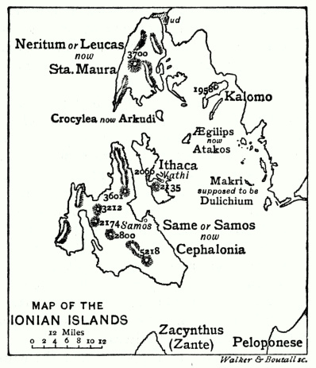
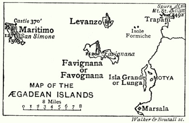
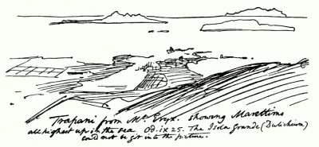
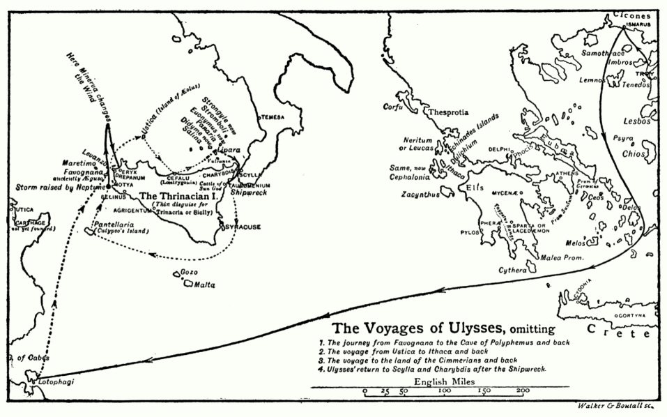
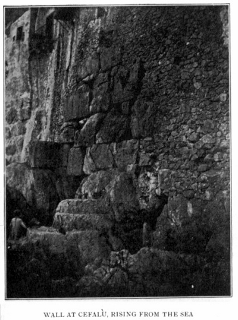
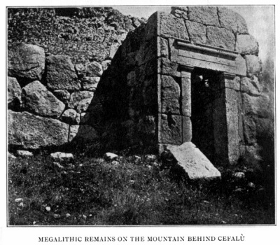

> 特洛伊史詩叢書 v2.0.0｜中文譯文與編輯文字：CC BY-NC-SA 4.0；英文原文與原書圖版屬公版（見 LICENSE-CONTENT.md、NOTICE.md）
[← 分章目錄](../README.md)　｜　[全書](../../中文好讀版_附原文.md)

## 第九章

<!-- U0956 -->
愛奧尼亞群島與埃加迪群島──奧德修斯的航程實際上是一趟從特拉帕尼出發、又回到特拉帕尼的環西西里航行

<!-- U0957 -->
在後面的一章裡，我打算證明：《奧德賽》的作者手上的《伊里亞德》，就是我們今天所見的樣子，只有無關緊要的抄寫錯誤除外。我將指出，歐陸與英國的知名荷馬學者最為懷疑的那幾卷，她引用起來，和那些公認出自荷馬手筆的卷次一樣完整、一樣隨意。我沒看過有誰提出充分的理由，足以懷疑《伊里亞德》卷二 484–877 行的〈船表〉不屬於荷馬身後所留的原詩──雖然他很可能找過某個比他更熟悉希臘的人幫忙。這個問題我打算以後再談，眼下只請讀者接受我的假定：《奧德賽》的作者知道上述的〈船表〉。在亞該亞大軍的〈船表〉中，埃基納伊諸島與愛奧尼亞群島是這樣描述的：

<!-- U0958 -->
> 還有杜利基昂島的人，以及神聖的埃基納伊諸島的人，他們住在隔海與埃利斯相望之處──率領他們的是堪比阿瑞斯的墨革斯，菲勒烏斯之子；菲勒烏斯從前因與父親失和，遷居杜利基昂島。隨墨革斯而來的有四十艘船。

<!-- U0959 -->
> 奧德修斯率領勇敢的凱法勒尼亞人，他們據有伊薩卡、林木茂密的涅里通、克羅庫勒亞、崎嶇的埃基利普斯、薩摩斯[^13-1]與扎金索斯，以及與這些島嶼隔海相對的大陸。率領他們的是謀略堪比眾神的奧德修斯，隨他而來的有十二艘船。（《伊里亞德》卷二 625–637 行。）

<!-- U0960 -->
讀者會注意到，杜利基昂島（意思是「長島」）並不屬於愛奧尼亞群島，而屬於鄰近的埃基納伊諸島。現在來看看《奧德賽》怎麼描述伊薩卡附近的島嶼。奧德修斯說（卷九 21–26 行）：

<!-- U0961 -->
> 「我住在伊薩卡，島上有一座高山，名叫涅里通。附近還有幾座彼此相距不遠的島嶼：杜利基昂島、薩墨與扎金索斯。伊薩卡橫在天際，在海中位置最高，朝向西方；其他島嶼則遠在它的東邊。」

<!-- U0962 -->

*圖版 9：愛奧尼亞群島地圖──沃克與布托爾。*

<!-- U0963 -->
在《奧德賽》裡，伊薩卡之外的島嶼從來不超過三座。三座島一起提到時，總是依上面的順序排列──大概是格律上的緣故；但在作者眼中，杜利基昂島最重要：它被單獨提起的次數比較多，而且派出了五十二名求婚者，相比之下，薩墨只有二十四名，扎金索斯二十名，伊薩卡本島十二名（卷十六 247–251 行）。

<!-- U0964 -->
只要瞄一眼上面的地圖就會明白，伊薩卡附近沒有哪一座島，能以詩意上說得過去的方式，被當成派出了將近其他三島總和那麼多的求婚者。最說不過去的就是杜利基昂島。這樣看來，作者要的是這個名字，而不是這座島；而且她想要得十分迫切，竟不惜動粗，從另一個群島把它搶了過來。

<!-- U0965 -->
她為什麼要這樣大費周章，非把它弄到手不可？《伊里亞德》的〈船表〉漏掉了三四座，仍給我們留下六座愛奧尼亞島嶼。去掉克羅庫勒亞與埃基利普斯這兩座小島，還剩四座，看來這正是《奧德賽》作者打算引入的確切數目；既然如此，涅里通為什麼不夠格？顯然它不合她的用途，否則她不會無視〈船表〉，把它塞進伊薩卡島內，再跑到更遠的地方去找她的首要島嶼。這種事從來不會無緣無故地做，而這一次尤其需要理由，因為真正的杜利基昂島既然微不足道，讓五十二名求婚者來自頗具規模的涅里通島，不但容易得多，也合適得多。

<!-- U0966 -->
只要假定作者住在特拉帕尼，是拿她所熟悉的埃加迪群島來描寫愛奧尼亞群島，一切困難便迎刃而解。瞄一眼前面的地圖就可看出，她不可能是照著真正的愛奧尼亞群島來寫的。伊薩卡無論怎樣硬拗，都不可能「在海中位置最高，朝向西方」。它完全被薩墨擋住了。其他島嶼也不是遠在它的東邊。由此可見，作者心中所想的並不是愛奧尼亞群島；不過我們可以順帶推論兩點：第一，她的聽眾住得離希臘夠遠，地形上不精確也無關緊要；第二，她實際取材的那些島嶼，和真正的愛奧尼亞群島一樣，都位於某處西岸之外。

<!-- U0967 -->
現在我附上一張特拉帕尼外海諸島的地圖。我注意到，弗里曼教授在他那張依他設想的古代樣貌所繪的西西里西岸地圖上，把大島（Isola Grande）和鄰近的本土連在一起，卻沒有提出任何根據。我在古代作家中找不到根據；親自勘察過那片地方之後，也看不出有任何跡象，顯示在離我們這個時代可以估量的時期之內，陸地與水域的分布曾經有過變化。

<!-- U0968 -->

*圖版 10：埃加迪群島地圖。*

<!-- U0969 -->
高峻崎嶇的馬雷蒂莫島，在作者心中充當伊薩卡──不過正如我說過的，需要細節時，她取材於特拉帕尼與埃律克斯山。那座長島，也就是今天的大島──地勢低平、出產小麥──就是她的杜利基昂島；就特拉帕尼而言，這座島想必是四島中最重要的一座，因為任何天候都能前往，而且當時很可能已經孕育著後來赫赫有名的莫提亞城；這座城幾乎什麼也沒留下，原本位於大島與本土之間兩座小島中靠南的那一座上。另外兩座島分別代表薩墨與扎金索斯，但哪座是哪座，我始終無法斷定。從特拉帕尼幾乎看不到馬雷蒂莫，因為它幾乎完全被萊萬佐擋住了。然而，從埃律克斯山的高處望去──基於其他理由，我認為作者很熟悉這座山──它就「橫在天際，在海中位置最高，朝向西方」。我毫不懷疑，這位女詩人描寫的，正是她在埃律克斯山頂所熟知的景象，也是讀者至今仍能看到的景象。下一頁的草圖，會比文字更能說明 πανυπερτάτη εἰν ἁλὶ（在海中位置最高）的意思；圖中特拉帕尼正上方的兩座小島是福爾米凱群島，我認為那就是波呂斐摩斯擲出的第二塊巨石。

<!-- U0970 -->

*圖版 11：從埃律克斯山望特拉帕尼。可見馬雷蒂莫「在海中位置最高」。《奧德賽》卷九 25 行。大島（杜利基昂島）未能收入畫面。*

<!-- U0971 -->
如果以上所說還不足以讓讀者相信，《奧德賽》的作者是拿埃加迪群島來描寫愛奧尼亞群島，那麼我再補充什麼，大概也說服不了他。因此，我現在進入第四點：奧德修斯的航程，在作者能力所及的範圍內，就是一趟環西西里的航行──從特拉帕尼出發，沿北岸穿過墨西拿海峽，到潘泰萊里亞島，再回到特拉帕尼；再往後就不必追了，因為伊薩卡與斯刻里亞兩者都是特拉帕尼，這一點我已經證明過了。

<!-- U0972 -->
航程的主要情節依下列順序發生。一、基科涅斯人。二、食蓮人，途經基西拉島之後抵達。三、奧德修斯與同伴獵山羊的那座島，以及與波呂斐摩斯的遭遇。四、埃俄羅斯的島，接著順風向東航行十天，風勢始終不改，直到伊薩卡清楚在望，隨即又被吹回奧德修斯出發的那座島。這段越過義大利腳尖與薩墨島、駛向伊薩卡的航行，在地形上沒有意義，只說明作者設想埃俄羅斯的島遠在伊薩卡以西。這段插曲的用意，不過是把酒杯送到奧德修斯唇邊，再一把打落。五、萊斯特律戈涅斯人。六、喀耳刻的島與冥府之行；後者同樣沒有地形上的意義，只是一根掛釘，用來掛上與亡魂的對話，之後又把我們帶回喀耳刻的島。七、塞壬。八、斯庫拉與卡律布狄斯。九、赫利俄斯的牛群。十、卡呂普索的島。十一、斯刻里亞與伊薩卡。

<!-- U0973 -->
至於基科涅斯人、基西拉島與食蓮人的位置，學者之間並無異議；所以讀者會看到，我們一點時間也沒浪費，就被帶到離西西里不遠的地方──馬勒亞岬外的逆風（卷九 81 行），似乎就是特意颳起來把我們帶離希臘的。為什麼要安排基科涅斯人出場，不太容易看出來，除非是要讓奧德修斯得到伊斯馬羅斯的奇妙美酒，好用它灌醉波呂斐摩斯。這一帶的酒，在《奧德賽》寫成之後許多世紀仍然有名，想必在《奧德賽》本身的時代也是如此。特拉帕尼人之間很可能流傳著某個關於這種酒的吹牛故事，促使作者把它寫進來，拿它打趣，並用它把波呂斐摩斯灌醉。

<!-- U0974 -->
又或者，我們從修昔底德（卷六第 2 章）得知，西西里這一帶原有的西卡尼居民，在特洛伊陷落之後，接納了一批從特洛伊附近逃來的難民；因此，作者的聽眾之間可能流傳著某種傳說，說他們當中有些人源自基科涅斯人，而她或許想奉承他們，告訴他們是他們打退了奧德修斯。這一點無法有把握地說什麼；我們只能注意到，那片地方毫無特色，因此和食蓮人之地一樣，看不出是根據親身見聞描寫的。

<!-- U0975 -->
離開食蓮人之地以後，一路陪伴我們的一致意見就沒有了；不過，古代、中世紀與現代都有相當分量的權威，把我們帶到法維尼亞納島──古稱埃古薩，即「山羊島」──認定那就是奧德修斯與同伴獵山羊的島。的確，這段情節的安排，就像是故意要讓聽眾聯想到埃加迪群島，也就是「山羊」群島；卷四 606 行也是如此：那裡說伊薩卡──其實也就是馬雷蒂莫島──是一座適合山羊的島。[^13-2]

<!-- U0976 -->
把埃律克斯山當作與波呂斐摩斯遭遇之地，也有相當廣泛的共識。在這裡，以及在獵山羊的那座島上，地方色彩比奧德修斯航程中任何其他地方都濃；對一位我已證明對特拉帕尼一帶瞭如指掌的作者來說，這本來就是可以合理預期的。

<!-- U0977 -->

*圖版 12：奧德修斯的航程，略去……*

<!-- U0978 -->
然而，到了這裡，連部分的共識也沒有了。埃俄羅斯的島與萊斯特律戈涅斯人的國度，被安放的地點幾乎和論《奧德賽》的作者一樣多。這兩處，以及法維尼亞納島與庫克羅普斯人，我會在後面再談。我眼下的目的，是說明航程中有多少可以視為已知，多少有相當的權威支持，還有多少尚待尋找。

<!-- U0979 -->
我們在波呂斐摩斯的洞穴失去的部分共識，到了喀耳刻的島、塞壬與漂移之岩又回來了──這幾處一般認為就是利帕里群島；到了斯庫拉與卡律布狄斯，則重新獲得一致的共識。把赫利俄斯的牛群放在西西里西岸、大約陶羅美尼翁（今陶爾米納）一帶，我不敢說意見一致；但這個看法非常普遍，根據又顯然十分充分，所以我要把這一點當作確定的：因為島名已足以指向西西里，困住奧德修斯的風向表明他在一處西岸，而一夜之間把他吹回卡律布狄斯的南風，則表明他被設想為在墨西拿海峽以南不遠處。

<!-- U0980 -->
卡呂普索的島一般被認為是馬爾他，但無論在《奧德賽》內部或外部都找不到根據，因此我將把卡呂普索的島視為尚待尋找。

<!-- U0981 -->
斯刻里亞就是特拉帕尼，這一點我沒有任何共識可依，但有了上面所寫的，我也要把這一點視為確定。因此，我在這裡附上的地圖，可以讓讀者看出：就共識與其他已確定的地點而言，我們的處境如何。可以視為確定的航段，我用粗實線；有相當權威支持的航段，用斷續線；而我自己要補上的航段，則用點線。我讓奧德修斯從南方駛近特拉帕尼，依據的是卡呂普索給他的指示：要他朝大熊星座航行，讓它保持在左手邊（卷五 276、277 行）。[^13-3]這無疑表示一條向北的航線，甚至可以說是北北東的航線；無論如何，這樣的航線與卡呂普索的指示毫不衝突。或許我最好把詩中的原句引出來：

<!-- U0982 -->
> 他坐著，目光注視著普勒阿得斯星團[^13-4]、遲落的牧夫座，以及又名大車的大熊星座──它面向俄里翁不停旋轉，唯獨它從不沉入海中──因為卡呂普索吩咐過他，要以它為準掌舵，讓它保持在左手邊（卷五 272–277 行）。

<!-- U0983 -->
奧德修斯航程中的所有地點，一般都被歸到某個實際的地方，那個地方以它本來的名字或某個虛構的名字，存在於作者心中；而一旦我們進入西西里海域，凡是有相當共識的地點，或不論有無共識、如今都可以宣稱已經確定的地點──我指的是喀耳刻的島、塞壬、斯庫拉與卡律布狄斯、特里納基亞島、斯刻里亞與伊薩卡──全都位於西西里沿岸或近旁。那麼，這三個尚未確知的地點──埃俄羅斯的島、萊斯特律戈涅斯人之地與卡呂普索的島──不管名字多麼虛構，也都是真實的地方，而且應該依照書中描述的順序，到西西里沿岸或附近去找；這樣的念頭豈不是叫人無法抗拒？

<!-- U0984 -->
假如我們假設法維尼亞納與埃律克斯山就是奧德修斯與同伴獵山羊之島和波呂斐摩斯洞穴的真正所在，便立刻被依序引向其他地點，而這些地點又令人信服地像是埃俄羅斯的島、萊斯特律戈涅斯人之地、喀耳刻的島、其他已確立的地點，最後是卡呂普索的島──那麼，我們難道不該斷定，至少暫時斷定，這個假設是正確的嗎？

<!-- U0985 -->
我就這樣斷定，並著手尋找埃俄羅斯的島：它應該是某座看來孤懸的島，位於利帕里群島以西相當遠處，離埃律克斯山不太遠。

<!-- U0986 -->
首先我得糾正一個非常普遍的誤解。πλωτῇ（卷十 3 行）一詞被過度引申，解釋成這座島四處漂浮，因而會改變位置。但如果原意真是這樣奇特的現象，作者應該會大做文章，不會只用一個字帶過，還留下輕易就能解釋為單純比喻的餘地。沒有人會把卷十五 299 行那些「飛快移動」的島，硬解釋成島嶼真的在移動。那裡的意思只是：船從旁飛馳而過時，那些島「看起來在移動」；埃俄羅斯的島也是如此──「它看起來在天際漂浮」。奧德修斯在島上住了一個月，看不出它有任何移動的跡象；他離開三個星期後又回到島上，書中也沒有絲毫暗示它換了位置。[^13-5]因此我的結論是：它和任何其他島嶼一樣固定不動；接著我便去尋找它。

<!-- U0987 -->
這並不難，因為烏斯蒂卡島立刻就自己送上門來。天氣晴朗時，從埃律克斯山可以隱約望見它；對一位把埃律克斯及其周遭當作整個天地的作者來說，它自然會在心中留下印象。冬季那幾個月，颳向特拉帕尼最猛烈的風正是從它那個方向吹來，特拉帕尼的作者把它選為風的家園，再恰當不過。它的距離──在利帕里群島以西相當遠，在伊薩卡以西更遠得多──完全符合要求。因此我接受它，接著去尋找萊斯特律戈涅斯人之地及其城市忒勒皮洛斯，地點應在西西里北岸、烏斯蒂卡與利帕里群島之間的某處。

<!-- U0988 -->
萊斯特律戈涅斯人，亦即「石匠」[^13-6]，這個名字就像西西里境內所有的地名與民族名一樣，是虛構的。如果西西里真有過叫這個名字的民族，修昔底德至少能打聽到一點關於他們的事；然而他明白宣稱（卷六第 2 章）他辦不到，還帶著一絲微笑，請讀者去找詩人，或去找他們能找到的其他資料來源。顯然，他只把他們當作詩人對西西里最古老居民的虛構；在他所知的居民中，沒有比西卡尼人更古老的了。

<!-- U0989 -->
可是，《奧德賽》的作者為什麼不可能是用她自己杜撰的名字──無論是庫克羅普斯人還是萊斯特律戈涅斯人──來指這些西卡尼人呢？萊斯特律戈涅斯人的城市名忒勒皮洛斯，肯定是虛構的。它的意思是「城門相距遙遠」，這只可能是事後（*ex post facto*）才取的名字：一座城市取名，遠在人們知道它日後會發展到多大之前。從這個名字我們只能看出，《奧德賽》的作者想讓聽眾明白，這是一座大城。

<!-- U0990 -->
城裡的居民和庫克羅普斯人一樣，是巨人，也是吃人的妖魔。既然他們是巨人，我們就該去找巨石建築的遺跡；既然他們是吃人的妖魔，我們就該懷疑，他們和與之如此相像的庫克羅普斯人屬於同一種族。作者兩者都厭惡，而她看不起庫克羅普斯人的樣子，很像諾曼征服之後好幾個世代裡，諾曼人看不起撒克遜人那樣。

<!-- U0991 -->
庫克羅普斯人似乎已被征服，淪為化外之民；萊斯特律戈涅斯人卻不然。後者是個興旺而非常勤勞的民族，夜裡和白天一樣工作（卷十 84–86 行）。關於他們有一個可憐兮兮的史前小笑話，大意是：在他們的國度裡，一個人只要能不睡覺，就能賺兩份工錢。此外，他們既富裕又講究，鮮奶一批接一批地送來（卷十 82、83 行），而不像西西里的城鎮直到今天大多那樣，只滿足於早上送來的一批。除此之外，我從《奧德賽》裡再也搜集不到關於他們的什麼了。

<!-- U0992 -->

*圖版 13：切法盧從海中升起的城牆。*

<!-- U0993 -->

*圖版 14：切法盧後山上的巨石遺跡。*

<!-- U0994 -->
那麼，在西西里北岸、烏斯蒂卡與利帕里島之間，我們能不能找到一個符合忒勒皮洛斯描述的地方？我可以毫不猶豫地說，切法盧能滿足我們的一切要求。那裡有兩處上好的巨石建築實例，兩者必定都比《奧德賽》早好幾個世紀。兩處相距約四分之三英里：一處是從海中升起的城牆，另一處是鎮後山丘上的一座建築，一部分是多邊形石塊砌成，極為粗糙，另一部分則是晚得多、異常精美的作品──這較晚的部分一般認為屬於邁錫尼時代。

<!-- U0995 -->
因此，這座城在當時想必規模很大。整個現代市鎮，老百姓都叫它波爾塔扎（Portazza），也就是 *portaccia*，意思是「寬門」；這太像是忒勒皮洛斯一名訛傳走樣的誤譯，我不能略過不提。

<!-- U0996 -->
我認為，埃律克斯與切法盧無疑是在極其遙遠的年代，由同一種族的人建造的。除了剛提到的這兩處，我在西西里沒有見過其他巨石遺跡；我在切法盧西南約十五英里的科萊薩諾見過一些古代建築遺跡，一般稱為庫克羅普斯式，但非常可疑，奧爾西博士懷疑它們屬於拜占庭時代，我幾乎毫不懷疑他是對的。我也在陶爾米納附近的斯基索角見過少數幾處，既不醒目，也不確定。塞傑斯塔城牆殘存的那一點點，年代要晚得多，而我很難想像，《奧德賽》寫作的時候塞傑斯塔已經存在。[^13-7]我聽說泰爾米尼後方有一座庫克羅普斯式衛城的遺跡，路易吉．毛切里先生寫過一本關於它的專論，可在大英博物館找到。在科萊薩諾往內陸兩小時路程的伊斯內洛，不久前發現了一處年代極早的墓地；我相信，當地考古學者的努力，還會在西西里北部許多鮮為人知的山區地點或其附近發現其他遺跡；事實上，奧爾西博士最近就在敘拉古內陸約四十英里的潘塔利卡，發現了一座巨石房屋的遺跡。然而，迄今發現的巨石建築，沒有一處在重要性上比得上埃律克斯與切法盧的遺跡，看來也不太可能再發現這樣的遺跡了。

<!-- U0997 -->
因此，考慮到切法盧相對於烏斯蒂卡與利帕里的位置、現存遺跡所證明的它與埃律克斯兩地建城者之間的親緣、它廣大的規模，以及它至今在老百姓口中的名字，我毫不猶豫地接受它就是萊斯特律戈涅斯人的城市；至於《奧德賽》所描述的港口細節與當地實況毫不相符，這並不影響我的看法。我不妨一提：1896 年春天，我和我的朋友 H．F．瓊斯先生在切法盧時，大約下午五點，遇到一群山羊進城擠奶；散步回來時，又遇到另一群剛擠完奶正要出城的山羊。這兩群羊必定相遇過，牧人們也必定像卷十 82、83 行那樣互相打過招呼，可惜我們恰好不在牠們相遇的地點。

<!-- U0998 -->
經過打聽，我們得知鮮奶在早上六點到八點、下午五點到七點分批送進城裡；提供消息的人還告訴我們，就他所知，沒有別的城鎮在早上那一批之外還有奶送。在人口三萬的特拉帕尼，傍晚就沒有鮮奶；雖然我不懷疑在巴勒莫、卡塔尼亞與敘拉古傍晚也能買到鮮奶，但即使在這幾座大城也不容易買到，而在較小的城鎮，就我所知，根本買不到。在羅馬，我問下榻旅館的老闆，山羊是不是傍晚也像早上一樣來擠奶，他說只有在特殊情況下才會這樣。

<!-- U0999 -->
現在我只剩下卡呂普索的島要找。這座島在《奧德賽》中被稱為大海的「肚臍」（卷一 50 行）；這個比喻絕對不可能用在孤島以外的任何島上，也排除了戈佐或馬爾他，以及同一群島中另外兩座小島。卡呂普索獨自居住，與其他所有人隔絕──奧德修斯坐在海岸上哭泣、眺望海浪時，不能設想他看得到其他島嶼。此外，既然斯刻里亞已確定在特拉帕尼，奧德修斯如果遵照卡呂普索的指示，朝大熊星座航行並讓它保持在左手邊，那麼無論從戈佐或馬爾他出發，都永遠到不了那裡。因此，我們不得不另找一座島，它要更孤立，而且更偏向特拉帕尼的南南西方。

<!-- U1000 -->
潘泰萊里亞島滿足這兩個條件；誠然，天氣晴朗時，有時勉強可以看出非洲海岸──我就曾從潘泰萊里亞望見過──但它既不夠近，也不夠常見，不至於硬闖進奧德修斯的眼簾；埃律克斯山就更不會了，它有時也看得見，但極為罕見。毫無疑問，詩中把這座島寫得比實際上離斯刻里亞遠得多，但在這方面所取的自由，並不比詩歌一般被容許的更大。

<!-- U1001 -->
因此，作者讓奧德修斯一離開特拉帕尼，就以一座她自己和聽眾都感興趣、因為就在他們眼界之內的島嶼展開航程；同樣地，她也以另一座同樣值得她和聽眾關注的島嶼結束這趟航程。

<!-- U1002 -->
[^13-1]: 此島在《奧德賽》中較常稱作薩墨（Same）。

<!-- U1003 -->
[^13-2]: 法維尼亞納（Favognana）這個名字源自法沃尼烏斯（Favonius，西風），因為這股風從該島方向吹向特拉帕尼。不過，它也叫 Favignana，而且或許這個名字最常用。

<!-- U1004 -->
[^13-3]: 希臘原文：Τὴν γὰρ δή μιν ἄνωγε Καλυψὼ δῖα θεάων ποντοπορευέμεναι ἐπ᾽ ἀριστερὰ χειρὸς ἔχοντα.（因為卡呂普索，那神聖的女神，曾吩咐他，航行時要讓它保持在左手邊。）

<!-- U1005 -->
[^13-4]: 普勒阿得斯星團我們可以不管，它們之所以被提到，只是因為它們出現在《伊里亞德》的那段文字裡（卷十八 486–489 行）；《奧德賽》的作者照搬這段，唯一的改動是拿掉許阿得斯星團與俄里翁，換上牧夫座。她非這樣做不可，因為她不能讓奧德修斯同時朝大熊星座和俄里翁航行，而她接著就要像《伊里亞德》那樣告訴我們，俄里翁在天空的另一邊。普勒阿得斯星團她就讓它留著了──我們之中有誰知道（且不說歲差）該到天空哪一方去找它們呢？──而詩中講得很清楚，奧德修斯是以大熊星座為準掌舵的。

<!-- U1006 -->
[^13-5]: 幾個月前，我在墨西拿看到一張印刷的傳單，上面寫著開往雷焦的船班時刻，傳單裡把義大利稱為「Terra firma」（堅實之地），彷彿任何島嶼都帶有一種不穩定的感覺。

<!-- U1007 -->
[^13-6]: 這個名字似乎源自 λᾶας（石頭）、τρυγάω（採收）與 αἶα（土地）；俄諾特里亞則源自 οἶνος（酒）、τρυγάω 與 αἶα。我讀過──但忘了在哪裡──說俄諾特里亞只是 Italia（義大利）的希臘譯名，而 Italia 源自 *vites*（葡萄藤）、*alo*（養育），以及某個相當於 αἶα 的拉丁字。現代義大利文的 *lastricare*，意思是「用石頭鋪路」，大概和 *Læstrygonian*（萊斯特律戈涅斯的）出自同樣的字根。

<!-- U1008 -->
[^13-7]: 從埃律克斯山頂，應該望得見塞傑斯塔在夏日夕照中閃閃發光；我認為，詩中應該會有某種暗示提到它。

<!-- U1009 -->
