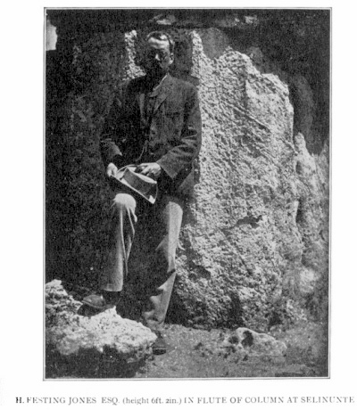
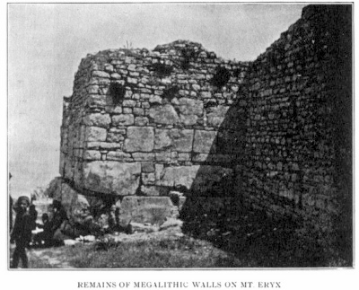

> 特洛伊史詩叢書 v2.0.0｜中文譯文與編輯文字：CC BY-NC-SA 4.0；英文原文與原書圖版屬公版（見 LICENSE-CONTENT.md、NOTICE.md）
[← 分章目錄](../README.md)　｜　[全書](../../中文好讀版_附原文.md)

## 第十章

<!-- U1010 -->
關於奧德修斯航程的進一步細節，以證實其航程主要是一趟以埃律克斯山與特拉帕尼為起點和終點的環西西里航行

<!-- U1011 -->
前一章所說的，應足以確立奧德修斯所走的航線就是我地圖上標示的那一條；不過關於庫克羅普斯人、埃俄羅斯島周圍的城牆、塞壬、漂移之岩，以及與航程有關的其他事項，我還有些話要說；為了讓整體輪廓更寬廣、更簡明，我先把它們保留下來。

<!-- U1012 -->
庫克羅普斯人住在埃律克斯山，這是我最有責任證實的一點，因為只要這一點獲得承認，再把斯庫拉與卡律布狄斯以及斯刻里亞都當作已經找到，其他地點便都會自然而然地落到我為它們標定的位置上，我不擔心會有什麼爭議。那麼，讓我們轉向法維尼亞納，姑且接受它就是奧德修斯獵山羊的那座島。

<!-- U1013 -->
我不禁納悶：作者為什麼那麼用心地召來一片濃重的黑暗，寫得那樣堂皇而詳盡，還藉神明之助把奧德修斯領進這座島的港口，而不讓他四處張望，看看那片「並不很遠」的陸地呢？

<!-- U1014 -->
答案其實「並不很遠」，一找就到。如果奧德修斯從食蓮人之地駛近時看到了西西里本土，他一定會沿著海岸一路走下去，那樣他就會被直接帶進特拉帕尼港。而雖然所有聽眾都知道，作者早已把特拉帕尼處理成奧德修斯整個航程的最後一站，奧德修斯本人卻不該在按部就班抵達之前，就對它有所知曉。

<!-- U1015 -->
波呂斐摩斯的洞穴──農民至今仍稱之為 *la grotta di Polifemo*（波呂斐摩斯洞）──位於特拉帕尼以北約六七英里處；奧德修斯必須被帶到那裡，而且可能的話，不能讓他看到一座八年後他將認得是斯刻里亞的城市，以免攪亂他自己或聽眾的心思。藉著一點霧氣，可以勉強設想他從法維尼亞納島前往皮佐隆戈岬與波呂斐摩斯的洞穴，而沒看見費埃克斯人的城市──只要他不特別使勁往那個方向看；但如果讓他一路駛到斯刻里亞的港口，即使是奧德修斯，也不得不注意到它。因此，最好讓某位神明把他帶到那座島，而完全不讓他看到任何其他陸地；這就是作者如此用心描寫那片濃黑的緣故。我們將會看到，後來（就故事設定的時間而言；在她詩的結構上則較早）她在完全相同的地方、出於相同的理由，又召來一片黑暗，讓奧德修斯完全無法判斷自己身在何處（卷五 291–294 行）──因為在那裡，同樣必須讓奧德修斯從特拉帕尼以南某處，到達城北另一處，而不看見這座城鎮。

<!-- U1016 -->
把我那張埃加迪群島地圖（第 177 頁）和特拉帕尼與埃律克斯山地圖（第 164 頁）合起來看，就能看出奧德修斯從法維尼亞納到 *Grotta di Polifemo*（波呂斐摩斯洞）會走的路線──這是特拉帕尼附近最大的洞穴，比其他洞穴大得多，至今仍用來在夜裡圈養一大群綿羊。波呂斐摩斯擲出的兩塊巨石，應當看作：第一塊是阿西內利[^14-1]，第二塊是名為福爾米凱的兩座小島，由於兩島緊挨在一起，算作一塊。

<!-- U1017 -->
因此，我在防止奧德修斯看見特拉帕尼的這份用心中，找到了一個相當有力的論據，支持這樣的看法：法維尼亞納就是奧德修斯獵山羊的島，而波呂斐摩斯的洞穴位於埃律克斯山。

<!-- U1018 -->
另有一項跡象，雖然力道不大，似乎也暗示庫克羅普斯人當時仍是費埃克斯人的近鄰。

<!-- U1019 -->
在卷六開頭，我們得知費埃克斯人過去住在一個叫許珀瑞亞的地方，「靠近無法無天的庫克羅普斯人」，但近年已遷到斯刻里亞──正如我說過的，斯刻里亞的意思是「日德蘭」。在一段我的縮譯沒有收入的文字中，阿爾基諾俄斯隨口說道（卷七 205、206 行），費埃克斯人與眾神的親緣，就和庫克羅普斯人及巨人族一樣近。且不說阿爾基諾俄斯身為波賽頓的孫子，算是波呂斐摩斯的半個姪子；庫克羅普斯人如此自然地浮上他的心頭，表示他們雖然不像從前那麼近，大概仍是他最近的鄰居。

<!-- U1020 -->
巨人族不過是庫克羅普斯人換個說法，無疑就是建造埃律克斯那些雄偉巨石城牆的人的後裔。許珀瑞亞，即「上城」，大概位於埃律克斯山頂的東端；那裡至今仍可追尋到一道極古老的城牆，性質與山西端西卡尼城市的城牆完全不同。這道城牆的遺跡就在 *Ruccazzù dei Corvi*（烏鴉岩）上方，位於佩波利伯爵的園地內，最初是伯爵本人指給我看的。外地人除非由見過的人帶路，否則不太可能找得到。

<!-- U1021 -->
關於許珀瑞亞，我要重申：西西里境內的地名，除了一個部分的例外之外，全是虛構的，連特里納克里亞也是──修昔底德告訴我們，那是西西里最古老的名字──它變成了「特里納基亞」島，即「三尖」島；然而一出了西西里，地名便都是真實的。這讓人有理由認為，作者描寫的是真實的人物與真實的地方，只是用一層她知道聽眾一眼就能看穿的薄薄偽裝，把他們改頭換面。面具只摘下過一次，而且只有片刻：奧德修斯說他剛從西卡尼亞來（卷二十四 307 行）；但這不算數，因為奧德修斯這時被設定是在說謊。

<!-- U1022 -->
舉例來說，庫克羅普斯人（Cyclopes）這個名字，也就是「圓臉」──這個字本身看不出還有任何別的意思，而我從利德爾與斯科特的辭典中看到，巴門尼德把月亮稱為 Cyclops──不過是作者取的綽號。如果 μήλωψ 意為「蘋果臉」，κύκλωψ 就該是「圓圈臉」。這個字本身沒有任何暗示，《奧德賽》裡也沒有任何暗示，說庫克羅普斯人是額頭中央只有一隻圓眼的民族。這樣顯著的特徵，不可能不言自明[^14-2]；而在最早的希臘藝術家眼中，它也並非不言自明，從他們總是給波呂斐摩斯畫兩隻眼睛就看得出來。要到羅馬時代，他才變成獨眼；而《奧德賽》給他的眉毛是複數（卷九 389 行），這就意味著眼睛也是複數。誠然，作者只弄瞎了一隻眼睛，但她可以指望如此嚴重的傷勢在另一隻眼睛引起交感性發炎，並認為燒烤了其中一隻，就足以讓兩隻都瞎掉。之所以只弄瞎一隻眼睛，不是因為波呂斐摩斯沒有兩隻眼，而是因為他那根木樁沒有兩個尖頭；作者既想不出怎麼把一件分叉的工具弄進洞裡，也想不出在這麼多人已被吃掉之後，剩下的人要怎麼揮舞它。

<!-- U1023 -->
所以我們可以確定，「庫克羅普斯人」的意思不過是「月亮臉」。波呂斐摩斯這個名字，在《伊里亞德》中是一位英雄的名字，或許是從那部詩借來，作為當地巨人（如果有的話）的化名。無論他原本叫什麼名字，也無論他是《奧德賽》之前就有的巨人，還是《奧德賽》的作者讓他誕生的，他如今以孔圖拉諾之名存在。我有時會想，這個名字會不會與希臘字 κόντος（長竿）和 οὐρανός（天空）有關，表示這個巨人高到能用他的手杖在天上戳個洞。果真如此，他在《奧德賽》的時代很可能就叫孔圖拉諾，或類似的名字，而奧德修斯弄瞎他所用的，正是他自己名字裡紀念的那根 κόντος。自《奧德賽》寫成以來，這個巨人已長大許多，*grotta di Polifemo*（波呂斐摩斯洞）再大，他也絕對擠不進去；因為他雙腳踩在平原上，肚子撐在埃律克斯山頂，身子前傾，把巨大的雙手伸進博納賈與科法諾之間的海裡捉鮪魚。有人打擾他時，他就從埃律克斯山頂扯下大石塊，朝所有打擾他的人砸去。

<!-- U1024 -->
重複並總結一下──這一點我不再多辯了：我認為庫克羅普斯人是埃律克斯山古老西卡尼居民被征服後的殘餘。他們之所以身材巨大，是因為他們在埃律克斯山上築城所用的石塊巨大無比。這些石塊幾乎看不出用硬化青銅或鐵製工具加工過的痕跡，只有腓尼基人局部重建城牆時，可能在這裡那裡修整過；腓尼基人重建時，部分是從頭（*de novo*）砌起，所用的石塊有些刻著腓尼基文字的採石工標記。[^14-3]古老的西卡尼工程有很大一部分被保留了下來，屬於真正的巨石時代，那時搬運比切割便宜；後來的世代沒有考慮到改良的切割方法帶來了怎樣的革命，便推論說用這麼大的石塊築城的人必定是大個子，其實他們只是精打細算的人。

<!-- U1025 -->
一旦切割變得比搬運便宜，我們在埃律克斯、切法盧，以及塞尼、阿爾皮諾、阿拉特里和南義大利許多其他城市看到的那些笨重巨塊，就過時了；但要等到砌層的種種不規則完全被拋棄、換成我們在敘拉古、塞利努斯、塞傑斯塔神廟以及歷史時期幾乎所有希臘與羅馬建築中所見的那種完美規則，還要經過很長的時間。事實上，我知道許多晚至西元十世紀的建築，砌層仍遠不規則；然而，幾乎就在切割變得較便宜之後，趨勢便是朝向砌層更規則、石塊更小，直到另一種巨石主義興起，與早期建造者的巨石主義截然相反──我指的是炫耀的巨石主義。

<!-- U1026 -->

*圖版 15：H．費斯廷．瓊斯先生（身高 6 英尺 2 英寸）站在塞利努斯的石柱凹槽中。*

<!-- U1027 -->

*圖版 16：埃律克斯山上的巨石城牆遺跡。*

<!-- U1028 -->
塞利努斯有些用於西元前五世紀建築的石塊，比埃律克斯或切法盧最大的石塊還大；那裡有些石柱底部直徑十三英尺，我的朋友 H．F．瓊斯先生能站進柱子的凹槽裡；然而這些石頭上，用清晰卻看不見的字體寫滿了「榮耀」一詞，而埃律克斯的石頭上，則同樣清楚地寫著「節約」。我認為，任何真正未經金屬工具加工的巨石多邊形城牆，年代都不可能比西元前 2000 年晚很多。等到邁錫尼的阿特柔斯寶庫，或希沙利克那道《伊里亞德》時代的城牆（不過後者的砌層遠不如前者規則）這樣的建築出現時，切割──無論是用硬化青銅的鑿子，或者更可能在那時已經用鐵──已不再費事；然而，直到赫西俄德的時代──一般認為他不早於西元前 1000 年──人們仍未忘記那個「黝黑的鐵尚未出現」的時代。（《工作與時日》148–151 行。）

<!-- U1029 -->
此外，我想請讀者留意，《奧德賽》對庫克羅普斯人的描述，與 1892 年 9 月 24 日《泰晤士報》刊載的現代西西里土匪的描述，吻合得何等緊密。

<!-- U1030 -->
撰文者──斯蒂甘德先生──寫道：

<!-- U1031 -->
> 聖毛羅（S. Mauro）是土匪的大本營，是一座位於三千英尺高山頂上的城鎮，望得見傑拉奇西庫洛──另一座高度差不多的城鎮──以及同樣位於另一座山頂的波利納。山間連接這些城鎮的道路，只是騾子走的小徑。群山之中洞穴遍布，只有土匪和牧人知道。

<!-- U1032 -->
《奧德賽》這樣描述庫克羅普斯人：

<!-- U1033 -->
> 他們既沒有議事的集會，也沒有法律，而是住在高山頂上的洞穴裡；每個人管自己的妻子兒女，對別人一概不理（卷九 112–115 行）。

<!-- U1034 -->
我在特拉帕尼以北約十五英里的科法諾山上，一個叫 *le grotte degli Scurati*（斯庫拉蒂洞穴）的地方，見過好幾戶穴居人家。不過，他們身上毫無庫克羅普斯的氣息。他們的洞穴乾淨極了，舒適程度不輸英國最好的農舍。這些人非常親切好客，膚色偏白而不偏黑，說是英國人也完全過得去。我們從特拉帕尼帶了午餐，他們為我們拿出雪白的桌布和餐巾，還給了我們數不清的杏仁，用一點鹽和奶油炒過；最出人意料的是，他們拿來的鹽裡摻了細葉芹籽。在我們野餐大約兩週之後，科法諾發生了一起駭人的綁架案。一名巴勒莫商人被扣在山上整整一個月，直到付了贖金才獲釋；但我確信，我們那些穴居人與此事無關。這些洞穴留有史前人類的痕跡，是一些如今已經石化的古代餐食殘跡。

<!-- U1035 -->
值得注意的是，σπέος 或 ἄντρον（洞穴）這兩個字的各種形式，在《奧德賽》中出現四十五次，在《伊里亞德》中卻只有六次；考慮到後者篇幅較長，比例大約是 10 比 1。因此我們可以推測，《奧德賽》出自一個洞穴遍布的地區。

<!-- U1036 -->
至於《奧德賽》作者告訴我們環繞埃俄羅斯島的那道「青銅城牆」，很難說究竟是不是純屬虛構。我們可以確定，它並非真是青銅造的，正如埃俄羅斯並非真是風之王；不過，在馬雷蒂莫島四周，凡是懸崖未能天然屏護之處，都曾有一道遠在《奧德賽》之前就建成的城牆；泰德斯科先生與斯帕達羅教授帶我看了它的遺跡，要不是他們幫忙，我是不會注意到的。我有時會想，作者會不會把這道城牆移到了烏斯蒂卡，就像我們後面將看到的，她把忒耳西忒斯背上的駝峰移到了歐律巴特斯的背上；但就我所知，烏斯蒂卡上並沒有這樣一道城牆的遺跡，法維尼亞納島或萊萬佐島上也沒有。馬雷蒂莫的古名是希耶拉；在海拔約 1,900 英尺處，有人帶我看了一片小台地上極為古老的城牆廢墟（並不醒目）；居民夜裡不敢穿越那片台地，據信那裡就是那個讓此島得名的祭祀所在之地。

<!-- U1037 -->
我對喀耳刻之島要說的話，推測成分太重，寫的時候不免戰戰兢兢。我注意到，喀耳刻的住所和歐邁俄斯的養豬場一樣，「位於從遠處就看得見的地方」（卷十 211 行）；我也注意到，奧德修斯是「越過山頂」去接近它的（卷十 281 行），正如他走近歐邁俄斯的小屋時一樣（卷十四 2 行）。我記得那些豬，於是忍不住想：雖然作者一開始告訴我們這座島地勢低平（卷十 196 行），但她終究擺脫不了自己身邊的環境，不知不覺地漂向埃律克斯山頂與歐邁俄斯的養豬場。她起初並不打算寫豬──從前被喀耳刻施法的人，變成的是狼和獅子──但聯想的力量太強，奧德修斯的同伴終究還是被變成了豬。

<!-- U1038 -->
讓厄爾佩諾爾從喀耳刻的屋頂上摔下來，是一種非常奇特的殺死他的方式。如果他是在歐邁俄斯的小屋，她讓他從小屋上方的懸崖跌落，就是再自然不過的殺法了；後來的時代，阿芙蘿黛蒂的神廟就矗立在那座懸崖頂上。我懷疑──說來不無慚愧──喀耳刻屋子的牆，是被拿來充當這座懸崖的。

<!-- U1039 -->
在利帕里群島中的帕納雷阿島（古稱厄諾倪摩斯）上，有一個小海灣叫 La Caletta dei Zummari（祖馬里小灣），令人聯想到 Cimmerii（基墨里安人）的訛音；不過我已經說明過，不應試圖為冥府之行定出地點。

<!-- U1040 -->
兩位塞壬可以──我得說──很有把握地安置在薩利納島上；此島古稱狄迪墨，得名於構成全島的兩座高山，每座高約三千英尺。在地中海這一帶，突如其來、極其猛烈的陣風，不時會從海邊所有的高處撲下來，例如特拉帕尼附近的科法諾，當地漁民之間就有一句俗話：「當心科法諾。」我的朋友 E．比亞吉尼先生──我不得不哀悼他在這十二個月內辭世──一再為我提供地方上的細節；他告訴我，有一次他幾乎被一陣從科法諾撲下的狂風掀翻，那陣風在天氣完全平靜時突然撲向他的船，只持續了短短幾秒。我認為，那兩位塞壬──在較早的希臘藝術表現中總是生有翅膀──正如她們的名字所暗示的，就是那些毫無預兆、從狄迪墨兩座山上撲下的呼嘯陣風，或者說空氣的雪崩。把這故事從詩翻成散文，意思就是：「靠近狄迪墨那兩座險惡山峰的人有禍了；海岸上散滿了船隻殘骸，他若聽見從山上吹下的風在他的索具間尖嘯，他的骨頭就要在岸上曬白。」讀者會記得，塞壬的島離喀耳刻的島非常近。

<!-- U1041 -->
談到埃俄利斯群島時，史邁思海軍上將說：

<!-- U1042 -->
> 無論是由於火山溫泉使海水變熱、武爾卡內洛的蒸氣、斯特龍博利不斷噴出的熱氣，還是這一切再加上一般的氣溫，可以確定的是，這一群島的天氣變化比鄰近地區更頻繁（《地中海》，帕克出版，1854 年，第 250 頁）。

<!-- U1043 -->
他談到墨西拿海峽時又說：

<!-- U1044 -->
> 也應提防猛烈的陣風；由於海岸多山，這些陣風有時會順著急流河床（Fuimare）直衝而下，對小船十分危險。我曾兩度痛心地目睹，忽視這些陣風的人因此喪命（《西西里及其島嶼》，默里出版，1824 年，第 111 頁）。

<!-- U1045 -->
這位女詩人之所以在漂移之岩上遇到這樣的困難，是因為正如布特曼所說，這個故事並不是指哪兩座特定的島，而是源自旅人講述利帕里群島整體航行之難的傳聞。據說：「它們一座接一座逼攏過來，快得連一隻鳥都幾乎飛不過去。」此外，「火的狂風」（卷十二 68 行）暗示是在影射埃俄利斯群島普遍的火山性質。斯庫拉岩頂那片無論夏冬都不散去的烏雲（卷十二 74 行），就更是如此了。

<!-- U1046 -->
斯庫拉與卡律布狄斯的恐怖，和塞壬、漂移之岩一樣，是以同樣的詩意筆調誇大的。兩者之間根本不可能一箭射到，實際上相距約八英里。對一篇告訴我們有個怪物生著六個頭、三排牙齒的敘事，我們不該期望它有默里先生旅遊手冊那樣的精確。只要有幾粒真實就夠了，而這些真實確實存在：斯庫拉是一塊面向西方的高岩，卡律布狄斯則是（就那個時代而言）一個可怕的漩渦，位於海峽另一側、地勢較低的岸外，靠近通往一座「三尖」島的入口。根據史邁思海軍上將的說法，它就在墨西拿港外，現在叫作加洛法羅。史邁思海軍上將這樣描述它：

<!-- U1047 -->
> 對雷吉翁人、洛克里斯人、贊克勒人與希臘人那些沒有甲板的船來說，它必定十分可怕，因為即使在今天，小船有時仍會遭它威脅；我也曾見過好幾艘軍艦，甚至一艘七十四門砲的戰艦，在它的水面上被捲得團團轉；不過只要謹慎從事，一般說來並沒有什麼危險或不便需要擔心（《西西里及其島嶼》，默里出版，1824 年，第 123 頁）。

<!-- U1048 -->
我毫不懷疑，加洛法羅就是卡律布狄斯故事凝聚而成的核心，但我在整個墨西拿海峽都見過海面相當大的擾動。這在很大程度上取決於風的情況：風有時會把海水堆積在義大利腳尖與西西里北岸之間的角落，於是墨西拿海峽便出現一股海流和強烈的漩渦。其他時候則幾乎看不出什麼。

<!-- U1049 -->
奧德修斯在海上漂流九天，從卡律布狄斯被帶到卡呂普索的島，也就是潘泰萊里亞──我們可以確定，如果作者敢讓他再久一點不吃不喝，一定會讓他花更長的時間──這段且不談；我只剩下要把從潘泰萊里亞到特拉帕尼的航程，比先前更詳細一點地處理一下。奧德修斯離開潘泰萊里亞後的第十八天，朝著大熊星座航行，但讓它保持在左手邊，望見利呂拜翁海岸那條又長又低的線在天際升起。他似乎沒有看到法維尼亞納島，那座島想必就在近處；他沒看到或許倒好，因為他幾乎不可能認不出，這就是他八九年前獵山羊的那座島，而這可能會讓他困惑。

<!-- U1050 -->
不過，雖然允許他看到陸地，卻不能允許他沿著海岸走，否則，正如我已經解釋過的，他就會直接駛進斯刻里亞的港口；而作者特意要他在城的北邊遇見瑙西卡，並且在瑙西卡帶他進城之前，對斯刻里亞一無所知。因此，作者讓波賽頓恰在此刻瞥見他，掀起一場可怕的風暴；海天被雲層遮蔽，黑得如同夜晚（卷五 291–294 行），奧德修斯就這樣被帶到很遠的地方，看來是往北，因為等他被帶得夠遠了，雅典娜便讓北風吹送他兩天兩夜，也就是往南吹，直到他抵達那個可以讓瑙西卡遇見他的港口附近。

<!-- U1051 -->
《奧德賽》裡再沒有其他如此引人注意的黑暗，除了這一次和卷九 144 行那一次（第 188 頁已提過）。兩者發生在同一地方，出於同一理由──把斯刻里亞城保留到後面。

<!-- U1052 -->
現在我已經證明，《奧德賽》中所有伊薩卡的場景，都極其忠實地取材自特拉帕尼及其近郊，斯刻里亞的場景也全都如此；此外，我也證明了愛奧尼亞群島其實取材自特拉帕尼外海的埃加迪群島；最後，我證明了奧德修斯的航程實際上始於特拉帕尼，又終於特拉帕尼。至於皮洛斯與拉刻代蒙，我只需指出它們遠在作者與聽眾的知識範圍之外，不必多談。

<!-- U1053 -->
兩處都沒有提到任何一項自然地貌。忒勒馬科斯與佩西斯特拉托斯乘一輛雙馬戰車，從費拉伊到拉刻代蒙，越過高峻、至今仍無道路的塔宇革托斯山脈──這段不可能的旅程，作者寫來毫無不安。她完全沒有暗示有山要翻越──由此我們可以推斷：要嘛她對皮洛斯與拉刻代蒙之間的地方一無所知，要嘛至少她的聽眾一無所知。不過，或許值得一提的是，雅典娜為了把忒勒馬科斯從伊薩卡送到皮洛斯而提供的西風，更適合把他從西西里送去。如果他是從真正的伊薩卡出發，北風會對他更有利；但雅典娜行事如此古怪，這一點我不打算深究。

<!-- U1054 -->
[^14-1]: 阿西內利（Asinelli）是一座單獨的小島，形狀很像一艘直朝法維尼亞納駛去的船。它沒有任何複數的成分，看不出為什麼要用複數的名字。那些「驢子」或「傻瓜」到底是誰？

<!-- U1055 -->
[^14-2]: 維吉爾可沒有放過這一點。他寫道：

<!-- U1056 -->
    「Cernimus adstantes nequidquam lumine torvo Ætnæos fratres,....」（我們看見他們站在那裡，目光兇狠卻無可奈何，那些埃特納的兄弟……）《埃涅阿斯紀》卷三 667、678 行。

<!-- U1057 -->
    他稱庫克羅普斯人為「埃特納的」，因為他把他們安置在埃特納山上。

<!-- U1058 -->
[^14-3]: 我插圖中所示的那座稜堡裡沒有任何腓尼基工程，這裡的修補是中世紀的。

<!-- U1059 -->
