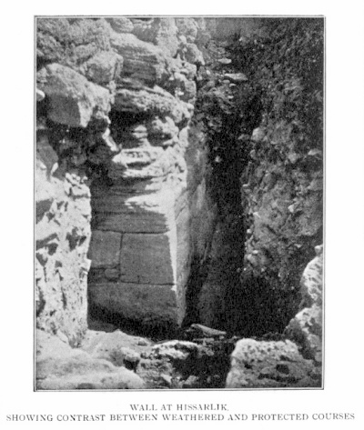
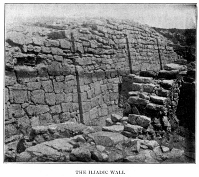

> 特洛伊史詩叢書 v2.0.0｜中文譯文與編輯文字：CC BY-NC-SA 4.0；英文原文與原書圖版屬公版（見 LICENSE-CONTENT.md、NOTICE.md）
[← 分章目錄](../README.md)　｜　[全書](../../中文好讀版_附原文.md)

## 第十二章

<!-- U1088 -->
這部詩的年代，並比較《奧德賽》所呈現的西西里西北部狀況，與修昔底德對同一地區已知最早時代的記述

<!-- U1089 -->
認定《奧德賽》寫於特拉帕尼，將為這部詩的年代問題投下意想不到的光。我們永遠無法把它的年代確定在一百年左右的範圍之內，但我將試著說明：我們必須把它定在不晚於西元前 1050 年──即使晚，也晚不了多少──而且不早於西元前 1150 年。

<!-- U1090 -->
我發現，我可以援引傑布教授的權威，至少在某種程度上支持這兩個年代中較晚的那一個。他寫道：

<!-- U1091 -->
> 至於《奧德賽》的年代，我們可以假定，最初的「歸返」早在西元前十一世紀便已在希臘本土寫成，而第一次擴充則在西元前 850 年以前完成。[^16-1]

<!-- U1092 -->
我已經說明過，我為什麼不能承認《奧德賽》有任何部分寫於希臘本土；而且，儘管我承認這部詩顯然經過擴充，加上了卷一至卷四，以及卷十三 187 行至卷二十四──這一點我將在後面一章詳細討論──我卻不認為擴充出自別人之手，而認為出自這部詩原始形態的那位女作者本人。儘管如此，傑布教授的支持就其所及而言，我仍樂於援引，用來把《奧德賽》的起始定在西元前十一世紀。

<!-- U1093 -->
我先說明，為什麼我認為《奧德賽》無論如何必定早於西元前 734 年。

<!-- U1094 -->
歐邁俄斯向奧德修斯講述自己的童年時（卷十五 403 行等處），說他出生在俄爾提基亞對面的「敘里埃的島」（the Syrian island），而我把它譯成「敘里埃島」（the island of Syra），依據的是「普緒里埃的島」（卷三 171 行）的類比──那無疑是指普緒里埃島。

<!-- U1095 -->
一座敘里埃島與一塊陸地俄爾提基亞連在一起，令人聯想到敘拉古；儘管事實上俄爾提基亞是一座島，而敘拉古既在島上，也在毗鄰的大陸上──因為，正如我已經說過太多次的，《奧德賽》中所有的西西里地方都經過喬裝，不管喬裝得多麼單薄。

<!-- U1096 -->
我們接著讀到，「太陽的轉向」就在「那裡」──我想這可以引申為「那一帶」──於是，詩中暗指的是敘拉古[^16-2]這個印象就更深了。那麼，什麼是「太陽的轉向」？我查了利德爾與斯科特的辭典──對於他們的成果，沒有人能比我懷有更衷心的敬佩、更深切的感激──發現太陽的轉向是「至日，或回歸點，*i.e*.（即）仲夏與仲冬的轉折點」。就時間而言，這也許說得通，就地點而言卻不然。關於《奧德賽》這一段，我讀到的是：「太陽的轉向表示天空中的某一點，大概在西方。」

<!-- U1097 -->
可是，我們要的不是太陽在天空中的某一點轉向，而是在敘里埃和俄爾提基亞附近轉向，而且是以一種在別處不會出現的方式轉向。要達到這個目的，最簡單的辦法是假定：《奧德賽》的作者採用了一種我們搭火車旅行時常用的說法──我們說太陽轉過去了，現在從另一邊的窗子照進來──意思是鐵路轉了一個急彎，我們正朝新的方向前進。作者的意思無非是：在這兩個地方附近，陸地急轉了一個彎，因此沿著海岸航行的水手會發現，太陽換到了船的另一側，不再是先前那一側；我這樣想，想必沒有錯吧。

<!-- U1098 -->
看一眼地圖就會明白：敘里埃與俄爾提基亞的組合所暗示的地點，可以由一個事實得到證實──就在它南邊不遠處，西西里的海岸陡然轉向，此後便朝新的方向延伸。其實，從普勒繆里翁岬角本身開始，海岸就已經急遽轉彎了。因此，應當把歐邁俄斯的話理解為：他出生在我們所知的敘拉古；而據他說，那裡當時是兩座小城的集合，居民不多。那似乎是個安靜悠閒的小地方，人人有足夠的吃喝，除了壽終正寢，沒有人會死，各種疾病一概不知。那裡做生意想必非常從容不迫，因為腓尼基人花了整整一年才把船裝滿貨，而那個時代最大的船，也大不到哪裡去。

<!-- U1099 -->
這不是一個繁忙的新建聚落的寫照，而西元前 734 年的敘拉古正會是那樣的聚落。這番描寫更不適用於敘拉古後來的任何時代。作者處理更早的時代時，像莎士比亞一樣坦然地把它現代化：我從未在她身上察覺任何一絲考古的本能。因此我相信，她說的是她對自己那個時代的敘拉古所知的一點點，而那個時代早於科林斯殖民者的到來。我也認為很可能，她之所以讓歐邁俄斯來自敘拉古，是因為她覺得在奧德修斯的航程中，自己多少應該在敘拉古安排點什麼，可是在那種情形下，又不好在卡律布狄斯與卡呂普索的島之間打斷他的旅程。於是，她用了另一種方式把敘拉古帶進她的故事。

<!-- U1100 -->
也許有人會主張：除了科林斯人建立的那個文明之外，我們沒有其他證據顯示敘拉古曾存在過任何相當程度的文明；就文字證據而言，這話沒錯，至少就我所知是如此；但我們有一種更具決定性的非文字證據。在敘拉古或其近郊發現的陶器與器具遺物，從羅馬時代以後一路不間斷地上溯到石器時代；而無數墓葬中出土器物的形制與材質，顯示至少從邁錫尼時代起，這裡就和伯羅奔尼撒有貿易往來。我有幸由奧爾西博士陪同參觀敘拉古博物館；在與西西里最早期歷史有關的一切問題上，沒有比他更審慎、更勝任的嚮導了；他一再強調，西西里東南岸──其實是整個東岸──與伯羅奔尼撒之間必定早已存在貿易，而那個年代是何等久遠。因此，那種人們罔顧修昔底德本人的說法、卻仍過於普遍地為人抱持的看法，認為在科林斯人到來以前，敘拉古或其附近沒有人居住，必須放棄；而我相信，我們可以確信，在歐邁俄斯的故事裡，我們得以一窺它在科林斯人以前的時代的情形。

<!-- U1101 -->
歐邁俄斯告訴我們的那兩個聚落，大概一個在普勒繆里翁岬角上，另一個在相距三、四英里的地方，今名科佐潘塔諾；奧爾西博士在這兩處遺址各發現了一個大型村落或城鎮──*borgo*（村鎮）──的墓地，並且在他注意到《奧德賽》中提到史前敘拉古之前，就已經把它們定年為西元前十二至十一世紀。在這兩處遺址出土的器具，有許多樣本可以在敘拉古博物館看到。據我所知，在敘拉古或緊鄰敘拉古的地方，並沒有發現其他史前墓地。

<!-- U1102 -->
在上述地點留下墓地的人，究竟是後來被西克洛伊人取代的希臘人──正如西克洛伊人後來又被科林斯人取代──還是某一波更早、未見記載的移民潮中的西克洛伊人，這得留給奧爾西博士和其他人去判定；不過，沖刷西西里東岸的那片海的名稱（愛奧尼亞海），顯示東西西里沿岸曾經有過廣大的愛奧尼亞人聚落。再者，Aci 這個名稱──見於 *Aci reale*（阿奇雷亞萊）、*Aci Castello*（阿奇卡斯泰洛）和 *Aci trezza*（阿奇特雷扎），而且在平民口中如今總是念作 Iaci（伊阿奇）──暗示它有一個遙遠的愛奧尼亞源頭；因為我們可以假定，西元前 734 年以後，並沒有哪一次愛奧尼亞移民重要到足以讓西西里的海域、城鎮和島嶼以「愛奧尼亞」為名。讀者在下一章會再次想起：Ἰακός 的意思是「愛奧尼亞的」。

<!-- U1103 -->
歐邁俄斯被拐走時年紀還很小，所以即使希臘語不是他的母語，幾年之內他也會變成希臘人了；不過我傾向於認為，假如《奧德賽》的作者心裡把他設想成西克洛伊人，她總會說點什麼。她似乎認為他生來就是希臘人。

<!-- U1104 -->
不過，西克洛伊人大概也說希臘語。位於義大利腳尖的忒墨塞，那裡的居民似乎確實不說希臘語（《奧德賽》卷一 183 行）；但我們並不知道他們是西克洛伊人。在普勒繆里翁和科佐潘塔諾都沒有發現任何文字；因此，我們可以依據的東西非常少。

<!-- U1105 -->
不過，修昔底德對敘拉古細節的準確，證明他即使不曾親身到過敘拉古，至少也有辦法掌握西西里歷史的資訊；他顯然下過功夫，而他的聲譽也沒有任何一位史家能夠超越──假如我們可以接受他的說法（卷六第 2 章），即那場使這個國家從西卡尼亞（Sicania）改名為西西里（Sicelia）的西克洛伊人大舉入侵，發生在西元前 734 年之前約 300 年，那麼，我想我們可以放心地把《奧德賽》的年代往前推到西元前 1000 年以前。

<!-- U1106 -->
因為《奧德賽》完全沒有給人一種印象，彷彿整個西西里不久前才被西克洛伊人征服、蹂躪。就局部而言，埃律克斯山頂的那座城市確實曾被征服、推翻，這我們已經看過（《奧德賽》卷七 60 行）；但我將援引修昔底德以及其他證據來說明，在這件事上，勝利者比較可能是亞洲的希臘人，而不是西克洛伊人。這部詩顯示的是一個當下深沉太平、無所憂懼的時代；而作者唯一一次用西西里自己的名字稱呼它時，用的是它在西克洛伊人以前的名稱：西卡尼亞。[^16-3]那位服侍拉厄爾特斯的西克洛伊老婦人（卷二十四 211 行及他處），詩中提到她時，既看不出作者對西克洛伊人有任何惡感，也看不出他們是統治民族。最後，求婚者之一（卷二十 382 行）勸忒勒馬科斯把忒俄克呂墨諾斯和奧德修斯裝上船，送到西克洛伊人那裡去。如果作者心裡想的是真正的伊薩卡，那麼不論西克洛伊人在義大利還是在西西里，都只能走海路才到得了；可是我已經說明過，她除了她在特拉帕尼創造出來的那個伊薩卡之外，從未設想過任何別的伊薩卡；因此，忒俄克呂墨諾斯和奧德修斯得先上船才能到達西克洛伊人那裡，這個事實顯示，她設想中的西克洛伊人（偶爾移入的人除外）是在她自己這座島的範圍之外。

<!-- U1107 -->
前面的推理若被接受，那麼西元前 1050 年，大約就是《奧德賽》年代最晚可以穩妥設定的時間；再晚幾年也有可能，但我認為不大可能。不幸的是，這個年代將迫使我們把特洛伊的陷落，移到比公認年代早得多的時候。因為，人們會以為，《奧德賽》與《伊里亞德》之間，至少得隔上一百年。神話與史詩系列的發展，在《奧德賽》中留下了大量痕跡，其規模之大，使任何更短的間隔都不大可能。因此我得出結論：西元前 1150 年是我們應該為《伊里亞德》設定的最晚年代。

<!-- U1108 -->
通常公認的特洛伊陷落年代是西元前 1184 年。這是根據修昔底德的一段話（卷一第 12 章）推算出來的：他說特洛伊陷落六十年後，皮奧提亞人被逐出阿爾涅，定居在原名卡德墨伊斯、後來稱為皮奧提亞的地方。他告訴我們，再過二十年，多利安人和赫拉克勒斯後裔成了伯羅奔尼撒的主人；可是，他既沒有確定這後一個年代──大概是因為他無法確定──所以也沒有確定特洛伊陷落的年代。

<!-- U1109 -->
赫拉克勒斯後裔回歸並征服伯羅奔尼撒，一般接受的年代是 1104 年，[^16-4]但翻閱繆勒《多利安族史》[^16-5]第一卷第 53 頁的人就會看到，這個年代沒有任何值得考慮片刻的根據；而這裡的根據一旦落空，以西元前 1184 年為特洛伊陷落的年代，就完全沒有根據了。

<!-- U1110 -->
姑且承認西元前 1150 年是我們應該為《伊里亞德》設定的最晚年代，問題就來了：荷馬寫作的時間比特洛伊陷落晚了多久？格萊斯頓先生曾非常有力地論證一種看法：荷馬寫作時，距他所記述的事件只有四、五十年；照這樣看來，格萊斯頓先生為《伊里亞德》所定的年代，似乎不會比我所定的最晚年代晚多少，因為他看來並不質疑公認的特洛伊陷落年代，雖然他也沒說他接受這個年代。我若能在這一點上援引格萊斯頓先生的支持，那是再高興不過了，但再進一步，我就不敢指望了；因為《伊里亞德》給我的印象是：荷馬所寫的那個時代，對他來說，大約就像中世紀對我們一樣。

<!-- U1111 -->
假如他真像格萊斯頓先生所設想的那樣，生活在離特洛伊戰爭那麼近的時代，他總該給我們一點暗示，透露特洛伊是怎樣陷落的；然而，除了城已陷落這個光禿禿的事實之外，看不出他知道得更多。他一再告訴我們這一點，但總是比我們預期的更簡短、更乾巴巴；而他對攻陷這座城的經過絕口不提，這就大大證明了：要不是關於 *modus in quo*（陷落方式）的一切記載都已湮滅──這意味著相隔了相當長的時間──就是暗示了一個事實；這個事實，我雖然常常認為有可能，卻幾乎不敢寫出來──我的意思是：特洛伊根本從未陷落，或者至少不是在特洛伊戰爭結束時陷落，而荷馬對此知道得一清二楚。

<!-- U1112 -->
《伊里亞德》的無窮精妙，幾乎和《奧德賽》的單純一樣深不可測──至少《奧德賽》的單純到目前為止已證明是如此。它的作者寫給一群他顯然瞧不起的希臘聽眾，順著他們的心意盡情愚弄他們，卻始終與風向保持足夠的距離，以免翻船；這樣一位作者，會非常小心地告訴他們──請容我用個時代錯置的比喻──拿破崙打贏了滑鐵盧之役，儘管他心裡很清楚，打贏的是威靈頓。可以確定的是，希臘人自己當中，連一個勉強說得過去的特洛伊陷落故事都沒有；一切說得過去的情節，都在他們燒掉營帳、鎩羽揚帆而去時結束了（《奧德賽》卷八 500、501 行）──另見普羅克洛斯殘篇中所載的《小伊里亞德》提要。木馬那個荒誕的故事，只是更突顯了一個事實：人們不知道什麼更合理的說法。

<!-- U1113 -->

*圖版 17：希沙利克的城牆，顯示風化的石層與受到保護的石層之間的對比*

<!-- U1114 -->

*圖版 18：《伊里亞德》中的城牆*

<!-- U1115 -->
不過，讓我們假定特洛伊確實陷落了，而荷馬的沉默，是因為關於它如何陷落的記載已全部失傳。這樣的話，人們會以為，特洛伊陷落與《伊里亞德》寫成之間，必定隔了兩百年，甚至三百年。我們就把這段時間定為和英國議會戰爭到今天的距離一樣長吧。這會把特洛伊戰爭推回到西元前 1400 年左右；而如果我們接受荷馬的說法，即特洛伊的城牆（*i.e*.（即）德普菲爾德博士在 1893 年發掘的那道城牆──它就是《伊里亞德》中的城牆，這一點可以視為確定）是在普里阿摩斯的父親拉俄墨東時代建造的，那麼這道城牆大約應定在西元前 1450 年。我還可以補充一點：在我看來，它的年代比邁錫尼那座所謂的阿特柔斯寶庫略早一些，因此又比冠上克呂泰涅斯特拉之名的那座更早。

<!-- U1116 -->
我從這方面的最新著作[^16-6]得知，德普菲爾德博士把它定在西元前 1500 年到 1000 年之間。我知道，拿遙遠國度的其他城牆來類比，為一道城牆定年，是多麼危險的事，因為那些城牆本身的年代就無法精確確定；不過，我既看過《伊里亞德》中的城牆，也看過提任斯和邁錫尼的城牆，以及拉丁人與沃爾西人城市現存的大部分城牆，我會說，特洛伊的城牆比巨石時代的城牆晚得多，但仍絕未擺脫巨石建築者的傳統。我大致會把它定在不晚於西元前 1300 年、也不大可能早於西元前 1500 年。[^16-7]

<!-- U1117 -->
不過，我將把《伊里亞德》中的城牆定在西元前 1400 年。這樣一來，特洛伊戰爭便應假定發生於西元前 1360 至 1350 年；《伊里亞德》寫於 1150 年左右；《奧德賽》則寫於西元前 1050 年左右。這很勉強，我倒樂意把《伊里亞德》中的城牆推回到德普菲爾德博士所定兩個年代中較早的那一個，可是精確是談不上的；西元前 1400 年大概和我們可能得到的任何年代一樣接近真相，而且能讓下列幾項彼此吻合：由特洛伊城牆可推得的考古證據、《伊里亞德》和《奧德賽》的內證、修昔底德所說西克洛伊人最後也最大的一次入侵發生在西元前 1030 年左右，以及我們關於《奧德賽》寫於這個年代之前的結論。

<!-- U1118 -->
西元前 1050 年這個年代，可以解釋為什麼《奧德賽》完全沒有提到烏提卡──在少數幾個特別的日子裡，從埃律克斯山可以望見烏提卡附近的陸地。《奧德賽》知道腓尼基人，對他們既厭惡又不信任，但看來並不畏懼他們；假如如此強大的航海民族已經在作者住處附近落腳，她一定會畏懼的。說到底，她對腓尼基人似乎所知不多，因為她在卷四 83 行讓墨涅拉俄斯說，他去過塞浦路斯、腓尼基和埃及人那裡，接著在下一行又加上他也去過埃塞俄比亞人和西頓人那裡，彷彿她不知道西頓是腓尼基的城市。

<!-- U1119 -->
忒勒馬科斯從皮洛斯回程時，詩中完全沒有提到奧林匹亞；最自然的解釋是假定奧林匹亞當時還沒有出名。雅典的主要英雄，看來是已知最早的全民崇拜對象，我指的是厄瑞克透斯（卷七 81 行）；較晚、但仍然很早的忒修斯崇拜，則沒有提及。凡是已知發生在西元前 1100 年以後的希臘歷史事件，詩中一件也沒有提到，哪怕是隱約的影射；某一件特定事件沒有提到，固然可以用漠不關心或遺忘來解釋，但完全沒有提到任何事件，我得說，這強烈暗示：那些本可望提到其中某一件的事件，當時都還沒有發生。

<!-- U1120 -->
然而，我雖把西元前 1050 年定為《奧德賽》的最晚界限，卻看不出我們怎能把它定在 1150 年以前，除非把《伊里亞德》城牆的年代推得比我們敢推的更早；因為我們很難把那道城牆定在西元前 1500 年以前，而從那道城牆的建造到《奧德賽》的寫成，350 年已經是我們所能容許的最短間隔了。

<!-- U1121 -->
現在，讓我們把《奧德賽》向我們揭示的西西里西北角的歷史──始終假定卷七中阿爾基諾俄斯和阿瑞忒的家世在主要事實上是史實──與修昔底德關於同一地區最早歷史的記述加以比較。

<!-- U1122 -->
在《奧德賽》中，我們已經看到，西卡尼人（我想我已經充分辨認出他們的身分）原本占有埃律克斯山，由一位在《奧德賽》中名叫歐律墨東的國王統治。看來，大約在《奧德賽》寫成前一百年──這是根據他是瑙西卡的高祖父這一事實所能推得最接近的估計──他被不知名的敵人推翻，他的人民的勢力也被摧毀。

<!-- U1123 -->
《奧德賽》的作者所用的語言以愛奧尼亞方言為主，但含有相當多的埃俄利斯成分。因此必須推斷，她的家人與聽眾──也就是費埃克斯人──說的是一種具有這些特徵的方言。最可能找到這種方言的地方，莫過於特洛阿斯稍南的福凱亞；因為福凱亞是一座愛奧尼亞城市，陸地的各面都被埃俄利斯人的領土完全包圍。我從傑布教授的《荷馬導論》[^16-8]得知，阿里斯塔克斯在編訂《伊里亞德》和《奧德賽》、藉著比對已知最好的抄本，把文本大致確定成我們今天所見的樣子時，最常使用的是馬賽的城邦版，其中同時收有《伊里亞德》和《奧德賽》。大家應當記得，馬賽是福凱亞人的殖民地。

<!-- U1124 -->
「費埃克斯人」這個名稱，作為「福凱亞人」的薄薄偽裝，並非毫無暗示；此外，卷四 441–443 行，如果我們設想那些氣味難聞的海豹（Phocæ）指的是作者顯然厭惡的同胞，而「誰會願意和海怪同床，要是避得開的話？」這句話，是她對費埃克斯年輕人據稱抱怨她誰也不肯嫁（卷六 276 行等處）的反唇相譏，那麼這幾行就會大大增添鋒芒。因此，撇開任何外部證據不談，我會懷疑費埃克斯人就是在島上這一帶定居下來的福凱亞人。[^16-9]從《奧德賽》時代的費埃克斯人顯然不但在特拉帕尼、也在埃律克斯山上居於統治地位這個事實，我推斷：歐律墨東以及西卡尼人在島上這一帶的勢力之所以被推翻，他們至少出了相當大的力。假如他們還有盟友同行，這些盟友似乎已轉往已知有埃利米城市存在的其他地點，因為《奧德賽》中沒有提到有任何其他民族與費埃克斯人共享許珀瑞亞和斯刻里亞。

<!-- U1125 -->
埃律克斯的西卡尼人勢力雖已瓦解，費埃克斯人也在許珀瑞亞立足──同樣在埃律克斯山頂，距西卡尼人的城市不到一英里──但西卡尼人仍是麻煩的鄰居；不過，費埃克斯人中某位首領似乎與老國王歐律墨東的幼女佩里波亞結了婚，這無疑會使兩個民族在某種程度上趨於融合。這樁婚姻的後代瑙西托俄斯，詩中說他是波賽頓所生，我由此推斷，這樁婚姻多少有些不合常規；但毫無疑問，瑙西托俄斯有一位費埃克斯人父親，會說費埃克斯方言，而西卡尼人雖然十之八九是說希臘語的民族，卻不能認為他們也說這種方言。瑙西托俄斯似乎是個能幹的人；他發現那些半淪為亡命之徒的西卡尼人不斷劫掠，仍舊騷擾不休，或許也因為特拉帕尼所在的岬角，比高聳而荒涼的埃律克斯山頂更適合一個航海民族，於是他把族人遷到海邊，建立了如今名為特拉帕尼的城市──不過，他保留了許珀瑞亞舊址作為自己的產業，讓他的豬和山羊在那裡覓食，他的家人也會在盛夏酷熱時上山避暑，正如特拉帕尼人至今仍然這麼做。

<!-- U1126 -->
讀者應該已經注意到，歐邁俄斯──我們絕不可忘記，他取材自埃律克斯山，而不是伊薩卡──夜裡看守豬群時，認為必須全副武裝（卷十四 526 行）。從卷十六 9 行看來，他似乎也有鄰居，由此我們可以推斷，古老的西卡尼城市埃律克斯當時還沒有完全荒廢；不過，要不是西卡尼人和福凱亞人已相當充分地融合，歐邁俄斯根本不會在那裡。西卡尼人在《奧德賽》中以庫克羅普斯人和萊斯特律戈涅斯人的名義出現，而西克洛伊人還沒有來。這就是我們能從《奧德賽》蒐集到的全部資訊。

<!-- U1127 -->
現在我們來看看，上面勾勒的輪廓能從修昔底德（卷六第 2 章）那裡得到什麼支持。據他說，被提到是西西里最早居民的萊斯特律戈涅斯人和庫克羅普斯人，只是詩人的虛構。不過，這並不排除他們在某個名稱不同的真實西西里民族身上有其原型；而且無論如何，不管他們多麼虛構，他總是把他們安置在西西里。

<!-- U1128 -->
他接著說，島上有史可考的最古老居民是西卡尼人，據他們自己說，他們自古以來就住在那裡。修昔底德否認這一點，因為他說他們是伊比利亞人；他說這話的口氣，彷彿經過適當的查考，已讓自己確信無疑；但由於他沒有暗示他們何時到來，他並沒有否定他們所說的在島上定居始於遙遠的古代。他說西卡尼人來自西班牙，這很可能是對的；而且確實，在伊貝魯斯河口以北約五、六十英里的塔拉戈納，有一些巨石城牆，就我從照片所能判斷的，和埃律克斯的城牆極為相似。在修昔底德自己的時代，西西里西部仍有西卡尼人。

<!-- U1129 -->
他接著又說，特洛伊陷落之後──但他沒有說之後多久──一些逃過希臘人之手的特洛伊人移居西西里。他們定居在西卡尼人附近，合稱埃利米人，他們的城市是埃律克斯和塞傑斯塔。和他們一起定居的還有──但究竟是同時，還是更早或更晚，如果是，又早晚多少，修昔底德都沒說──某些特洛伊一支的福基斯人，*i.e*.（即）福凱亞人；福凱亞是由來自科林斯灣的福基斯人，在雅典首領菲洛革涅斯和達蒙的率領下建立的（*Strab*.（斯特拉波）卷十四 § 633；*Pausan*.（保薩尼阿斯）卷七第 3 章 § 5；參見 *Herod*（希羅多德）卷一第 146 節）。這些福凱亞人先被一場暴風吹到利比亞，[^16-10]再從那裡到了西西里。

<!-- U1130 -->
我們不必跟著他講到西克洛伊人的到來，因為我希望我已經讓讀者相信，《奧德賽》屬於西克洛伊人以前的時代，而我處理的只是《奧德賽》與修昔底德共同涵蓋的那段時期。

<!-- U1131 -->
我或許應該把一件事說得毫無疑義：修昔底德指的是福凱亞人，而不是福基斯人。首先，福基斯人站在亞該亞人一方（《伊里亞德》卷二 518 行），很難理解他們怎麼會和特洛伊人混居融合；其次，修昔底德的話，無法解釋成一般人所加給它的那種意思，彷彿這裡說的福基斯人正從特洛伊返回福基斯途中。他的原話是 Φωκέων τινες τῶν ἀπὸ Τροίας（來自特洛伊的那些福基斯人中的一些），這不能解釋成他說的是 Φωκέων τινες τῶν ἀνερχομένων ἐν νόστῳ ἀπὸ Τροίας（正從特洛伊歸返途中的一些福基斯人）。如果 ἀπό（從）要表示「從某處移動而來」，它前面就應該有一個含有移動之意的動詞或分詞；沒有的話，它就是表示居住於某地的常見說法。例如，Ὀρέστης ἤλυθεν ... ἀπ᾽ Ἀθηνάων（卷三 307 行）的意思是「俄瑞斯忒斯從雅典來」，而 Ὀρέστης ὁ ἀπ᾽ Ἀθηνάων 的意思則會是「雅典人俄瑞斯忒斯，或準雅典人俄瑞斯忒斯」，正如 Λακεδαιμόνιοι οἱ ἀπὸ Σπάρτης 的意思是「住在斯巴達的拉刻代蒙人」。後面這兩個例句，都無法解釋成「正從雅典前來途中的俄瑞斯忒斯」或「正從斯巴達前來途中的拉刻代蒙人」。讀者在利德爾與斯科特的辭典裡查一查 ἀπὸ，就會找到大量例子。對修昔底德來說，小亞細亞的福凱亞人和科林斯灣的福基斯人，由於同出一源，同樣都是福基斯人；但為了避免誤會，他把福凱亞人稱為「特洛伊一支的福基斯人」，所謂「特洛伊」，意思是離特洛伊不遠。應當注意，在《伊里亞德》卷九 517 行、卷十五 516 行、卷十七 307 行，科林斯灣的福基斯人被稱為 Φωκῆες，而不是 Φωκέες。我發現，多布里（《修昔底德札記》*Adversaria in Thucyd*.）對我們現在討論的這段修昔底德文字中 Φωκέων（福基斯人的）這個讀法存疑。他顯然認為 Φωκέων 必定是指科林斯灣的福基斯人；如果沒有 τῶν ἀπὸ Τροίας（來自特洛伊的那些）這幾個字加以限定，確實如此；但有了這幾個字，就排除了指歐洲福基斯人的可能。

<!-- U1132 -->
修昔底德完全沒有提到有一個叫埃利米人的民族入侵西西里。在他看來，埃利米人不過是亞洲人與西卡尼人合而為一、後來被稱為埃利米人的民族罷了。假如他相信埃利米人是一批獨立的移民，他總會多寫一兩行介紹他們。

<!-- U1133 -->
福基斯人與福凱亞人之間眾所周知的關聯，或許正可以解釋，為什麼奧德修斯的外祖父被安排住在帕爾那索斯山[^16-11]──那座山在福基斯。對《奧德賽》的作者來說，奧德修斯是入了籍的費埃克斯人，因為在她眼中，她的家鄉已經既成了斯刻里亞，也成了伊薩卡。因此，她想把他的祖先和福基斯──福凱亞人的祖居之地──連在一起，也不是不自然的事。

<!-- U1134 -->
回到修昔底德：他與《奧德賽》版本唯一不同的地方，是他讓福凱亞人以外的其他特洛伊人也移居埃律克斯；而《奧德賽》的作者只提到費埃克斯人，對他們出自福凱亞人一事隻字未提。不過，她已經把自己的底細洩露得相當充分了。再者，修昔底德並沒有告訴我們福凱亞人又在德列帕農重新定居；可是，一個人只是概述他寫作之前約七百年發生的事件，很難指望他交代這麼細小的細節。奇妙的是，《奧德賽》竟能如此驚人地印證他的說法、證實他的準確。因此，我們現在明白了：在埃律克斯山附近發現一部愛奧尼亞－埃俄利斯方言的詩，非但沒有任何值得驚訝之處，這一帶反而正是我們預期會找到這樣一部詩的地方。

<!-- U1135 -->
最後，讓我們看看維吉爾。他作為史家的權威一文不值；但我們不能設想，假如他認為早在荷馬時代以前德列帕農就有說希臘語的民族是件荒謬的事──荒謬得像我們那些傑出的荷馬學者所以為的那樣──他還會讓埃涅阿斯看似建立了德列帕農。我說「看似建立了德列帕農」，是因為埃涅阿斯所建的那座城市（《埃涅阿斯紀》卷五 755–761 行），其位置不太容易確定；因為在《埃涅阿斯紀》卷三結尾，安基塞斯死於德列帕農，彷彿這座城市早已存在。不過，不論埃涅阿斯所建的城市真的就是德列帕農，還是緊鄰它的另一座城市，顯然維吉爾都把說希臘語的人安置在德列帕農或其附近，而且就在特洛伊陷落之後。除非在他那個時代，人們相信德列帕農是一座極為古老、由說希臘語的人所建立的城市，否則他不大會這麼做。至於特洛伊人的語言是希臘語，這一點不會有人爭議。

<!-- U1136 -->
[^16-1]: 《荷馬導論》，1888 年版，第 172、173 頁。

<!-- U1137 -->
[^16-2]: 在早期的錢幣上，敘拉古不時以 Syra（敘里埃）之名出現。

<!-- U1138 -->
[^16-3]: 在這座島被稱為 Σικελία（西西里）的許多世紀裡，Σικανίης（西卡尼亞，卷二十四 397 行）竟沒有訛變成 Σικελίης（西西里）──後者在格律上同樣說得通──這個事實暗示有一個書面的原本；不過，不用我說也知道，這麼小的一件事若是單獨存在，我是不會倚靠它的。

<!-- U1139 -->
[^16-4]: 見傑布教授《荷馬導論》，1888 年版，第 43 頁註一。

<!-- U1140 -->
[^16-5]: 默里出版，1830 年。

<!-- U1141 -->
[^16-6]: 《邁錫尼時代》，赫里斯托斯．聰塔斯博士與 J．歐文．曼內特博士合著，麥克米倫出版，1897 年，第 369 頁。

<!-- U1142 -->
[^16-7]: 我那張插圖上橫過的一道黑線，只是我的底片出了意外所致。我相信（但不十分確定，因為我關於這件事的筆記不是在現場寫的），我第二張插圖所示的那一段城牆，和《伊里亞德》中的城牆毫無關係，年代要晚得多。我刊出它，是為了顯示要判斷一道飽經風化的城牆，需要多少想像力。

<!-- U1143 -->
[^16-8]: 1888 年版，第 91 頁註。

<!-- U1144 -->
[^16-9]: 希羅多德告訴我們（卷一第 163 節），福凱亞人是最早從事遠航的民族，他們探索了第勒尼安海，最遠到達加的斯。他說，他們的船不是一般用於貿易的圓船，而是有五十名槳手的長船。讀者會記得，福凱亞人航海的這個特點，也見於費埃克斯人身上：他們用一艘有五十名槳手的船，把奧德修斯送到我們應視為伊薩卡的地方。

<!-- U1145 -->
[^16-10]: 讓人不禁想到，食蓮人的插曲，會不會是因為費埃克斯人之間流傳著一些傳說，說他們的祖先在抵達西西里之前，曾在利比亞逗留過一段時間。

<!-- U1146 -->
[^16-11]: 《奧德賽》卷十九 410、432 行。

<!-- U1147 -->
