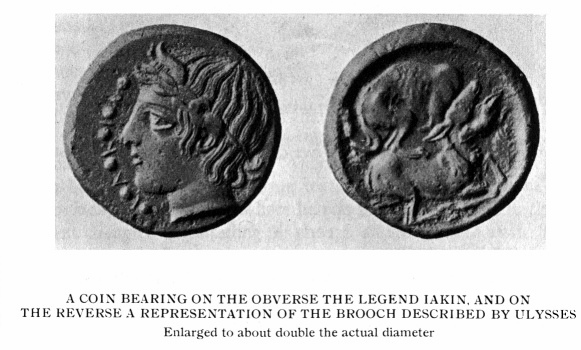

> 特洛伊史詩叢書 v2.0.0｜中文譯文與編輯文字：CC BY-NC-SA 4.0；英文原文與原書圖版屬公版（見 LICENSE-CONTENT.md、NOTICE.md）
[← 分章目錄](../README.md)　｜　[全書](../../中文好讀版_附原文.md)

## 第十三章

<!-- U1148 -->
特拉帕尼或其近旁早有愛奧尼亞人定居的進一步證據

<!-- U1149 -->
常有人問我：古代作家筆下，從來找不到任何傳說提到《奧德賽》寫於德列帕農，或者作者是個女人，這一點我要怎麼解釋？他們把這個難題擺到我面前，彷彿它幾乎足以致命。不過我得承認，比起另一個難題──這兩件事實怎麼會這麼久都沒有被人重新發現──它在我看來實在微不足道。波賽頓固然沒有把斯刻里亞壓在埃律克斯山底下，但他，或者某位同樣心懷怨恨的神，似乎把斯刻里亞連同它偉大的女詩人一起埋進了另一座山底下；那座山，我只怕會比埃律克斯山還要難以搬動──我說的是一大片近乎地質構造的學院博學。

<!-- U1150 -->
這項反對意見所暗含的事實，本身就沒有足夠的根據。費埃克斯人是真實存在的民族，住在一個名叫德瑞帕涅的地方（就一切實際用途而言，這個名字和德列帕農已經夠接近了）[^17-1]，這件事從來不曾被人遺忘──只有覺得遺忘比較方便的人才會忘記。修昔底德（卷一 25 節）告訴我們，科孚的居民是費埃克斯人的後裔；而費埃克斯人的船護送奧德修斯到伊薩卡之後，在駛進港口時被變成的那塊岩石，至今仍在科孚供人指認──那是一座 58 英尺高的小島，頂上有一座修道院。可是科孚的舊名正是德瑞帕涅[^17-2]；迦太基人在西西里的德列帕農站穩腳跟之後，科孚德瑞帕涅的居民要自稱費埃克斯人的後裔，自然輕而易舉；他們接著果然也這麼做了，還把自己的島叫做斯刻里亞，儘管這座島和《奧德賽》的描述沒有一處對得上。

<!-- U1151 -->
我承認，並沒有明確的傳說說整部《奧德賽》是在科孚寫成的；但費埃克斯插曲是全詩的眼睛。因此我認為，傳統長久以來、而且至今仍然，透過暗示把這段插曲和一個地方連在一起，而那個地方已知最早的名字，實際上和我主張它寫成的那座城鎮的名字並無二致。

<!-- U1152 -->
雅典的作家，包括修昔底德在內，對任何能把荷馬──他們無知地這樣稱呼《奧德賽》的作者──拉得離自家門口更近的地點，都會心存偏袒。再說，埃律克斯和塞傑斯塔的人，連帶德列帕農的人，都被視為蠻族，修昔底德本人就這樣稱呼他們（卷六 2 節）；在他眼裡，只要有任何傳說支持科孚，不管多麼含糊，若還在科孚的德瑞帕涅和西西里的德列帕農之間猶豫不決，簡直就和褻瀆神明差不多。然而修昔底德不太可能不知道西西里方面的主張──不只主張費埃克斯插曲，而是主張整部詩；因為晚至西元前 430 年，也就是他自己著書前不久，埃律克斯山上或其附近仍然有人看來分明提出過這樣的主張，這一點我馬上就要說明。

<!-- U1153 -->
至於忘記了這部詩出自女人之手：連「荷馬不可能寫出它」這件事都能忘記的人，還有什麼不能忘記？一個民族不但能做到這一點，還能把指出他們錯誤的人有效地掐熄，那麼對於兩部詩背後的差異，他們所知道的，大概不會比一般英國平信徒對三部對觀福音書與〈約翰福音〉之間的差異知道得更多。

<!-- U1154 -->
現在我要回到我的論斷：在修昔底德的時代，似乎有不少人知道德列帕農自稱是《奧德賽》的誕生地，而且自己也參與了這項主張。

<!-- U1155 -->
大英博物館藏有一枚獨一無二的小銅幣，被十足有把握地歸入埃律克斯與塞傑斯塔的錢幣之列。它出自錢幣藝術最巔峰的時期，博物館當局把它的年代定在約西元前 430 年。

<!-- U1156 -->

<!-- U1157 -->
讀者會看到，錢幣正面鑄有銘文 IAKIN，背面則是奧德修斯所描述的那枚胸針（《奧德賽》卷十九 225–231 行）。這段文字的譯文見第 80 頁。

<!-- U1158 -->
原物上看不見 A 的那一橫，但博物館方面毫不懷疑它原本存在。

<!-- U1159 -->
然而，銘文究竟該讀作 IAKIN 還是 ΓIAKIN（Γ 是 Π 的古體），似乎比較有疑問。也許是想兩種情形都不落錯，博物館的目錄在插圖裡作 IAKIN，在說明文字裡卻作 ΓIAKIN。就我的論證而言，兩種讀法幾乎一樣管用，因為我的論證只需要這枚錢幣屬於埃律克斯與塞傑斯塔一系、年代約在西元前 430 年──這兩點都沒有人懷疑。不過，我還是要把讓我確信 IAKIN 才是正確讀法的理由交代出來。

<!-- U1160 -->
第一，在最下方那個凸飾與頸部之間，我自己找不到任何 Γ 的痕跡，我幾位藝術家朋友──他們的意見比我的寶貴不知多少倍──也找不到。我知道有些能力一流的專家聲稱看得出這種痕跡，但在博物館目錄裡描繪這枚錢幣的畫師顯然看不出來，而那些專家對自己的意見似乎也沒有自信到要他改畫。

<!-- U1161 -->
第二，這幅構圖顯然是有意對稱的。能設計出如此精美錢幣的人，若要把一個 Γ 硬擠進它（假如真有的話）非放不可的位置，從而破壞整體的平衡，那是違背他本能、令他深惡痛絕的事。

<!-- U1162 -->
第三，把這枚錢幣賣給博物館的商人，原本把它歸於皮亞庫斯城。拜占庭的斯特凡努斯曾極簡略地提到皮亞庫斯是一座西西里城市，此外再沒有別的作家提過；而且他明白指出，那裡的市民叫做 ΠΙΑΚΗΝΟΙ；所以這枚錢幣若是他們的，銘文應該是 ΓΙΑΚΗΝ，而不是所謂的 ΓIAKIN。拜占庭的斯特凡努斯要到西元 500 年左右才著書，既然他沒有說皮亞庫斯是一座古城，就斷定它在他提到時已經存在了至少一千年，未免有點魯莽；任何方面都沒有證據支持這樣的結論。比較穩當的結論是：上面說的那位商人不知道這枚錢幣出自何處，便到拜占庭的斯特凡努斯書裡找一座城市，發現最接近的只有皮亞庫斯──於是他在錢幣裡「看出」了一個 Γ（在 Π 字上動手腳，這已是他所能做的最小的一筆），然後把它賣給了大英博物館，售價比起它如今證明具有的價值，大概只是區區幾文。就這樣，博物館當局把「銘文是 ΓΙΑΚΗΝ」寫進了他們筆記的一部分（因為他們似乎又把 IAKIN 寫進了另一部分），於是很自然地，他們在錢幣上看到的東西，比沒有筆記的人所能完全認可的還要多。不過我不再多說了。銘文顯然是 IAKIN。

<!-- U1163 -->
這是 ΙΑΚΙΝΩΝ（伊阿克斯人的）的縮寫，就像 ΕΡΥΚΙΝ 與 ΚΕΝΤΟΡΙΠΙΝ 分別是 ΕΡΥΚΙΝΩΝ（埃律克斯人的）與 ΚΕΝΤΟΡΙΠΙΝΩ（肯托里帕人的）的縮寫一樣，其他例子就不必再舉了。它表示鑄幣的人叫做 ΙΑΚΙΝΕΣ；雖然我們無法確定他們城市的確切名稱，卻可以有把握地推斷，那是 ΙΑΚΟΣ 的某個派生詞──利德爾與斯科特的辭典把 ΙΑΚΟΣ 解作「愛奧尼亞的」。城名很可能是 ΙΑΞ（伊阿克斯），雖然我找不到任何根據證明有這樣一座城鎮存在。

<!-- U1164 -->
因此我認為，晚至西元前 430 年，特拉帕尼附近仍有一座或多或少自治的城鎮，自稱是愛奧尼亞人的後裔，也自稱與《奧德賽》有某種特殊的關聯；因為我得到保證，錢幣上只容許出現對鑄幣者過去歷史有重大意義的東西。既然承認這枚錢幣的背面必須看作奧德修斯那枚胸針的再現──在這一點上，我發現博物館的錢幣學家之間沒有任何異議──那麼要在錢幣上說出「奧德賽」三個字，還有什麼辦法比鑄上全詩中最適合以錢幣表現的那個題材更貼切，實在很難想像。所以在我看來，「埃律克斯附近有一座能自稱與《奧德賽》有關的愛奧尼亞城市」這個理論，沒有這枚錢幣也完全站得住；這枚錢幣卻非得牽涉到「埃律克斯附近有一座自稱與《奧德賽》有關的愛奧尼亞城市」才站得住。可喜的是，這枚錢幣雖然獨一無二，其真偽卻毫無疑問。

<!-- U1165 -->
因此，有人向我要紀念碑、建築遺跡、歷史文獻，來證明埃律克斯附近在迄今被視為史前的時代有過西卡尼－愛奧尼亞文明，我的回答是：晚至西元前 430 年，這一切似乎都還存在。且不說修昔底德的證詞，一枚愛奧尼亞錢幣，對一座愛奧尼亞城市而言，總不能算是微不足道的歷史文獻吧。一枚錢幣說的話比什麼都多，用字比什麼都少，也比什麼都更有權威。這枚錢幣不可能屬於西元前 430 年才在埃律克斯山上或其附近新建的愛奧尼亞殖民地。若有這樣一個殖民地，我們應該會聽說；再者，照這個假設，把《奧德賽》扯進來又是何等不可思議。這座城市如果真的存在，就只能是修昔底德告訴我們的那個福凱亞人定居點的遺存。

<!-- U1166 -->
至於這樣一個定居點在後世是否存續，我不需要任何證據；證明它存續與否，並不是我的責任。《奧德賽》裡所有斯刻里亞與伊薩卡的場景，同特拉帕尼及其近郊之間那些豐富──我幾乎要說過於豐富──的吻合之處，已經足以證明這部詩源出特拉帕尼。詩中那些早於敘拉古、早於西克洛伊人的跡象，把它的年代定在不晚於約西元前 1050 年；它的方言是愛奧尼亞－埃俄利斯方言，把它和上面提到的福凱亞人連在一起。《奧德賽》寫成之後這些福凱亞人的下落如何，與我無關；我對 IAKIN 錢幣所說的話，與其說是為了《奧德賽》，不如說是為了這枚錢幣；因為《奧德賽》本身對自己的*出處*與年代所提供的證明，比任何晚了約六百年才鑄造的錢幣所能提供的，都更有力、更無可辯駁。不過，錢幣既然擺在那裡，我就拿它來回答那些要求《奧德賽》本身以外證據的人。他們問我的紀念碑在哪裡，我就回答：都在這枚錢幣裡，圈在至多一英寸半的小小圓周之內。因為一枚錢幣就是一座具體而微的城市；看著它的人，看到的是一個民族、一份產權憑證、一整個連同各式建築的文明。把這些都毀掉吧，只要它的錢幣還留下一枚，這座城市便雖死猶生，而它曾有過會淪為廢墟的建築這件事，就像廢墟本身流傳到我們手上一樣確鑿可觸。

<!-- U1167 -->
這座名叫伊阿克斯（Iax、Iacus 或 Iace）的城市確切位置已無法確定，但我傾向把它定在特拉帕尼以東約一英里或一英里半處，在一個叫阿爾真泰里亞的地方或其附近。據說此地出過銀，但沒有人相信真有其事。那是一座採石場，規模一點也不大，就在登上埃律克斯山的坡道起點。有人說阿爾真泰里亞是切塔里亞的訛變，指的是在這裡被殺的一條巨魚──至於這條魚怎麼會跑到離海這麼遠的地方，就不得而知了；不過我認為，它更可能是伊阿琴泰里亞的訛變，而伊阿克斯是德列帕農一個半自治的郊區；迦太基人佔據城中臨港的地帶時，希臘居民獲准退居到那裡。

<!-- U1168 -->
我的朋友、特拉帕尼的蘇加梅利先生，在這件事上的熱心遠遠超過我──我若知道怎麼節制它，倒樂於替他節制一下──他向我保證，他年輕時蓋房子常用一種石頭，石匠告訴他，那石頭出自埃律克斯山腳一座叫 Dacinoi 或 D'Acinoi（達奇諾伊）的採石場。這是在任何人想到要把愛奧尼亞人帶到特拉帕尼來的好多年以前。蘇加梅利先生提出，這個名字也許是 D'Alcinoo（「阿爾基諾俄斯的」）的訛變──但我們可以肯定，阿爾基諾俄斯的名字無論是什麼，總之不是阿爾基諾俄斯。我請蘇加梅利先生把那位石匠找來，但他既找不到人，也打聽不到達奇諾伊這座採石場。儘管如此，我確信他確實聽人這麼說過；而這座採石場既然不可能離阿爾真泰里亞太遠，我認為它的名字很可能是 *degli Iacinoi*（伊阿奇諾伊人的）的訛變。

<!-- U1169 -->
不論這個說法是否站得住，我都毫不懷疑，在我們紀元十一世紀的西西里歷史上舉足輕重的伊阿森塞人，應該和產生《奧德賽》的那個愛奧尼亞定居點有關。當時伊阿森塞人主要定居在特拉帕尼以東約四十英里處；不過從 IAKIN 錢幣的年代到諾曼人征服西西里，中間隔了大約一千四百多年，足夠他們散布或遷徙。

<!-- U1170 -->
[^17-1]: 德列帕農（Drepanum）的意思是彎刀或短彎刀；德瑞帕涅（Drepane）則是鐮刀。

<!-- U1171 -->
[^17-2]: 見史密斯《古典地理辭典》「科西拉」條，那裡有完整的參考資料。

<!-- U1172 -->
