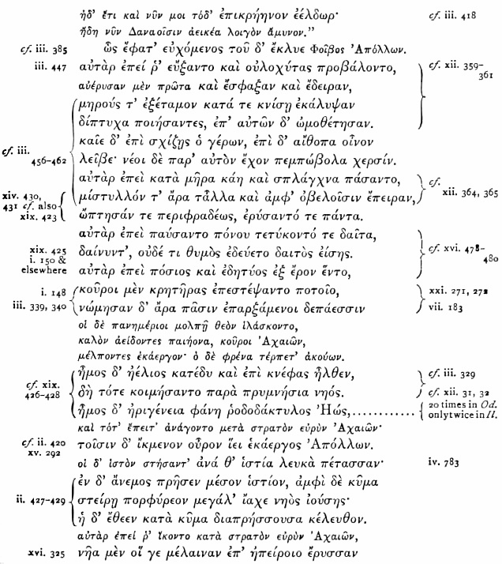
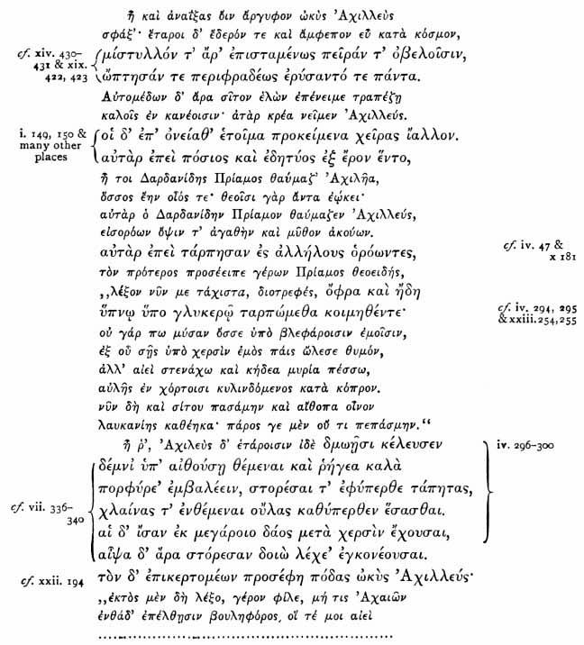

> 特洛伊史詩叢書 v2.0.0｜中文譯文與編輯文字：CC BY-NC-SA 4.0；英文原文與原書圖版屬公版（見 LICENSE-CONTENT.md、NOTICE.md）
[← 分章目錄](../README.md)　｜　[全書](../../中文好讀版_附原文.md)

## 第十四章

<!-- U1173 -->
《奧德賽》作者所知的《伊里亞德》與我們今天所見的相同

<!-- U1174 -->
剩下要我說明的，是《奧德賽》的作者手邊那部《伊里亞德》，實際上就是我們今天所見的這部；並且要談一談這部詩在她手下是怎樣逐漸成形的。

<!-- U1175 -->
在我自己的《伊里亞德》和《奧德賽》上，我把兩部詩共有的段落都劃了線，並註明出處。真希望我們哪一所大學出版社能給我們出一部《奧德賽》，把所有出自《伊里亞德》的段落用略為不同的字體印出，並附上出處，體例大致像本章所收《伊里亞德》卷一與卷二十四的摘錄那樣。這些段落可在鄧巴《奧德賽詞語索引》的書末找到，但在詩中它們出現之處一一標出，會更有啟發性。在我（現已完成）的兩部詩的譯本中，相同的段落我都盡可能用相同的字句譯出。在《奧德賽》譯本裡，我打算把它們用另一種字體印出，並註明在《伊里亞德》中的出處。在《伊里亞德》的譯本裡這樣做就沒有用處了，因為沒有人認為荷馬從《奧德賽》拿過什麼。不過，這兩部譯本的出版，我只怕得延後了；但我會在本章舉出足夠多的例子，我想足以讓讀者滿意：《奧德賽》作者的《伊里亞德》，就是我們自己的《伊里亞德》。

<!-- U1176 -->
我先舉《伊里亞德》的兩段，一段出自卷一，另一段出自卷二十四，所附出處一律指《奧德賽》。這兩段被《奧德賽》作者採用的詩行，或許比《伊里亞德》其他任何段落都多，雖然也有幾段與它們不相上下。以較小字體印出的詩行或半行，不見於《奧德賽》。

<!-- U1177 -->
我要請讀者注意的第一段，是《伊里亞德》卷一 455–485 行，原文如下：──

<!-- U1178 -->

<!-- U1179 -->
或許我該告訴讀者，《伊里亞德》卷一是現代批評仍允許保留在原詩人名下的少數幾卷之一──這位詩人寫的，就是傑布教授所謂「原始的」《伊里亞德》。

<!-- U1180 -->
上面提到的兩段中，第二段是《伊里亞德》卷二十四 621–651 行，原文是：──

<!-- U1181 -->

<!-- U1182 -->
傑布教授傾向於把《伊里亞德》卷二十四歸給卷九的作者──他並不認為卷九出自荷馬──並把它定年在*約*西元前 750–600 年。遺憾的是，我只能跟他走到「卷二十四與卷九出自同一人之手」這一步為止。

<!-- U1183 -->
我在若干《奧德賽》詩行後註明了出處，這些詩行與《伊里亞德》之間有些細微而完全無關緊要的差異；逐一指出它們，超出了本書的範圍。這些差異幾乎無一例外，都是上下文不同所致。它們雖然無關緊要，卻不是沒有意思；但我只好留給有興趣的讀者自己去查考。

<!-- U1184 -->
讀者會注意到，上面兩段摘錄之中，有些詩行彼此幾乎相同，有些完全相同；我還應補充一句：另有不少詩行也在《伊里亞德》別處重複出現。但兩段摘錄各自獨有的詩行仍剩下夠多，足以讓我確信《奧德賽》的作者兩段都熟悉。不僅如此，這些詩句湧上她心頭時，似乎就像《聖經》、《公禱書》和莎士比亞的句子湧上我們心頭一樣自然，而且無疑往往一樣不自覺。

<!-- U1185 -->
那麼，如果我們發現這位作者對《伊里亞德》首卷與末卷中如此可觀的兩段這樣熟悉──因為我相信讀者會和我一樣毫不懷疑，她熟悉它們，也在借用它們──我們還能不認為，她至少很可能也熟悉中間各卷嗎？這無疑應是最自然、最不牽強的結論；但我還要進一步證明，她對中間各卷熟悉得很。

<!-- U1186 -->
門托爾的名字是怎樣從涅斯托爾的名字變造出來的（參見《伊里亞德》卷二 76–77 行與《奧德賽》卷二 224、225、228 行），我就略過不談，直接進入奧德修斯的僕人歐律巴特斯這個引人注目的例子。在《奧德賽》卷十九 218、219 行，潘妮洛碧向奧德修斯（他喬裝改扮，她認不出他來）打聽奧德修斯前往特洛伊途中帶在身邊的隨從的細節，奧德修斯回答說，他有個名叫歐律巴特斯的僕人，肩膀是駝的（卷十九 247 行）。翻到《伊里亞德》卷二 184 行，我們發現奧德修斯確實有個來自伊薩卡、名叫歐律巴特斯的僕人，但他似乎並不駝背；然而再往下讀，我們馬上就碰到忒耳西忒斯，「他的雙肩向前拱起，蓋住了胸膛」（《伊里亞德》卷二 217、218 行）。《奧德賽》的作者想多添一個細節好讓潘妮洛碧更加放心，在《伊里亞德》裡又找不到，於是把駝背從緊挨著的下一個人背上取下來，安到歐律巴特斯背上──我這樣下結論，是否太倉促了？我並不是說，為了支持別的結論就無法構想出其他假說；但我認為上述這個最合乎常識；而由此得出的最自然的推論是：《奧德賽》的作者至少熟悉《伊里亞德》卷二的一部分，大致就像我們今天所見的那樣。

<!-- U1187 -->
我常納悶，為什麼要讓墨涅拉俄斯恰好在俄瑞斯忒斯為埃癸斯托斯和克呂泰涅斯特拉舉行喪宴的同一天回來；告訴我們這件事的希臘原文是：──

<!-- U1188 -->
αὐτῆμαρ δέ οἱ ἦλθε βοὴν ἀγαθὸς Μενέλαος（就在同一天，擅長吶喊的墨涅拉俄斯來到他那裡）（《奧德賽》卷三 311 行）。

<!-- U1189 -->
直到我想起《伊里亞德》卷二 408 行，才找到解答：阿伽門農邀請亞該亞眾首領赴宴時，並沒有請墨涅拉俄斯，因為墨涅拉俄斯是自己來的：──

<!-- U1190 -->
αὐτόματος δέ οἱ ἦλθε βοὴν ἀγαθὸς Μενέλαος（擅長吶喊的墨涅拉俄斯不請自來，到了他那裡）；

<!-- U1191 -->
想起這一點，我便看出：要保住這行詩其餘部分還能用，與其用別的辦法改動 αὐτόματος（自動、不請自來），不如讓墨涅拉俄斯恰好在埃癸斯托斯喪宴那天回家，來得省事。如果我不相信這純粹是無意識腦力運作的結果，我會替《奧德賽》的作者感到羞愧。凡是稍有處理文學問題經驗的人，憑直覺都會認定：《奧德賽》這行和《伊里亞德》那行，必有一行取自另一行；而若說在《伊里亞德》裡，墨涅拉俄斯之所以被寫成不請自來，是因為在《奧德賽》裡他碰巧在俄瑞斯忒斯為埃癸斯托斯舉行喪宴的那一天回來，那是不可想像的。《伊里亞德》的上下文說明了墨涅拉俄斯為什麼不請自來──因為他知道阿伽門農忙得無暇邀請他。因此我推斷，《奧德賽》的作者又一次顯示出她熟悉《伊里亞德》卷二的某個部分。

<!-- U1192 -->
《伊里亞德》卷二中亞該亞與特洛伊兩軍的名錄，原本就是荷馬脫手時《伊里亞德》的一部分；對此我看不出有什麼充分的理由去懷疑，哪怕只是提出疑問。需要這些名錄，才能交代我們在詩的主體中將會聽到的那些人是誰；它們的位置十分自然；亞該亞名錄在涅斯托爾的發言中已有鋪墊（卷二 360–368 行）；荷馬幾乎等於告訴我們，他編這份名錄時得過協助，因為他呼求繆思──後面幾卷他也不只一次這樣做──並聲明他本人一無所知，完全仰賴別人告訴他的話[^18-1]；《奧德賽》中引用或暗指的詩行太過顯眼，容不得我們懷疑作者對兩份名錄都爛熟於心。限於篇幅，我無法一一列出，但要請讀者注意以下各處：《伊里亞德》卷二 488 行，參見《奧德賽》卷四 240 行；把斯巴達和拉刻代蒙當成兩個地方（《伊里亞德》卷二 580、581 行），《奧德賽》的作者也這樣做（卷四 10 行），儘管她已充分表明，她知道兩者其實是同一處；《伊里亞德》卷二 600 行，參見《奧德賽》卷三 386 行；614 行的行尾 θαλάσσια ἔργα μεμήλειν（關心海上的營生），參見《奧德賽》卷五 67 行 θαλάσσια ἔργα μέμηλειν；670 行，參見《奧德賽》卷二 12 行；673、674 行，參見《奧德賽》卷十一 469、470 行；《伊里亞德》卷二 706 行 αὐτοκασγνητος μεγαθύμον Πρωτεσιλάου（心志高昂的普洛忒西拉俄斯的親兄弟），這必定就是《奧德賽》卷十 137 行 αὐτοκασιγνήτου ὀλοόφρονος Αἰήταο（心懷惡意的埃厄忒斯的親姊妹）這一行的母本；《伊里亞德》卷二 707 行 ὁπλότερος γένεῇ ὁ δ᾿ ἅμα πρότερος καὶ ἀρείων（他出生較晚，另一人卻既年長又更勇武），參見《奧德賽》卷十九 184 行，同一行詩在那裡出現；《伊里亞德》卷二 721 行 ἀλλ᾿ ὁ μὲν ἐν νήσῳ κεῖτο κρατέρ᾿ ἄλγεα πάσχων（但他躺在島上，忍受著劇烈的痛苦），參見《奧德賽》卷五 13 行，同一行詩在那裡出現，只是為了配合上下文，κεȋτο 改成了 κεῖται；另參見《奧德賽》卷五 395 行，那裡有 πατρός, ὃς ἐν νούσῳ κῆται, κρατέρ᾿ ἄλγεα πάσχων（父親，他臥病在床，忍受著劇烈的痛苦），這行詩顯示《奧德賽》的作者被《伊里亞德》浸透到了何等程度；《伊里亞德》卷二 755 行 Στυγὸς ὕδατός ἐστιν ἀπορρώξ（是斯堤克斯河之水的支流），參見《奧德賽》卷十 514 行，同樣的字眼在那裡收束詩行；《伊里亞德》卷二 774 行 δίσκοισιν τέρποντο καὶ αἰγανέῃσιν ἱέντες（擲鐵餅、投標槍取樂），參見《奧德賽》卷四 626 行與卷十七 168 行，同一行詩在那裡出現；《伊里亞德》卷二 776 行，說密爾米頓人的馬 λωτὸν ἐρεπτόμενοι（嚼食蓮草），參見《奧德賽》卷九 97 行，同樣的字眼用在奧德修斯那些與食蓮人在一起的手下身上；《伊里亞德》卷二 873 行 νήπιος, οὐδέ τί οἱ τό γ' ἐπήρκεσε λυγρὸν ὄλεθρον（愚蠢的人，這也沒能替他擋住悲慘的毀滅），參見《奧德賽》卷四 292 行 ἄλγιον, οὐ γάρ οἵ τι τά γ' ἤρκεσε λυγρὸν ὄλεθρον（更令人痛心，因為這些都沒能替他擋住悲慘的毀滅）。

<!-- U1193 -->
以上引用或提到的段落，沒有一處見於《伊里亞德》其他地方；所以它們如果出自《伊里亞德》，就是出自這兩份名錄。不過，既然我相信已經證明了《奧德賽》的作者熟悉卷二第 76、77、78、184、216、217 與 408 行，又既然我承認卷二其餘部分出自荷馬之手（不論有沒有人協助），對於我的論點──整個卷二都為《奧德賽》的作者所熟知，而且偶爾被她借用──我就不再多加論證了。

<!-- U1194 -->
《奧德賽》中無意識腦力運作最漂亮的例子，或許要數卷三的開篇一行：ἠέλιος δ' ἀνόρουσε λιπὼν περικαλλέα λίμνην（太陽離開美麗的湖水，一躍而起），它取自《伊里亞德》卷五 20 行 Ιδαῖος δ' ἀνόρουσε λιπὼν περικαλλέα δίφρον·（伊代俄斯離開華美的戰車，一躍而下）。一位顯然下筆如此輕鬆的作者，竟會這樣漂到一行意思截然不同的《伊里亞德》詩句上，除了浸淫太深所致之外，實在令人想不出還有什麼別的解釋。說她四處搜尋一行詩來表達太陽升起，結果認為伊代俄斯跳下戰車那一行正好合用，那是不可想像的。她在卷二十二 95 行寫下 Τηλέμαχος δ' ἀπόρουσε λιπὼν δολιχόσκιον ἔγχος（忒勒馬科斯丟下影子長長的長矛，跳開了）時，心裡又想著這一行。

<!-- U1195 -->
上面最後提到的那幾行所顯示的同一類無意識腦力運作，有時也使她以奇特的方式重複自己的詩句，而她多半全然不自覺。例如：──

<!-- U1196 -->
βασιλῆες.....εἰσὶ καὶ ἄλλοι πολλοὶ ἐν ἀμφιάλῳ Ἰθάκῃ νέοι ἠδὲ παλαιοί,（王公們……在四面環海的伊薩卡還有許多別的，有年輕的，也有年老的）（卷一 394、395 行）。

<!-- U1197 -->
這段文字到了下一卷就變成：──

<!-- U1198 -->
εἰσὶ δὲ νῆες πολλαὶ ἐν ἀμφιάλῳ Ἰθάκῃ νέαι ἠδὲ παλαιαί·（在四面環海的伊薩卡有許多船，有新的，也有舊的）（卷二 292、293 行）。

<!-- U1199 -->
另一個類似的例子，是那行寫西西弗斯的石頭在一串長短短格中蹦跳下山的著名詩句，見《奧德賽》卷十一 598 行，原文是：──

<!-- U1200 -->
αὖτις ἔπειτα πέδονδε κυλίνδετο λᾶας ἀναιδής.

<!-- U1201 -->
「那塊無情的石頭又蹦跳著滾回平地。」我相信這不過是無意識地改編自《伊里亞德》中我記得的唯一一行長短短格詩句，我指的是：──

<!-- U1202 -->
ἀμφοτέρω δὲ τένοντε καὶ ἴστέα λᾶας ἀναιδὴς ἄχρις ἀπηλοίησεν.《伊里亞德》卷四 521、522 行。

<!-- U1203 -->
「那塊無情的石頭把頸骨連同筋腱一起砸得粉碎。」就算《奧德賽》那行詩可能有以音配義之妙（這一點十分可疑），我也認為那靈感來自《伊里亞德》那一行。

<!-- U1204 -->
我很樂意把整部《伊里亞德》從頭到尾走一遍，一一指出《奧德賽》的作者如何利用它，但這樣做幾乎需要專門寫一本書。因此我要請讀者接受我的說法：就被利用的情形而言，《伊里亞德》沒有哪一卷和其他各卷有明顯差別；我只談最普遍被宣稱為後來增補的那幾卷──我指的是卷十與卷十八──因為我認為，我已經充分證明《奧德賽》的作者熟悉卷一、卷二十四，以及卷二中的名錄。不過，把卷十一也納入檢視或許不錯，因為這是最無可置疑的幾卷之一；而且值得一提的是，最受懷疑的幾卷和最無可置疑的幾卷，《奧德賽》的作者同樣瞭如指掌。我只會指出在《伊里亞德》中出現不超過一次的段落，至於為數極多、可視為套語的那些，一律略去。

<!-- U1205 -->
在《伊里亞德》卷十 141、142 行，我們讀到：──

<!-- U1206 -->
τίφθ' οὔτω;..... Νύκτα δι' ἀμβροσίην,（為何這樣……在神聖的夜裡）而在《奧德賽》卷九 403、404 行則是：τίπτε τόσον..... Νύκτα δι' ἀμβροσίην.（為何如此……在神聖的夜裡）

<!-- U1207 -->
《伊里亞德》卷十 142 行有 ὅτι δὴ χρείω τόσον ἴκει;（如此急迫的需要臨到了你們？）；《奧德賽》卷二 28 行有 τίνα χρειὼ τόσον ἵκει（是誰有這樣急迫的需要？）。

<!-- U1208 -->
《伊里亞德》卷十 158 行以 λὰξ ποδὶ κίνησας（用腳踢醒）這幾個字開頭，《奧德賽》卷十五 45 行也是。

<!-- U1209 -->
《伊里亞德》卷十 214 行有 ὅσσοι γὰρ νήεσσιν ἐπικρατέουσιν ἄριστοι（因為凡在船上掌權的首領們），這一行見於《奧德賽》卷一 245 行、卷十六 122 行、卷十九 130 行，只是把 νήεσσιν（船上）換成了 νήσοισιν（島上）。

<!-- U1210 -->
《伊里亞德》卷十 220 行以 ὀτρύνει κραδίη καὶ θυμὸς ἀγήνωρ（我的心和高傲的精神催促著我）結尾，《奧德賽》卷十八 61 行也是。

<!-- U1211 -->
《伊里亞德》卷十 221 行有 ἀνδρῶν δυσμενέων δῦναι στράτον ἐγγὺς ἐόντων（潛入近在咫尺的敵軍營中）；參見《奧德賽》卷四 246 行 ἀνδρῶν δυσμενέων κατέδυ πόλιν εὐρυάγυιαν·（潛入敵人那街道寬闊的城中）。

<!-- U1212 -->
《伊里亞德》卷十 243、244 行是 πῶς ἂν ἔπειτ' Ὀδυσῆος ἐγὼ θείοιο λαθοίμην, οὗ περὶ μὲν.....（那麼我怎能忘記神樣的奧德修斯？他的……）

<!-- U1213 -->
在《奧德賽》卷一 65、66 行，我們看到同樣的字句，只是把 οὗ 換成了 ὅς。這是非常有說服力的例子，因為 ἔπειτα（那麼）在《伊里亞德》那行裡十分自然，放在《奧德賽》這行裡卻讓人覺得有些不得其所，這就清楚表明《奧德賽》的段落取自《伊里亞德》的段落，而不是*反過來*。

<!-- U1214 -->
《伊里亞德》卷十 255 行以 μενοπτόλεμος Θρασυμήδης（驍勇善戰的特拉緒墨得斯）結尾，《奧德賽》卷三 442 行也是。

<!-- U1215 -->
《伊里亞德》卷十 278、279 行：……ἥ τέ μοι αἰεὶ ἐν πάντεσσι πόνοισι παρίστασαι.....（你在一切艱難之中，總是站在我身旁……），參見《奧德賽》卷十三 300、301 行：……ἥ τέ τοι αἰεὶ ἐν πάντεσσι πόνοισι παρίσταμαι.....（我在一切艱難之中，總是站在你身旁……）。《伊里亞德》卷十 292–295 行：σοὶ δ᾿ αὖ ἐγὼ ῥέξω βοȗν ἦνιν εὐρυμέτωπον ἀδμήτην, ἣν οὐ πω ὑπὸ ζυγὸν ἤγαγεν ἀνήρ. τήν τοι ἐγὼ ῥέξω χρυσὸν κέρασιν περιχεύας. ὧς ἔφαν εὐχόμενοι, τῶν δ᾿ ἔκλυε Παλλὰς Ἀθήνη.（我要向你獻上一頭一歲、寬額、未經馴服的小母牛，從沒有人把牠套上軛；我要給牠的角包上黃金，獻祭給你。他們這樣祈禱，帕拉斯．雅典娜聽見了他們。）

<!-- U1216 -->
這四行的前三行，在《奧德賽》卷三 382–384 行中逐字重複。在《奧德賽》385 行，第四行變成 ὧς ἔφατ᾿ εὐχόμενος τοȗ δ' ἔκλυε Παλλὰς Ἀθήνη（他這樣祈禱，帕拉斯．雅典娜聽見了他）。

<!-- U1217 -->
《伊里亞德》卷十 351 行：……ὅσσον τ' ἐπὶ οὖρα πέλονται ἡμιόνων（有騾子犁一程那麼遠），參見《奧德賽》卷八 124 行 ἕσσον τ' ἐν νείῳ οὖρον πέλει ἡμιόνοιιν（就像一對騾子在休耕地上犁一程那麼遠）。

<!-- U1218 -->
《伊里亞德》卷十 400 行 τὸν δ' ἐπιμειδήσας προσέφη πολύμητις Ὀδύσσευς（足智多謀的奧德修斯微微一笑，對他說），這一行見於《奧德賽》卷二十二 371 行。

<!-- U1219 -->
《伊里亞德》卷十 429 行以 δῖοί τε Πελασγοί（以及神聖的佩拉斯吉人）結尾，《奧德賽》卷十九 177 行也是。

<!-- U1220 -->
《伊里亞德》卷十 457 行 φθεγγομένου δ' ἄρα τοῦ γε κάρη κονίῃσιν ἐμίχθη（他話還在嘴邊，頭顱就已滾落塵土），這一行見於《奧德賽》卷二十二 329 行。

<!-- U1221 -->
《伊里亞德》卷十 534 行 ψεύσομαι ἦ ἒτυμον ἐρέω κέλεται δέ με θυμός（我是說錯了，還是說對了？可我的心催我說出來）。這一行見於《奧德賽》卷四 140 行。

<!-- U1222 -->
《伊里亞德》卷十 556 行 ῥεῖα θεός γ' ἐθέλων καί κ.τ.λ.（神只要願意，便能輕易……云云）。參見《奧德賽》卷三 231 行。

<!-- U1223 -->
《伊里亞德》卷十 576 行 ἔς ῥ ἀσαμίνθους βάντες εὐξέστας λούσαντο（他們步入光潔的浴盆沐浴）。見《奧德賽》卷四 48 行、卷十七 87 行。

<!-- U1224 -->
這樣，卷十就有十七處明顯的引用，還不算那些雖見於《奧德賽》、卻也見於《伊里亞德》其他各卷的詩行──有人可以聲稱，《奧德賽》的作者是從那些卷而不是從卷十取來的。這等於說，卷十共 579 行，《奧德賽》的作者大約每 33 行就取了一行。沃爾夫的門徒──不過他們之中沒有哪兩個人意見相同，所以很難說究竟誰算是──若要反駁我的理論，即《奧德賽》全部寫於一地、出自一手、成於西元前十一世紀，那麼要嘛就得拿出比過去六年來他們顯示過的更強的武器，要嘛就只好退回某種勒皮他式的造書理論──這種理論他們會比我更擅長設計。

<!-- U1225 -->
我沒有忘記，反對《伊里亞德》卷十為真作的人，可能會主張上面所舉的段落是取自《奧德賽》；但這種主張不應只針對卷十而不針對其他各卷，因為其他各卷全都同樣充滿見於《奧德賽》的段落；而且就上面所舉《伊里亞德》卷十 243、244 行與《奧德賽》卷一 65、66 行的例子而言，很難懷疑《伊里亞德》的段落是原作、《奧德賽》的是抄本。

<!-- U1226 -->
現在我要處理無可置疑的卷十一；和處理卷十時一樣，凡是見於其他各卷的詩行一律略去，除非我特別提請注意。

<!-- U1227 -->
卷十一的頭兩行，和《奧德賽》卷五的頭兩行完全相同，但《伊里亞德》卷十一 2 行也見於《伊里亞德》卷十九 2 行。

<!-- U1228 -->
《伊里亞德》卷十一 42、43 行：ἵππουριν· δεινὸν δὲ λόφος καθύπερθεν ἔνευεν, εἵλετο δ' ἄλκιμα δοῦρε δύω, κεκορυθμένα χαλκῷ.（……飾有馬鬃，那盔飾在上方可怕地搖晃；他抓起兩支結實的長矛，矛頭包著青銅。）

<!-- U1229 -->
這兩行見於《奧德賽》卷二十二 124、125 行，但其中第一行在《伊里亞德》別處也出現過三四次。

<!-- U1230 -->
《伊里亞德》卷十一 181 行：ἀλλ' ὅτε δὴ τάχ' ἔμελλεν ὑπὸ πτόλιν αἰπύ τε τεῖχος ἵξεσθαι τότε δὴ.....（但當他眼看就要抵達城下與高牆時，就在那時……），參見《奧德賽》卷四 514、515 行：ἀλλ' ὅτε δὴ τάχ' ἔμελλεν Μαλείαων ὄρος αἰπύ ἵξεσθαι τότε δὴ.....（但當他眼看就要抵達馬勒亞的陡峭山岬時，就在那時……）。

<!-- U1231 -->
《伊里亞德》卷十一 201 行 προέηκε τεῒν τάδε μυθήσασθαι（派我來把這些話告訴你），參見《奧德賽》卷四 829 行，同樣的字句在那裡出現。

<!-- U1232 -->
《伊里亞德》卷十一 253 行 ἀντικρὺς δὲ δίεδχε φαεκνοῦ δουρὸς ἀκωκή.（閃亮的矛尖直直穿了過去。）參見《奧德賽》卷十九 453 行，同一行詩在那裡出現，只是把 δίεσχε 換成了 διῆλθε。

<!-- U1233 -->
《伊里亞德》卷十一 531 行 ὧς ἄρα φωνήσας ἵμασεν καλλίτριχας ἵππους（他說罷，便揮鞭催動鬃毛美麗的馬），參見《奧德賽》卷十五 215 行，同一行詩在那裡出現，只是把 ἵμασεν（揮鞭）換成了 ἔλασεν（驅趕）。

<!-- U1234 -->
《伊里亞德》卷十一 624–639 行。赫卡墨得為帕特羅克洛斯和馬卡翁調製的那份羹湯，《奧德賽》的作者在講喀耳刻為奧德修斯手下調製的那份羹湯時（《奧德賽》卷十 234、235 行），心裡想必想著它。

<!-- U1235 -->
《伊里亞德》卷十一 668、669 行：……οὐ γὰρ ἐμὴ ἲς ἔσθ', οἵη πάρος ἔσκεν ἐνὶ γναμπτοῖσι μέλεσσιν（因為我柔韌的四肢裡，已沒有往日那股力氣），參見《奧德賽》卷十一 393、394 行 ἀλλ᾿ οὐγάρ οἱ ἔτ᾿ ἦν ἲς ἔμπεδος οὐδέ τι κȋκυς οἵη περ πάρος ἔσκεν ἐνὶ γναμπτοȋσι μέλεσσιν（但他柔韌的四肢裡，已不再有往日那股堅實的力量與活力）。《伊里亞德》卷十一 678、679 行：……ἀγέλας, τόσα πώεα οἰῶν τόσσα συῶν συβόσια, τόσ' αἰπόλια πλατέ' αἰγῶν（……牛群，同樣多的綿羊群，同樣多的豬群，同樣多四處散布的山羊群）。

<!-- U1236 -->
這兩行見於《奧德賽》卷十四 100、101 行，只是把 ἀγέλας 換成了 ἀγέλαι。

<!-- U1237 -->
《伊里亞德》卷十一 742 行 τὸν μὲν ἐγὼ προσιόντα βάλον χαλκήρεϊ δουρί（他衝上前來，我用包青銅的長矛擊中了他）。這一行見於《奧德賽》卷十三 267 行，只是把 προσιόντα（衝上前來）換成了 κατιόντα（走下來）。

<!-- U1238 -->
《伊里亞德》卷十一 777 行 στῆμεν ἐνὶπροθύροιστι ταφὼν δ' ἀvόρουσεν Ἀχιλλεύς（我們站在門廊前，阿基里斯吃驚地跳起身來），參見《奧德賽》卷十六 12 行 ἔστη ἐνὶ προθύροιστι ταφὼν δ' ἀvόρουσε συβώτης（他站在門廊前，牧豬人吃驚地跳起身來）。

<!-- U1239 -->
這裡兩部詩共有的明顯段落只有十一處，儘管卷十一比卷十長了將近三百行；但我已自我設限，凡是也見於《伊里亞德》其他任何一卷的段落都不能引用。瀏覽我那部《伊里亞德》裡劃了線的詩行，我並不覺得卷十一和其他各卷在這方面的頻率有多大差別，雖然我承認確有一些。此外，我承認我覺得卷十一或許是整部《伊里亞德》中最乏味、寫得最敷衍的一卷，也很能相信《奧德賽》的作者之所以從中借得較少，正是因為她也有同感；但無論如何，上面蒐集到的共有段落已足以確立：《奧德賽》的作者心中既有卷十，也有卷十一。

<!-- U1240 -->
現在我要接著檢視《伊里亞德》卷十八中被《奧德賽》的作者全部或部分採用的段落。它們是：──

<!-- U1241 -->
《伊里亞德》卷十八 22–24 行：ὦς φάτο τὸν δ' ἄχεος νεφέλη ἐκάλυψε μέλαινα ἀμφοτέρῃσι δὲ χερσὶν ἑλὼν κόνιν αἰθαλόεσσαν χεύατο κὰκ κεφαλῆς χαρίεν δ' ᾔσχυνε πρόσωπον.（他這樣說，一團黑色的悲雲籠罩了他；他雙手抓起焦黑的塵土，撒在頭上，玷污了俊美的面容。）

<!-- U1242 -->
這幾行見於《奧德賽》卷二十四 315–317 行，只是因為說的是一位老人，而不像《伊里亞德》說的是一個年輕人，χαρίεν δ' ᾔσχυνε πρόσωπον（玷污了俊美的面容）就變成了 πολιῆς ἀδινὰ στεναχίζων（〔撒在〕灰白的〔頭上〕，不住地呻吟）。三行中的第一行也見於《伊里亞德》卷十七 591 行。

<!-- U1243 -->
《伊里亞德》卷十八 108 行 καὶ χόλος ὅς τ' ἐφέηκε πολύφρονά περ χαλεπῆναι（還有那怒氣，它使人即使再明智也會暴躁起來），參見《奧德賽》卷十四 464 行 ἠλεός, ὅς τ' ἐφέηκε πολύφρονά περ μάλ' ἀεῖσαι（〔酒〕令人昏亂，它使人即使再明智也會引吭高歌）。

<!-- U1244 -->
《伊里亞德》卷十八 250 行 Πανθοΐδης· ὁ γὰρ οἶος ὅρα πρόσσω καὶ ὀπίσσω（潘托俄斯之子；因為唯有他能瞻前顧後），參見《奧德賽》卷二十四 452 行，不過那裡 Πανθοΐδης（潘托俄斯之子）變成了 Μαστορίδης（馬斯托爾之子）。

<!-- U1245 -->
《伊里亞德》卷十八 344–349 行：

<!-- U1246 -->
ἀμφί πυρί στῆσαι τρίποδα μέγαν ὄφρα τάχιστα Πάτροκλον λούσειαν ἄπο βρότον αἱματόεντα. οἱ δὲ λοετροχόον τρίποδ' ἵστασαν ἐν πυρὶ κηλέῳ, ἐν δ' ἄρ' ὔδωρ ἐχέαν, ὑπὸ δὲ ξύλα δαῖον ἑλόντες· γάστρην μὲν τρίποδος πῦρ ἄμφεπε, θέρμετο δ' ὔδωρ αὖτὰρ ἐπεὶ δὴ ζέσσεν ὕδωρ ἐνὶ ἤνοπι χαλκῷ,（在火上架起一只大三腳鼎，好儘快替帕特羅克洛斯洗去凝結的血污。他們便把沐浴用的三腳鼎架在熊熊的火上，倒進水，又拿來木柴在底下燒起；火舌舔著鼎腹，水漸漸熱了；等到水在發亮的青銅鼎裡沸騰起來，）

<!-- U1247 -->
參見《奧德賽》卷八 434–437 行，ὄφρα τάχιστα（好儘快）變成了 ὄττι τάχιστα（儘快）。

<!-- U1248 -->
《伊里亞德》卷十八 345 行被略去。接下來那一行的 οί（他們）變成了 αί（她們），再下一行的 ἑλόντες 變成了 ἑλοῦσαι·（「拿來」由陽性變成陰性）。

<!-- U1249 -->
《伊里亞德》那段的最後一行，《奧德賽》卷八沒有用，卻一字不改地出現在《奧德賽》卷十 360 行。

<!-- U1250 -->
《伊里亞德》卷十八 363 行 ὅς περ θνητός τ' ἐστὶ καὶ οὐ τόσα μήδεα οἶδεν（他只是個凡人，懂得的計謀也沒有那麼多）。這一行見於《奧德賽》卷二十 46 行。

<!-- U1251 -->
《伊里亞德》卷十八 385–387 行：

<!-- U1252 -->
τίπτε Θέτι τανύπεπλε, ἱκάνεις ἡμέτερoν δῶ αἰδοίη τε φίλη τε; πάρος γε μὲν οὔ τι θαμίζεις. ἀλλ' ἕπεο προτέρω ἵνα τοι πὰρ ξείνια θείω·（長袍曳地的忒提斯啊，你這位可敬又親愛的貴客，為何來到我們家中？從前你可不常來。請再往裡走，好讓我款待你。）

<!-- U1253 -->
《伊里亞德》卷十八 424–427 行：

<!-- U1254 -->
τίπτε Θέτι τανύπεπλε, ἱκάνεις ἡμέτερὸν δῶ αἰδοίη τε φίλη τε; πάρος γε μὲν οὔ τι θαμίζεις· αὔδα ὅ τι φρονέεις· τελέσαι δέ με θυμὸς ἄνωγεν εἰ δύναμαι τελέσαι γε καὶ εἰ τετελεσμένον ἐστίν.（長袍曳地的忒提斯啊，你這位可敬又親愛的貴客，為何來到我們家中？從前你可不常來。說吧，你心裡想的是什麼；我的心催我為你辦到，只要我辦得到，只要那是辦得成的事。）

<!-- U1255 -->
《奧德賽》（卷五 87–91 行）把這兩段合在一起，如下：──

<!-- U1256 -->
Τίπτε μοι, Ἐρμεία χρυσόρραπι, εἰλήλουθας αἰδοῖός, τε φίλος τε; πάρος γε μὲν οὔ τι θαμίζεις αὔδα ὁ τι φρονέεις· τελέσαι δέ με θυμὸς ἄνωγεν εἰ δύναμαι τελέσαι γε καὶ εἰ τετελεσμένον ἐστίν. ἀλλ' ἕπεο προτέρω, ἵνα τοι πὰρ ξείνια θείω.（金杖的赫耳墨斯啊，你這位可敬又親愛的貴客，為何來到我這裡？從前你可不常來。說吧，你心裡想的是什麼；我的心催我為你辦到，只要我辦得到，只要那是辦得成的事。請再往裡走，好讓我款待你。）

<!-- U1257 -->
《伊里亞德》卷十八 389、390 行：……ἐπὶ θρόνου ἀργυροήλου καλοῦ δαιδαλέου· ὑπὸ δὲ θρῆνυς ποσὶν ἦεν·（……在一張鑲著銀釘、美麗精巧的寶座上；腳下還有一張腳凳。）

<!-- U1258 -->
這兩行見於《奧德賽》卷十 314、315 行。

<!-- U1259 -->
《伊里亞德》卷十八 431 行 ὅσσ' ἐμοὶ ἐκ πασέων Κρονίδης Ζεὺς ἄλγε' ἔδωκεν·（克洛諾斯之子宙斯在眾女神之中，偏偏給了我這麼多苦難。）

<!-- U1260 -->
參見《奧德賽》卷四 722、723 行：……πέρι γάρ μοι Ὀλύμπιος ἄλγε' ἔδωκεν ἐκ πασέων（因為奧林帕斯之神在所有〔女子〕之中，給了我最多的苦難）。《伊里亞德》卷十八 457 行 τούνεκα νῦν τὰ σὰ γούναθ' ἱκάνομαι αἴ κ' ἐθέλησθα.（所以我現在來抱住你的膝頭，但願你肯……）

<!-- U1261 -->
這一行見於《奧德賽》卷三 92 行與卷四 322 行。

<!-- U1262 -->
《伊里亞德》卷十八 463 行 θάρσει, μή τοι ταῦτα μετὰ φρεσὶσῇσι μελόντων.（放心吧，別讓這些事在你心上掛慮。）

<!-- U1263 -->
這一行見於《奧德賽》卷十三 362 行、卷十六 436 行與卷二十四 357 行。

<!-- U1264 -->
《伊里亞德》卷十八 486–489 行 Πληιάδας θ'.....（普勒阿得斯星團……）

<!-- U1265 -->
ἄρκτον θ', ἣν καὶ ἄμαξαν ἐπίκλησιν καλέουσιν, ἥ τ' αὐτοῦ στρέφεται καί τ' Ωρίωνα δοκεύει οἴη δ' ἄμμορος ἐστι λοετρῶν Ὠκέανοιο·（還有大熊星座，人們又管它叫大車；它在原地旋轉，注視著俄里翁，唯獨它不曾沐浴於俄刻阿諾斯的水流。）

<!-- U1266 -->
這幾行見於《奧德賽》卷五 272–275 行。

<!-- U1267 -->
《伊里亞德》卷十八 533、534 行 στησάμενοι δ' ἐμάχοντο μάχην ποταμοȋο παρ' ὄχθας βάλλον δ' ἀλλήλους χαλκήρεσιν ἐγχείῃσιν·（他們擺開陣勢，在河岸邊作戰，用包青銅的長矛互相投擲。）

<!-- U1268 -->
這兩行見於《奧德賽》卷九 54、55 行，只是把 ποταμοῖο παρ' ὄχθας（在河岸邊）換成了 παρὰ νηυσὶ θοῆσιν（在快船旁）。

<!-- U1269 -->
《伊里亞德》卷十八 604–606 行：

<!-- U1270 -->
τερπόμενοι· μετὰ δέ σφιν ἐμέλπετο Θεῖος ἀοιδὸς φορμίζων· δοίω δὲ κυβερνιστῆρε κατ' αὐτοὺς μολπῆς ἐξάρχοντος ἐδίνευον κατὰ μέσον.（歡樂著；神聖的歌手在他們中間彈著豎琴歌唱；兩個翻筋斗的人領頭起舞，在人群中央旋轉。）

<!-- U1271 -->
這幾行見於《奧德賽》卷四 17–19 行。

<!-- U1272 -->
為了回應「《伊里亞德》卷十八寫於《奧德賽》之後，因而可能是它借用了《奧德賽》」這種可能的反對意見，我要把第 108 行連同上下文一併引出。這段文字（卷十八 107–110 行）是：──

<!-- U1273 -->
ὦς ἔρις ἔκ τε θεῶν ἔκ τ' ἀνθρώπων άπόλοιτο καὶ χόλος ὅς τ' ἐφέηκε πολύφρονά περ χαλεπῆναι, ὅς τε πολὺ γλυκίων μέλιτος καταλειβόμενοιο ἀνδρῶν ἐν στήθεσσιν ἀέξεται ἠύτε καπνός.（但願紛爭從神界和人間消失，還有那怒氣──它使人即使再明智也會暴躁起來；它比流淌的蜂蜜還要甜，在人們胸中像煙一樣滋長膨脹。）

<!-- U1274 -->
我認為從這段高貴的文字衍生出來的那行《奧德賽》詩句，其上下文如下（卷十四 462–465 行）：──

<!-- U1275 -->
κέκλυθι νῦν Ἐύμαιε, καὶ ἄλλοι πάντες εταῖροι· εὐξάμενός τι ἔπος ἐρέω· οἶνος γὰρ ἀνώγει ἠλεός, ὅς τ' ἐφέηκε πολύφρονά περ μάλ' ἀεȋσαι καὶ θ' ἁπαλόν γελάσαι, καί τ' ὀρχήσαθαι ἀνῆκεν,（歐邁俄斯，還有其他所有的夥伴，現在聽我說；我要誇口說一句話，因為是酒叫我這麼做的──那令人昏亂的酒，它使人即使再明智也會放聲高歌、輕聲嬉笑，還引人起身跳舞，）

<!-- U1276 -->
哪一種比較可能──是《伊里亞德》那幾行壯麗的詩句由《奧德賽》卷十四 464 行發展而來，還是這一行是無意識地改編自《伊里亞德》卷十八 108 行？因為這兩行是父子關係，這一點幾乎不會有人爭辯。

<!-- U1277 -->
再問，哪一種說法比較說得通──是《伊里亞德》卷十八的作者拿奧德修斯燒洗澡水的段落來替帕特羅克洛斯燒水，還是《奧德賽》的作者略去了關於帕特羅克洛斯的那一行，拿這段的其餘部分來替奧德修斯燒洗澡水？

<!-- U1278 -->
至於向忒提斯致意的那兩段話（《伊里亞德》卷十八 385–387 行與 424–427 行），哪一種比較可能──是《伊里亞德》卷十八的作者把《奧德賽》卷五 87–91 行這顆櫻桃分成兩口吃，還是《奧德賽》的作者只需要一段致意，便把《伊里亞德》的兩段合而為一，如上文所引？

<!-- U1279 -->
最後，赫淮斯托斯放在阿基里斯盾牌上的那一串星座，比較可能是由《奧德賽》卷五 272–275 行擴充而來，還是後面這幾行是經過必要的修改、取自《伊里亞德》卷十八 486–489 行？不論《奧德賽》的年代為何，我都毫不懷疑《伊里亞德》卷十八的年代一定更早；然而我們傑出的荷馬學者，對《伊里亞德》其他任何一卷都不像對這一卷這樣滿腹小小的牢騷，也不像對這一卷這樣一致認定是竄入的增補。如果說《伊里亞德》有哪一部分最能顯出荷馬的無可企及，那就是他對阿基里斯之盾的描寫。

<!-- U1280 -->
我要再向讀者保證，《伊里亞德》各卷被取用的自由程度，似乎都和我剛才詳細討論的那幾卷一樣；我也找不到《奧德賽》有哪一部分向《伊里亞德》借用得比全詩其餘部分少。偶爾題材不同，使作者連續三四頁都沒有一處《伊里亞德》的拼綴，但這很少見。每頁一兩處，甚至有時三四處《伊里亞德》的段落，比較接近平均數；不過其中有些屬於可稱為套語的東西。

<!-- U1281 -->
它們出現得如此頻繁，卻不會讓人聯想到剽竊，正如《天路歷程》裡引用的《聖經》文字，即使刪去出處，也不會讓人聯想到剽竊一樣。它們深深嵌進上下文，是結構性的而非裝飾性的；這也排除了它們是抄寫者或編者添加進去的可能。它們似乎是作者對《伊里亞德》爛熟於胸、自然流露的產物。同樣明顯的是，她並不是在為別人的作品寫摘要；她是從她自己、她的家鄉、她的同胞，以及整個西西里島的角度，*從頭*講述這個故事。其他民族和地方或許還能容忍，但在她心中激不起任何熱情。

<!-- U1282 -->
儘管如此，《奧德賽》與史詩集成中的所有詩篇之間，必定存在某種風格與情感上的相似，而且從那些失傳詩篇至今殘存的斷片，確實可以證明這種相似存在過。在一切藝術中，不論是文學、繪畫、音樂還是建築，同一時代、同一國度總會有某種共同的特質。每個時代都有它慣用的藝術題材；原因在於，讀者、觀眾或聽眾熟悉故事的大綱，比較方便。書面文學在這方面比繪畫或雕塑自由，因為它能解釋，也更能讓讀者對即將到來的內容有所準備。至於雖已寫成文字、卻主要是要對著一群幾乎不識字的聽眾朗誦的文學，它存在的條件是必須立刻訴諸理解，因此只會處理聽者應當已經知道大概的內容。作者──不論是他還是她──可以從國族慣用題材中任取一段，並在合理範圍內隨心所欲地處理，但必須和古老而熟悉的故事掛得上鉤；同一時代、同一語言、同一民族的同類詩篇之間某種風格上的相似，便由此而生。這一點對中世紀義大利畫家和對史詩集成同樣適用。它們呈現給我們的，是相異中的相似，也是相似中的相異。

<!-- U1283 -->
然而，我們若記得，《奧德賽》的風格不但勢必向當時現存的所有其他史詩靠攏，而且作者的心靈──且不說其他史詩集成詩人──還深深浸透了荷馬的心靈，程度正如我們所見；那麼，這樣加在一個女人作品上的一層陽剛的飾面，竟遮掩了那較不顯眼、卻遠為確鑿的證據──證明作者和她所借用的那個男人或那些男人並不同性別──也就不足為奇了。

<!-- U1284 -->
同時，儘管她利用荷馬，我認為她是在生他的氣，或許還有點嫉妒；關於這一點，我會在下一章多談。也許是他嘲笑女人、捉弄女人的方式激怒了她──他這麼做不是因為不喜歡她們，而是因為喜歡逗弄她們；她卻無意在這麼嚴肅的題目上開玩笑。我們已經看到，荷馬把一只三腳鼎的價值定為一個能幹耐用、什麼雜活都做的女人的三倍，她是怎樣反唇相譏的。再者，他對眾神全然的輕蔑──他毫不費心掩飾──對一位從不允許自己逾越牧師女兒偶爾那點溫和不敬的作者來說，想必很刺眼。因此，在我看來，她對待荷馬不無幾分嚴苛；這是我對她唯一要認真挑剔的毛病。

<!-- U1285 -->
例如，赫克托耳向安德洛瑪刻告別的結尾幾行，人們本以為她會不忍把這段文字挪作尋常之用，她卻拿來放進忒勒馬科斯口中，而他不過是叫母親回房去罷了。她在卷一 356–359 行這樣做，在卷二十一 350–353 行又這樣做。這可不應該。她拿那些為了洗淨可憐的帕特羅克洛斯屍身血污而燒的水（《伊里亞德》卷十八 344 行以下），用來給奧德修斯洗澡（《奧德賽》卷八 434–437 行），也同樣不應該。這裡的不敬，無疑比荷馬對眾神的任何不敬都要深。

<!-- U1286 -->
不過，不論《奧德賽》的作者是以什麼樣的心態對待《伊里亞德》，我都毫不懷疑，她對這部詩以我們今天所見的形態熟悉得很；而這一點，正是我認為值得在上面這一章花這麼多篇幅來力求證實的。

<!-- U1287 -->
[^18-1]: ἡυεῖς δέ κλέος οἷον ἀκούομεν, οὐδέ τι ἴδμεν,（我們只聽到傳聞，什麼也不知道，）《伊里亞德》卷二 486 行。

<!-- U1288 -->
